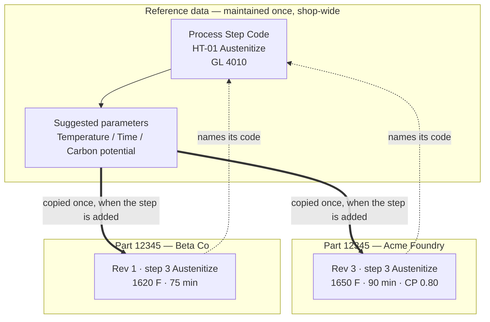
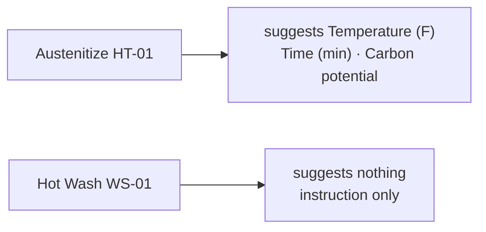
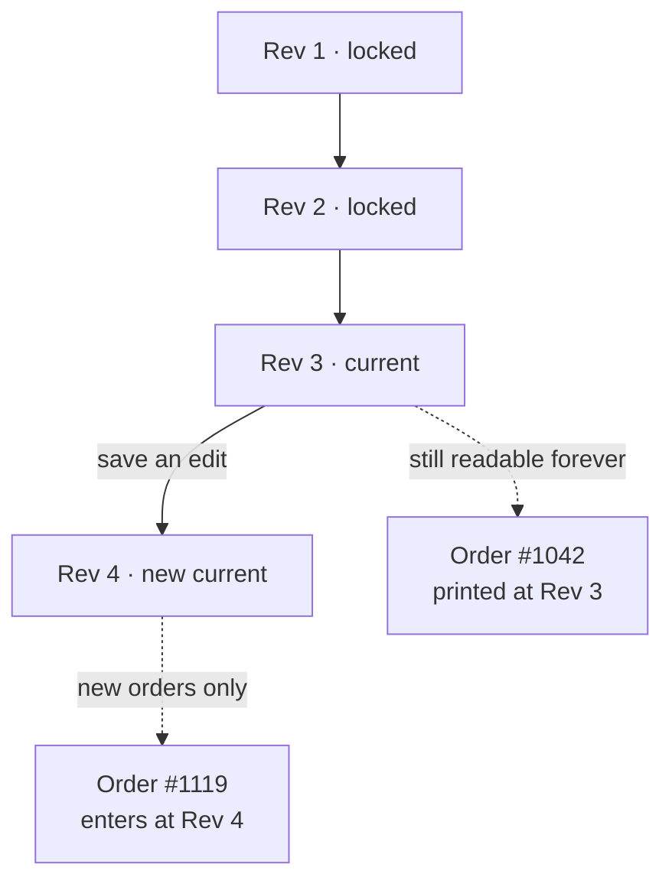

# Process Steps — the part-owned model

[Domain contracts](specs/domain-contracts.md) · [Documentation index](README.md)

This model supersedes the earlier shared process-master design. Process templates were removed: each part owns its
steps, and a step's parameters are part-owned rows. Examples below are illustrative.

**The change in one line:** the recipe belongs to the **part**, not to a shared master. What is shared is the
*vocabulary* — Process Step Codes, which carry billing and may suggest parameters. No part's process can ever be
affected by an edit to another part's, or by a later edit to a code.

---

## Vocabulary

| Term | What it is |
|---|---|
| **Process Step Code** | Shop-wide reference record — `HT-01 Austenitize`. Carries the **GL account** (billing posts by it), a standard name, standard instructions and optional **suggested parameters**. |
| **Process Steps** | A part's ordered recipe. Each step names a code and carries this part's own instruction and parameters. |
| **Parameter** | A row on a step: label, type (NUMBER, TEXT, DATE or CHECKBOX), optional unit and value, printed as `Label: value unit`. |
| **Revision** | A numbered version of a part's Process Steps. Once an order uses it, it is locked; the next saved edit creates N+1. |

"Recipe" stays the shop's spoken word for the parameters. The application says **Process Steps**.

---

## 1. Ownership: where everything lives

Same part number, two customers, two chemistries, two independent recipes. They share only the *code* they point
at, which is what makes billing consistent; Beta Co's step omits the carbon potential it does not use.

- **The part owns its steps and their parameter rows**, built on the part page one code at a time.
- **Nothing is copied between parts** — that is how one customer's chemistry silently becomes another's — and there
  are no templates: one place to build steps is simpler than two, and identical part families are rare.
- **One save path.** **Save process steps** writes order, instructions and parameters atomically against the
  baseline it was edited from; a concurrent change is refused as a conflict, never overwritten.

---

## 2. Step codes are vocabulary

Admin → Process step codes keeps each code's name, GL account, standard instructions and suggested parameters. Adding
a step copies the standard instructions and the suggestions (in order, with empty values) **once**; after that there
is no link. Editing, reordering or removing a suggestion never changes a part row, an open draft or a captured
snapshot, and removal is a soft delete, so a draft holding a copy can still be saved. A step's printed name follows
the code's standard name live, except on the orders of a revision that captured a numbered recipe: orders print the
captured projection, so they keep the code name captured with it. Labels and units belong to the part, which can
relabel, re-unit or remove any row and add its own (always TEXT).

Parameters print in a fixed place above the instruction, and a traveler template cannot hide them. An empty value
prints as `Label: ________ unit`, a blank for handwriting.

---

## 3. Keys, revisions and what an order freezes

Every parameter row carries a **key**, the stable identity LoadSynQ reads as `fieldDefId`: a copied row takes the
suggestion's ID, a row migrated from a pre-2026-09-26 step value keeps its field definition's ID, and a hand-added row
gets a new key from the server when first saved. Keys survive revision cuts. **One key always means one type and one
unit:** a suggestion's type and unit never change in place (remove it and add a new one), a row whose type or unit
changes on a part is saved under a new key, and a relabel keeps the key. Units compare trimmed; empty means none.

A working revision is edited in place. Saving the first order with this part as its lead part locks the current
revision for good; the next saved edit cuts N+1, copying every step, instruction and parameter row with its key.
Orders store **part + revision number**, so a traveler reprints identically years later. Changing a shared step
vocabulary does not replace the saved process revision used by an order.

For a numbered recipe the first lock also captures a `RecipeSnapshotV1` from the revision's own rows: `fields` lists
each step's rows in position order, keyed by `fieldDefId`, with the row's label, type and unit, and `null` for an
empty value. A captured snapshot is never recomputed, and neither is an archived traveler PDF.

---

## What this deleted

- Shared process masters and per-part step overrides (2026-07-30)
- Process templates with Load Template, and code-owned step fields with the guards they needed (2026-09-26)

## What it costs

- **No cross-part propagation.** Changing how you austemper means editing each part. Given that outcome depends on
  the customer's base chemistry, this is the safe direction — but it is a real trade.
- **No enforced consistency.** Nothing stops a recipe that skips Hot Wash; suggestions make the usual parameters easy
  without compelling them.

## Implementation

The [part-process service](../erp/src/server/part-process-steps.ts) owns revision creation
and mutation checks. Preserve its existing order-consumption and snapshot rules when
changing a recipe. Additional recipe capabilities are future work.
