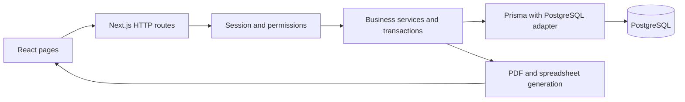

# HeatSynQ codebase map

[Documentation index](README.md) · [Domain contracts](specs/domain-contracts.md)

HeatSynQ is one Next.js application with a shared PostgreSQL database. React
pages call HTTP routes; routes resolve the session, check permissions and invoke
business services. Services validate inputs and use Prisma transactions. Document
builders produce PDFs; stored prints and attachments live in the database.

| Area | Start reading |
|---|---|
| Interface and requests | [Pages](../erp/src/app/), [shared components](../erp/src/components/), [fetch helpers](../erp/src/lib/fetcher.ts) |
| Identity and access | [Request wrapper](../erp/src/server/http.ts), [permissions](../erp/src/server/permissions.ts), [sessions](../erp/src/server/sessions.ts) |
| Customers and parts | [Customers](../erp/src/server/customers.ts), [parts](../erp/src/server/parts.ts), [process steps](../erp/src/server/part-process-steps.ts) |
| Orders and shipping | [Order creation](../erp/src/server/order-create.ts), [orders](../erp/src/server/orders.ts), [shippers](../erp/src/server/shippers.ts) |
| Certificates and documents | [Certifications](../erp/src/server/certs.ts), [templates](../erp/src/server/templates.ts), [PDF renderer](../erp/src/server/pdf/render.ts) |
| Billing and accounting | [Invoices](../erp/src/server/invoices.ts), [applications](../erp/src/server/applications.ts), [close periods](../erp/src/server/close-periods.ts), [GL export](../erp/src/server/gl-export.ts) |
| Reporting | [Reports](../erp/src/server/reports/README.md), [registry](../erp/src/lib/report-registry.ts) |
| Database and public admission | [Schema](../erp/prisma/schema.prisma), [database client](../erp/src/server/db.ts), [public installation](../erp/scripts/lib/public-installation.ts), [bootstrap](../erp/scripts/lib/public-bootstrap.ts) |
| Source operation | [Commands](../erp/package.json), [Dockerfile](../erp/Dockerfile), [Compose](../erp/docker-compose.yml), [CI](../.github/workflows/ci.yml) |

For a complete slice, follow [new-order UI](../erp/src/app/orders/new/page.tsx) →
[order API](../erp/src/app/api/orders/route.ts) →
[order creation service](../erp/src/server/order-create.ts) →
[Prisma schema](../erp/prisma/schema.prisma). Then follow
[traveler endpoint](../erp/src/app/api/orders/[id]/traveler/route.ts) →
[traveler service](../erp/src/server/traveler.ts) →
[PDF renderer](../erp/src/server/pdf/render.ts).

Dependency declarations are in [package.json](../erp/package.json); the
[lockfile](../erp/package-lock.json) pins the resolved tree. Node is pinned by
[.nvmrc](../.nvmrc); the documented database is PostgreSQL 18. Next runs the UI and
server, Prisma/pg access PostgreSQL, Zod validates inputs, Argon2 hashes passwords,
pdfmake/pdf-lib render documents, bwip-js produces barcode images and write-excel-file
produces spreadsheet exports. Vitest covers unit/integration contracts and
Playwright covers browser flows and manual captures.

Public startup checks database lineage before serving writes. Docker builds the
public command bundle and starts through the admission/deployment wrapper. CI
checks source, tests, browsers, manual artifacts, images and dependencies; there
is no release publishing job. Read the [operations guide](../erp/README.md) before
running any database command or changing a deployment.
