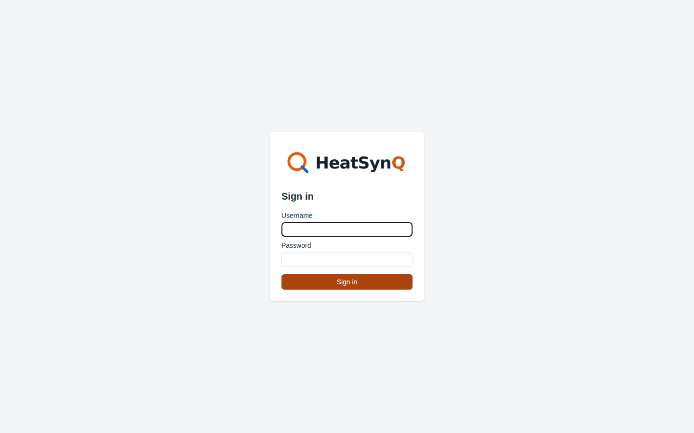
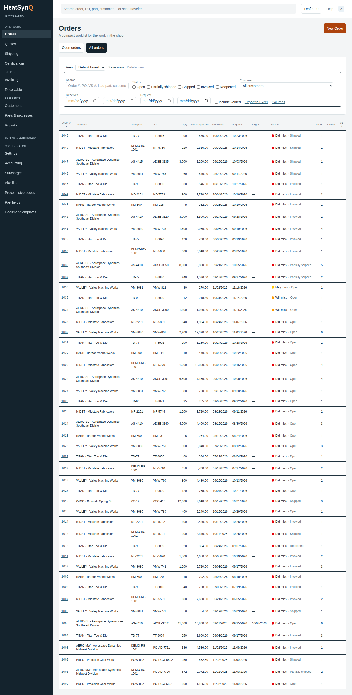

# 1. Getting around

[← Back to contents](README.md)

## Signing in

Open the address the office gives you — on the shop PC it is usually a bookmark — and you land
on the sign-in screen.

Enter your username and password and press **Sign in**. There is no "remember me" and no
self-service password reset: if you are locked out, an administrator resets you from the Users
page (chapter 12).

> **The first account.** A brand-new installation has one administrator, `admin`, with the
> password `admin`. Until that password is changed the app shows an amber banner on every
> screen saying so. Change it immediately — the banner is the app telling you the shop's books
> are currently protected by a password everyone knows.

## The screen

Every screen has the same three parts.

**The left rail** is the menu, in six groups that follow how work moves through the shop:
**Daily work** (Orders, Quotes, Shipping, Certifications), **Billing** (Invoicing, Receivables),
**Reference** (Customers, Parts & processes, Reports), and, under **Settings & administration** at
the bottom, the administration groups **Configuration**, **People** and **System**. You only see
the entries you have permission to use, and a group heading only appears when it holds at least
one entry you can open — so your rail may be shorter than a colleague's, and may be missing whole
groups. That is normal, not a fault. The entry for the screen you are on is highlighted. On a short
window the rail scrolls on its own, separately from the page, so the last entries are always
reachable — and it fits the window from the first screen, under any banners across the top (the
setup, password and backup notices come and go, and the rail makes room for them as they do).
At the foot of the rail, **Build Version** names the build the install is running, as the date
of its last change and a short code — for example *101526 · 0f5eb58* for a change made on
15 October 2026. Quote it when you report a problem.

**Global search** across the top searches orders, parts and customers at once. Click the box or
Tab into it and type. Use **Down/Up Arrow** to highlight a result, then **Enter** to open it.
**Escape** closes the results and keeps your text; **Tab** closes them and moves to the next
control. If you have unsaved grid changes, cancelling the discard prompt keeps your work. Page links
that reload the screen use your browser’s leave-page warning. Canceling keeps your
unsaved edits on the current page, just as canceling an in-app discard prompt does.

It is also the **barcode box**: focus Global search first, then scan a traveler. A scanner that
sends Enter opens the matching order immediately. A combined code such as **91246-2** also
refreshes and highlights Load 2. Older order-only barcodes still work. You can also type the
complete order number and press **Enter**, without highlighting a result first.

**The right-hand corner** shows **Drafts in this tab**, who you are signed in as, and
**Sign out**.

## Recovering unsaved work after Back or Forward

When you follow a link away from an editor with unsaved changes, HeatSynQ asks first. For an
editor it can recover, the question says the changes stay under **Drafts in this tab** until you
save or discard them, and they do. For one it cannot (the order's Lines boxes, or a new
order), it says leaving discards them.

If browser **Back** or **Forward** takes you away from an editor, HeatSynQ likewise keeps its
unsaved changes in the current tab. Return to the editor
and wait for the access and saved-record checks. Press **Restore** to continue with
your retained changes, or **Discard retained changes** to throw that copy away.
**Restore does not save anything to the server:** use the editor's normal Save or
Apply button when you are ready.

Open **Drafts in this tab** to find retained editors. Each entry offers **Return to
editor** and **Discard**. Different sections can have separate entries; clearing one
does not discard unrelated work. Changes include unfinished grid rows and text you
have typed but have not yet added, such as a serial range.

While a grid's **Save** runs, its boxes and its add and remove buttons are greyed until the save
lands, so nothing you type can be lost under it. Other grids on the page stay open.

If the saved record has changed or become read-only, the editor may show your retained
copy for review instead of allowing Restore. Follow the message and review that copy
before choosing **Start fresh**. Access must be confirmed before retained values can
be shown. Printing, finalizing or replacing the affected record may remain blocked
until its relevant changes are saved or discarded.

This recovery belongs to the current tab and login. It is not a backup or an autosave:
**save before reloading, closing the tab, signing out or leaving the application.** A
fresh page or a new tab starts without these retained changes. Confirming an in-app
discard still discards the changes named in that prompt. A Save already sent to the
server can finish after you leave; leaving or discarding cannot cancel that request.

Order entry's existing automatic server draft is separate; its **Resume** behavior
is described in [chapter 2](02-orders.md).

## Reading dates and amounts

Dates on lists and reports use **MM/DD/YYYY**, such as **09/11/2026**. History and
print timestamps use your browser's local time. Date-entry controls follow your
browser's own date picker. A date the app fills in as today, such as a new order's
**Received date** or a new shipment's **Ship date**, is the date in UTC, so from
7 PM Central (6 PM in winter) it is already tomorrow's date.

Money shows a dollar sign, grouping and two decimal places: **$1,234.50** or
**-$1,234.50** for a negative amount. Read-only unit prices keep four decimal
places. Counts are grouped whole numbers; weight totals show two decimal places,
and each weight keeps four, except in the parts list, which shows it as stored
(**6.4**). Editable amount fields keep plain decimal values. In a box for a
price, an amount, a weight, a percent or a measurement, type a figure without a
dollar sign or commas; a zero before the point is optional, so **.36** is 0.36.
A part's Number custom fields and a process step's Number parameters still need
the zero (**0.36**). An em dash means a value is missing or unavailable, rather than zero.

## When something is greyed out

This is the single most useful habit in the whole application: **a disabled control carries
its reason**, in a tooltip you see when you hover it or in the text beside it.

The reason is one of a small number of things:

| What the tooltip says | What it means |
|---|---|
| "Requires *something*.edit" | You do not have that permission. An administrator can grant it. |
| "Order is voided" | The record was voided. Voided records are read-only forever. |
| "Invoice is finalized" | The paper has been raised. Correct it by unlocking or by a credit memo (chapter 6). On a shipment and on an order the tooltip also says what is frozen and names the invoice: "This shipment cannot be changed — Invoice 1031 is finalized; unlock it or raise a credit". |
| "That month is closed" | The accounting period is closed. It must be reopened before anything can post into it (chapter 8). |
| "Pick a lead part first", "Pick an order first", "Enter an order # first", "Save a load first", "Add or clear the typed serials first" | The screen needs something done first: an earlier field filled in, a choice picked or a record saved. |
| "No unsaved changes" | There is nothing to save: nothing in that section has changed since it was last saved. |
| "Checking access to this editor…" | The section is still checking your access and reading its saved record. Give it a moment. |
| "This editor is unavailable." or "This editor could not be loaded." | "Unavailable": the section could not read its saved record. "Could not be loaded": it could not use what it read, or the changes retained in this tab. The notice above it says the same and offers **Check access and saved record again**. |

Where a list or a picker already says why there is nothing to add, that text is the reason the
button next to it is greyed: the **Add order** list reading *No unshipped orders for this
customer*, for example, or *Every order line is on this shipment* beside a picker.

Controls are **disabled and visible**, never hidden. If you cannot see a button at all, that is
a different thing — it means the whole section is outside your permissions.

## Nothing is really deleted

Deleting hides a record; it never destroys it. Every create, edit and delete is recorded with
who did it, when, and the before-and-after values. Most detail screens carry a **History**
panel showing that trail, including changes made in the sub-sections of the record.

Deletes that carry consequences — deleting a customer, deleting a role — ask you for a
**reason**, and that reason is stored with the record. Routine tidying up (removing a carrier
you mistyped) does not ask, deliberately: being asked to justify every small correction trains
people to type "x".

## Two habits worth forming

**Read the warnings, they are not errors.** Several screens show amber notes: an order whose
containers, loads or serial numbers do not add up to its quantity, a quote that overlaps another,
a shipment that exceeds what was ordered. These do not block you. They are the app telling you
something a person should look at.

**Let the app allocate numbers.** Order numbers, shipper numbers, BOL numbers, invoice and
credit numbers are all issued by the system in sequence when the document is saved. A number is
never consumed by a save that fails, and you cannot type your own.

---

Next: [2. Orders →](02-orders.md)
