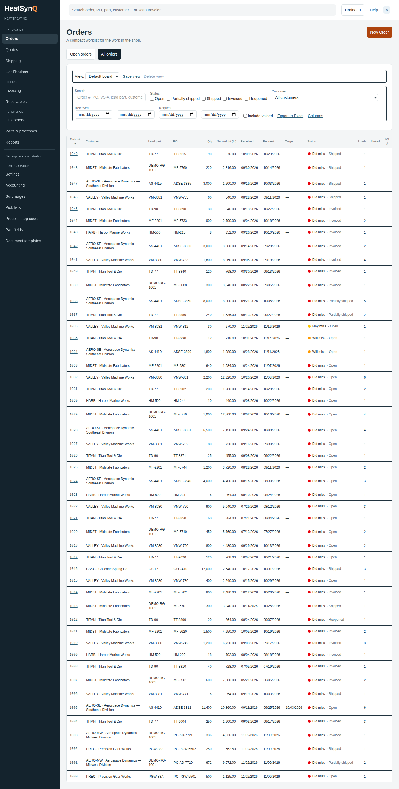
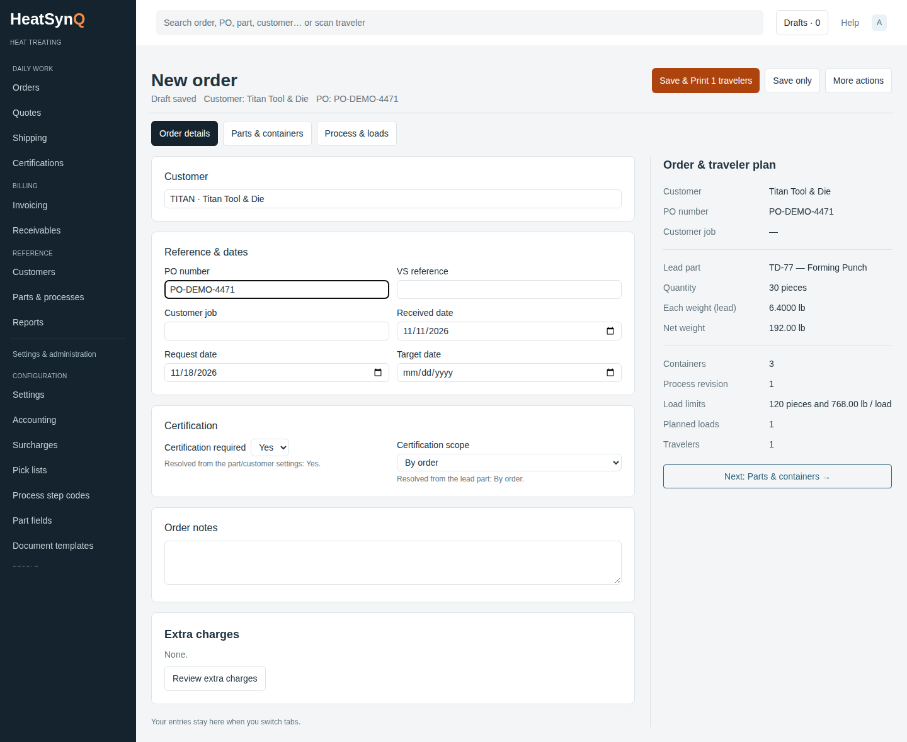
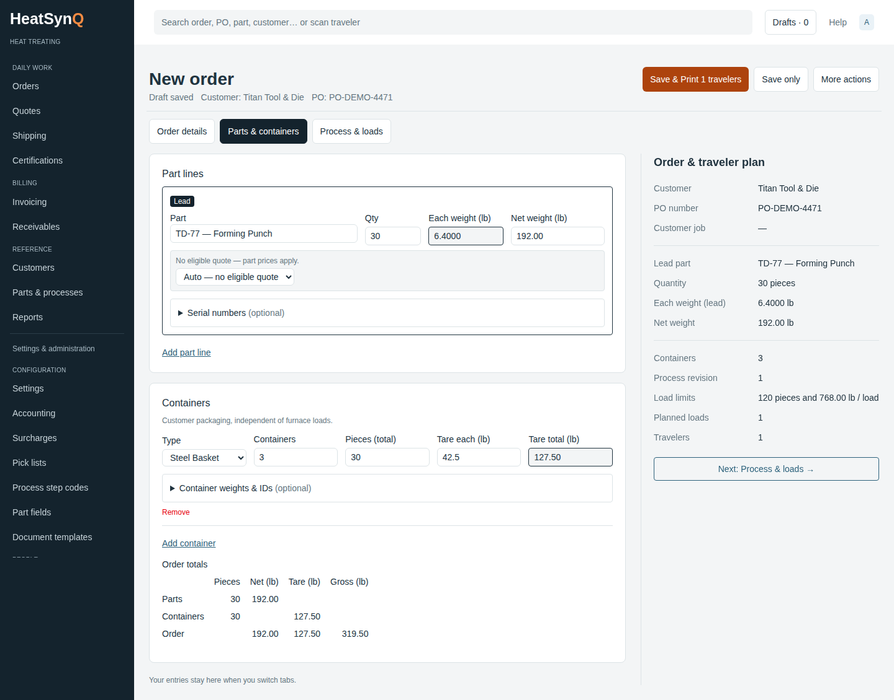
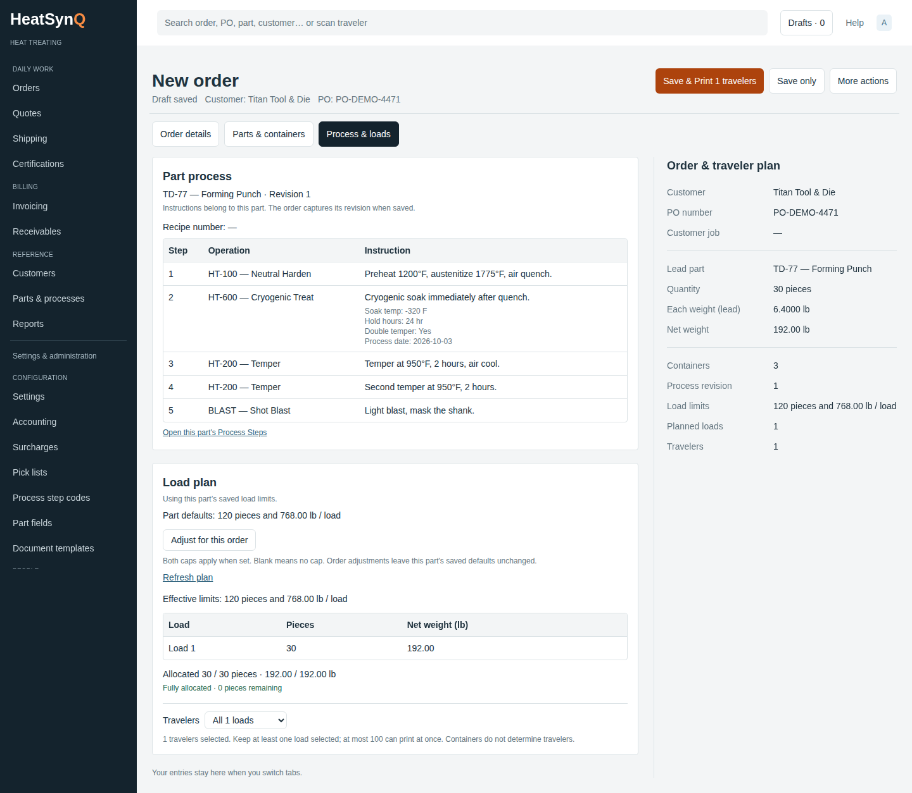
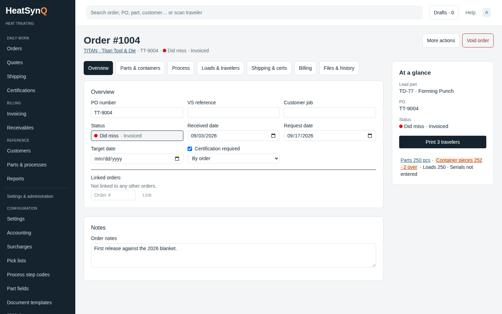

# 2. Orders

[← Back to contents](README.md)

An order is the centre of the system. Everything else — the traveler that goes to the floor,
the shipper, the certificate, the invoice — hangs off it.

## The board

The Orders screen is the shop's daily list.

Each row is an order. **Status** tells you where it is:

| Status | Meaning |
|---|---|
| Open | Nothing shipped yet |
| Partially shipped | Something has shipped and at least one line is still short |
| Shipped | Every line has shipped its ordered quantity, or was closed short |
| Invoiced | An invoice has been raised |
| Reopened | A shipment was reversed after invoicing, putting the order back in play |

**Voided orders are not a status.** Voiding hides the order; it stays in the system and in the
history forever. Tick **Include voided** to see them.

Above the filters, **Open orders** and **All orders** are presets of the status boxes: Open orders
ticks Open, Partially shipped and Reopened with voided left out; All orders clears every status box.
The preset the boxes equal is lit, so a saved view that matches one shows it; ticking a status box
or Include voided yourself leaves neither lit. Search, Customer and the date ranges narrow within a
preset and keep it lit.

The coloured dot beside the status is the **traffic light** against the request date — on
target, close, or late. It is a metric, not a gate: nothing stops you shipping a late order.

### Finding work

The filters across the top narrow the board by search text, status, customer and date range.
The board shows the first 200 rows of the sort you have chosen, the newest 200 under the usual
order-number sort, and says so under the filters: **Showing newest 200, refine or show all**.
Narrow the filters, or press **show all** to see every matching order for the filters as they
stand; change a filter or the sort and the board goes back to its 200. Export to Excel always
writes every matching order.
Tab to an **order number** and press **Enter** to open it. To sort, Tab to a column heading and
press **Enter** or **Space**; activate it again to reverse the direction.

**Global search at the very top of the screen** searches orders, parts and customers together.
Focus that box before scanning a **traveler barcode**, or type the complete order number and
press **Enter**. For other searches, use **Down/Up Arrow** to highlight a result and **Enter** to
open it. **Escape** or **Tab** closes the results without opening anything and keeps your text.

### Saved views

Set the filters and columns the way you like them, then **Save view**. Pick a saved view from
the dropdown to return to it. Tick **Set as default** on a view and it is the one you land on
each morning. Change a filter, a column or the sort while a saved view is picked and the dropdown
names it with **(changed)**; **Update view** writes what is on screen into that view, and the mark
goes.

**Columns** lets you choose which columns appear and in what order. **Export to Excel** exports
exactly what you are looking at — same filters, same columns.
With Columns open, use **Tab** to reach a checkbox and **Space** to show or hide its column.
The **Move … up/down** buttons change its position with **Enter** or **Space**.

## Entering an order

**New Order** opens the entry screen.

The three tabs share one draft. Move between them freely; the customer, PO, draft status,
**Save & Print N travelers**, **Save only**, **More actions** (which holds **Back to orders**) and
the **Order & traveler plan** card stay available. Use Left/Right Arrow on the tabs to switch,
or Home/End to reach the first/last tab. A validation error opens its tab and focuses the field.
A refused Save lists every reason in a red banner under the screen's header, which stays on
screen as you scroll (a long list scrolls inside it), and each box it names is outlined in red.

1. **Order details.** Choose the customer, then enter the PO, VS reference, customer job,
   dates, certification choices (Certification required is a Yes/No choice) and order notes;
   **Review extra charges** opens the charges editor in a dialog. Standing customer notes are read-only.
   The request date derives from the customer's or part's lead time until you override it. If it
   cannot be worked out, the reason shows under the box, and without the **orders.view**
   permission the box says *"Requires orders.view"*; the save still works the date out.
2. **Parts & containers.** Choose the lead part and any rider lines; each needs a quantity and
   a net weight. Net weight normally computes from the part's each weight, with an explicit override and
   **Reset to computed**. Quote choices and serial ranges remain with their line. Part numbers
   belong to a customer: the same number can name different parts for different customers.
   Containers describe customer packaging. A container row gives **Containers**, how many there
   are, and **Pieces (total)**, the pieces in all of them together. **Tare each (lb)** is the weight of
   one empty container: it fills from the container type when the type has a figure, and you can
   type over it. The app multiplies it by Containers and shows **Tare total (lb)**. Expand
   **Container weights & IDs** for **Scale gross (lb)** and the customer's container identifier.
   A scale gross is typed only when the row was weighed, and it covers all the row's containers
   together. Under the container rows, **Order totals** adds the order up as you type. **Parts**
   is the lines' quantities and weights added up. **Containers** is the rows' Pieces (total) and their
   Tare totals added up. **Order** is Net, Tare and Gross, and Gross is Net plus Tare. The pieces
   by the parts and by the containers sit one above the other, so a difference shows; it is
   information only and never stops a save. A row without Pieces (total) is left out of the containers'
   pieces, and the table says how many were. A row without a Tare each makes Tare read
   *Incomplete* and Gross *Not available*: the app never shows a gross that leaves a container
   out. With no containers, Tare reads *Not entered* and Gross *Not available*. When you type a
   **Scale gross**, the totals add the weighed net: the rows' scale grosses added up, less their
   tare. It shows only when every container row has a Scale gross and a Tare each. When every
   part line names the same part, **Implied pieces** follows: the weighed net divided by that
   part's each weight, to the nearest whole piece. Nothing is changed for you: if the scale is
   right, correct the quantity or the weight yourself. Implied pieces is worked out from the
   part's each weight as it stands now. It can differ from the parts' pieces even when the
   weighed net equals Net, when a line's weight was typed over.
3. **Process & loads.** Review this lead part's saved Process Steps and the proposed loads.
   Instructions belong to that individual part, and the order captures its revision when saved.
   **Adjust for this order** sets quantity and/or weight caps for this order only; both caps apply
   when entered. **Use part defaults** resets the adjustment. Changing the lead part also resets
   it. These controls never edit a part's saved instructions or load defaults.

Some fields stay disabled until the field above them is answered — the certification control,
for instance, says *"Pick a lead part to resolve the certification requirement."* A part line
works the same way: its part, quantity, weight and serial box all wait on the customer, because
all four of them belong to that customer's part. That is the form telling you the order of
operations, not a fault.

**Your work is not lost if you wander off.** Order entry keeps a draft as you type. Come back
and you are offered **Resume** or **Discard**, under the date and time the draft was last saved. **Draft saved** means the latest edits were
acknowledged; **Saving draft…**, **Unsaved changes** and **Draft autosave failed** describe
different states. Leave a failed autosave visible until it succeeds or save the order explicitly.

When you save, the app allocates the order number, splits the loads, and — if the part or
customer calls for a certificate — creates the cert requirement automatically.
If the part's process or limits changed after your preview, saving stops for review and refreshes
the plan. Check it and click Save only again; the app does not silently save a different plan.

**Save only** saves without printing. **Save & Print** saves first, then prints the selected persisted loads as one archived PDF.
The default is all loads; choose **Selected loads** to print a nonempty subset. A changed load
plan resets that subset to all loads. Thirty pieces at 127 lb with a fifteen-piece cap make two
loads of fifteen pieces and 1,905 lb each, totaling 3,810 lb. Containers do not decide the traveler
count. Long instructions can make one traveler's sheets span several pages.

A save warning must be acknowledged before printing. Reloading or returning with Back does not
repeat the automatic print. If printing fails or its outcome is unclear, review the saved order's
Documents before printing again; the order has already been saved. A blocked popup has a link to
the archived PDF. Changes to the saved plan require review before printing.

## Loads

A load is a furnace run. The order splits into loads automatically from the lead part's load
quantity and load weight: 1,000 pieces at 300 per load becomes 300 / 300 / 300 / 100.

You can edit the split by hand, and **Re-split** re-derives it from the part's current limits.
Re-split uses the part's current defaults, including when entry used an order-only adjustment.
Loads must be numbered 1 to N with no gaps.

The allocation summary compares the displayed loads with the quantity and weight of **all
order lines**, including riders. It marks edited values **Unsaved totals** and shows remaining
or excess amounts. Blank or invalid values are identified; allocation differences are warnings.
Use **Save loads** to keep the split, or **Discard** to return to the saved values.
Each saved row has **Print Load N traveler**. Save or discard load changes before printing.
If recovered loads need a fresh order read, use **Refresh order before printing**.

**Loads are not containers.** A load is how the work runs through the furnace; a container is
how the customer's parts are packed. They rarely line up, and shipping is not tied to load
boundaries — you can ship 230 pieces out of a 300-piece load because that is what fills the
customer's basket.

**When the printed traveler no longer matches the order, the order says so.** Each traveler
print records the line quantities and weights and the loads it printed. If a line's quantity or
weight changes after that, a rider is added or removed, or a printed load's quantity or weight
changes, a notice shows beside **Print N travelers**, in the **At a glance** card beside the order's tabs:
*"The printed traveler is out of date: a quantity, a weight or the loads changed after it
printed."* It does not stop you.

Each load is judged by its own newest print, so on an order with several loads the notice names
the loads whose paper is out of date: *"The printed travelers for Loads 2 and 3 are out of date:
a quantity, a weight or the loads changed after it printed."* A changed line puts every printed
load out of date. A changed load puts only its own. A load added after an all-loads print is
named as well, until it prints. When more than eight loads are out of date the notice gives how
many, not a list.

The notice goes when the paper and the order agree again: print a fresh traveler, for all loads
or for the loads named, or put the values back. Until then it stays, through a reload and through
other saves. Only an order that is Open, Partially shipped or Reopened shows it, and a voided
order never does. A load that has never printed raises nothing, unless it was added after an
all-loads print. Neither does a change to the containers, although the sheet lists them and
prints their tare and the order's gross weight from them. A PO changed after printing does not
mark the traveler out of date, so print again to carry the new PO. A traveler printed before the
app kept this record cannot be compared, so it raises nothing either.
The page compares the order as it last read it: if someone else has changed the order since,
reload the page before you rely on the notice.

## The order hub

Opening an order gives you every part of it under seven tabs: **Overview** (the header details,
linked orders and notes), **Parts & containers** (the lines, containers, serial numbers and extra
charges), **Process**, **Loads & travelers** (the loads and the documents printed against it),
**Shipping & certs**, **Billing** (invoices) and **Files & history** (attachments and the
**History** panel showing every change made to it — including changes made in its sub-sections).
Every tab stays loaded: switching tabs keeps your unsaved grid edits in place, and a tab whose
sections hold unsaved work shows an **Unsaved changes** badge. Use Left/Right Arrow or Home/End
on the tabs to switch. The address carries the tab, so Back leaves the order and a link into a
section opens its tab.

The title row shows the order number, the customer, the PO and the status, with **More actions**
(Link another order, Unlink from group) and **Void order** at the right. The **At a glance** card
beside the tabs shows the lead part, PO and status, **Print N travelers**, the traveler notice and
the line of quantities below.

That line sets the order's saved quantities against each other, in pieces:
*"Parts 250 pcs · Container pieces 250 · Loads 250 · Serials not entered"*.

| Figure | What it counts |
|---|---|
| Parts | Every line's quantity added up, riders included. Container pieces and Loads are compared with it |
| Container pieces | The pieces the containers hold: each row's Pieces added up, over the rows that have one |
| Loads | The load quantities added up, over the loads that have one |
| Serials | Counted line by line: a line that has any serial numbers is compared with its own quantity. A line with none is left out |

A figure with nothing entered reads *not entered*, which is not a difference. A piece figure that
differs turns amber, says by how much, and is a link to the section where it is corrected (it
opens that section's tab):
*"Container pieces 252 · 2 over"*, *"Loads 140 · 108 over"*, *"Serials Line 2: 30 of 32 · 2
under"*. When rows were left out of a sum that differs, the figure says how many: *"Container
pieces 84 · 166 under · 1 row has no Pieces"*. While any figure differs, Parts is a link to the
Lines section as well, because the quantity may be the figure that is wrong. The line is on every
saved order, voided and invoiced ones included, and a figure stays amber until it agrees. It only
informs: no save, print or shipment is refused because of it.

On an order whose container rows were all weighed, the line ends with a weight: *"Net 1,600.00
lb · weighed 1,612.50 lb · 12.50 lb over"*. This figure is information only: it is never amber
and is not a link, because a scale seldom agrees with a calculated weight to the cent.

The line shows what is saved. A grid's unsaved edits do not move it, and neither does a Qty
marked Not saved. For loads you are still editing, read the allocation summary in the Loads
section: it follows the unsaved rows, and it is the only place that compares load weights with
the order. It says *remaining* where the line above says *under*. Order entry's totals add up the
rows that have Pieces, as this line does. They always say how many rows were left out; this line
says so only when its figure differs.

Containers, Charges, Loads and each line's Serials have their own Save button. When a grid has
unsaved work, **Discard** appears beside it. It restores that grid to its saved values, including
undoing added or removed rows, and leaves every other grid's edits alone. For Serials it also
clears a range you typed but have not added. Discard is temporarily disabled while that grid is
saving. If removing a line is refused because its serials are unsaved, save or discard those
serials first.

Above the rows of the **Containers** section, **Order totals** is the table order entry shows.
Here it follows the rows as you type and reads *Unsaved totals* until you **Save containers**;
the line at the top shows what is saved.

A row of the **Containers** grid has the fields order entry gives it: **Type**, **Containers**,
**Pieces (total)**, **Tare each (lb)**, **Scale gross (lb)** and **Cust Cont Id**. **Tare total (lb)** is
not typed. It is Tare each × Containers, it follows the row as you type, and it shows a dash
while either is missing. Nothing is filled in when the order opens, so a row saved without a Tare
each shows an empty box. Changing a row's type can change its Tare each. An empty box takes the
new type's figure, if that type has one. A box that holds the old type's figure takes the new
type's, and is emptied when the new type has none. Any other figure stays as it is.

Beside **Save containers**, **Print tags** downloads the order's container tags, printed from the customer's Container tag template (chapter 13; the Standard when the customer has none), one 4 in × 3 in
tag per saved container row, for a label printer: open the file and print it, and the printer takes
it page by page. Every tag of an order reads the same: the order number and customer, the PO
number (a dash when there is none), each line's part number and quantity, the number of
containers on the whole order (every row's Containers added up) and *Received* with the Received
date and the time of day the order was keyed in. A tag names no container type, Cust Cont Id or
load, and carries no barcode. The tags are for telling containers apart on the shop floor; they
are not kept with the order's documents, and nothing changes when you print them. Print tags is
greyed while a Lines box reads *Not saved* or the Containers grid has unsaved edits, because the
tags print what is saved, and on an order with no container row or a voided order. A tag lists at
most six part lines and then says how many more there are, and a long name or PO is cut at the
tag's edge, so a tag is always one page. A customer whose Container tag template is laid out on a canvas
(chapter 13) gets its tags as drawn there: each piece where the template puts it, a value cut at its box's
edge, the part lines as many as their box holds, and the order number always whole.

**Qty** and **Net weight (lb)** in the Lines section have no Save button. Change a box and it saves by
itself when you leave it (tab or click away) or press **Enter**; Enter keeps the cursor in the
box. When the save lands, **Saved** appears beside the box. It goes when you next edit that box
or reload the page.

If a value cannot be saved, it stays in the box, marked **Not saved**. The reason shows in red
under the line, and again under the table of lines: *"Lead: quantity must be a whole number of at
least 1."*, for instance, or the refusal to take a quantity below what has already shipped. Beside
the mark is a button that names the stored value, such as **Restore 32**. It puts that value back
in the box. Usually that is all it does: nothing is sent. When the app could not tell whether a
save of that box went through (the connection dropped, for instance), Restore saves the stored
value again, so the order and the screen agree, and the mark goes when that save lands. After
such a save the mark stays until a save of that box does land, even if the box already shows the
value the order holds: press **Enter** to save what is in the box, or use Restore. If that
save is refused or fails as well, the box stays marked Not saved and Restore tries again each time
you click it; if the order can no longer be changed at all (it was voided or invoiced in the
meantime, say), reload the page to see what it holds. To correct the value instead, type a new
one and leave the box.
Press **Enter** to try the same value again; tabbing through the box does not resend it.

A value marked Not saved is unsaved work. While it stands, the app asks before you leave the page,
and the traveler print buttons are disabled with the reason *"Save the changes first, restore a
value marked Not saved, or press Remove again on a line marked Removal not confirmed — a print
archives what the server holds"*.

If the app could not tell whether a rider's removal went through, the line stays on the page
marked **Removal not confirmed**. Press **Remove** to try again. The mark goes when the order no
longer lists the line; a refusal does not take it away. Until then it is unsaved work, like a
value marked Not saved. To see what the order holds, reload the page; that also clears the mark.

**After a quantity change the app offers a weight; it never changes the weight by itself.** Once a
quantity save lands, if quantity × the part's each weight is not the saved weight, a row under
that line shows the sum and one button. Correct 332 pieces to 32 on a part that weighs 1.5 lb each
and, under a saved weight of 498 lb, the row reads *32 × 1.5000 lb = 48.00 lb* with the button
**Use 48.00 lb**. Click it to save that weight, or leave it alone: the saved weight may be one you
received and entered on purpose. The offer goes when a weight is saved for that line, whether the
offered one or one you type, and when the page reloads. If the figure is less than the weight
already shipped on that line, the row still shows it, but the button is disabled and the row adds
*Below the 95.00 lb already shipped*. A line's weight cannot go below what has shipped.

**Under a finalized invoice the Lines and Charges sections are closed before you click.** Qty,
Net weight (lb), a line's quote choice, a rider's **Remove**, the offered weight's button and the add-rider
strip are greyed out with *"A line cannot be changed — Invoice 1031 is finalized; unlock it or
raise a credit"*. Every Charges control, **Save charges** included, carries *"Charges cannot be
changed — Invoice 1031 is finalized; unlock it or raise a credit"*. The header details, Notes,
Containers, Serials and Loads stay open, and a draft invoice closes nothing. The page learns of
the invoice when it loads, so one finalized while the order is open still refuses the save, with
the reason, until you reload; one unlocked meanwhile leaves the two sections greyed until you
reload. **Void order** is not greyed for an invoice: it is refused when pressed, and the refusal
names what is in the way.

Attachment filenames wrap so you can read the full name alongside the size, date and **Delete**
control. Click a filename to open or download the file.

### The saved recipe

The **Process** section shows the lead part's saved recipe number and revision when it has a
numbered recipe. The order keeps the revision selected when it was saved. Later changes to the
part create a new working revision; they do not replace this order's captured settings.
Rider parts use the lead part's process. Permission to view the order is enough to read its
saved process, even without access to the part's process editor.

A numbered locked revision displays the labels, units, instructions and parameter values
captured when that revision was first used. Blank parameters remain blank. An older order
without a captured numbered recipe keeps its ordinary process display; the app does not
invent a historical recipe for it. The example screenshot above is an unnumbered part.

The optional LoadSynQ interface reads the current saved order/load pair and this same captured
lead-part recipe. Changing a load's number or split requires a fresh traveler. HeatSynQ supplies
recipe data; LoadSynQ owns equipment delivery and confirmation, starting with SSI 9010.
Saving a recipe or order does not send settings to equipment.

### The traveler

**Print N travelers** produces the shop paper, with the barcode that brings you back to this order
when scanned. Each load has its own barcode: order 91246 split into five loads prints
**91246-1**, **91246-2**, **91246-3**, **91246-4**, and **91246-5** on the five travelers.
Continuation pages repeat the same load barcode. You can print all loads at once or one load
at a time; entry's Save & Print also supports a selected set. Each load's sheets carry their own
page numbering. The Documents list identifies selected-load archives separately from all-load
archives and keeps their original coverage after later load edits.

An order with more than 100 loads cannot print all its loads at once; the refusal names the count,
for example *"This order has 101 loads — more than the 100 an all-loads traveler prints at once.
Print the loads one at a time."* A print that cannot finish in the time it is allowed, which a
print of many loads whose sheets each run to two pages can take, is refused once the print
finishes, and nothing is stored: *"This traveler took too long to print, so nothing was stored. Print
the loads one at a time."* The button reads **Printing…** until then.

The traveler prints each line's **Each weight** and **Net weight**. For each container row it
prints the type with the row's pieces beneath, how many **Containers**, and the row's **Tare**:
its tare total, with the tare each beneath. Beside the container rows, the last column is headed
**Order totals** and prints the order's **Net**, **Tare** and **Gross**, the same three figures as
**Order totals** on this page. They are the order's, not the load's, so every load's sheet shows
the same three beside that load's own quantity. With no containers on the order, or with a
container row that has no Tare each, **Tare** and **Gross** print with no figure after them, and
**Order totals** on this page says which it is. Under each load's quantity the sheet prints that
load's own net weight. Every weight carries "lb".

Under the customer's name, address and phone, the sheet prints the order's PO as the last line on
the left (**PO: ADSE-3335**). An order with no PO prints **PO:** and a line to write one in. After
changing the PO on the order, let it save before printing, or the sheet may carry the old PO.

Scan into Global search and press Enter to open the order, refresh its load details, and
highlight that load. Existing order-only barcodes still open the order; an order without loads
also prints an order-only barcode. Invalid or missing numeric order-load pairs show an error.
If you have unsaved load edits, save or discard those edits before the saved row is highlighted.
Changes to load numbering or splitting require fresh travelers: a barcode identifies the
current order/load number pair, not a historical version of the load.

Opening a traveler in **Documents** reissues the **stored** document — the exact bytes that printed the first time, not
a fresh render. That matters: the paper in the shop and the paper in the system are the same
paper.

## Voiding an order

**Void order**, in the title row, asks for a reason in a dialog and records it. A voided order is read-only forever: no new
documents, no edits. It cannot be voided at all if a finalized invoice covers it — correct that
through the invoice first (chapter 6).

---

Next: [3. Quotes →](03-quotes.md) · Previous: [1. Getting around](01-getting-around.md)
