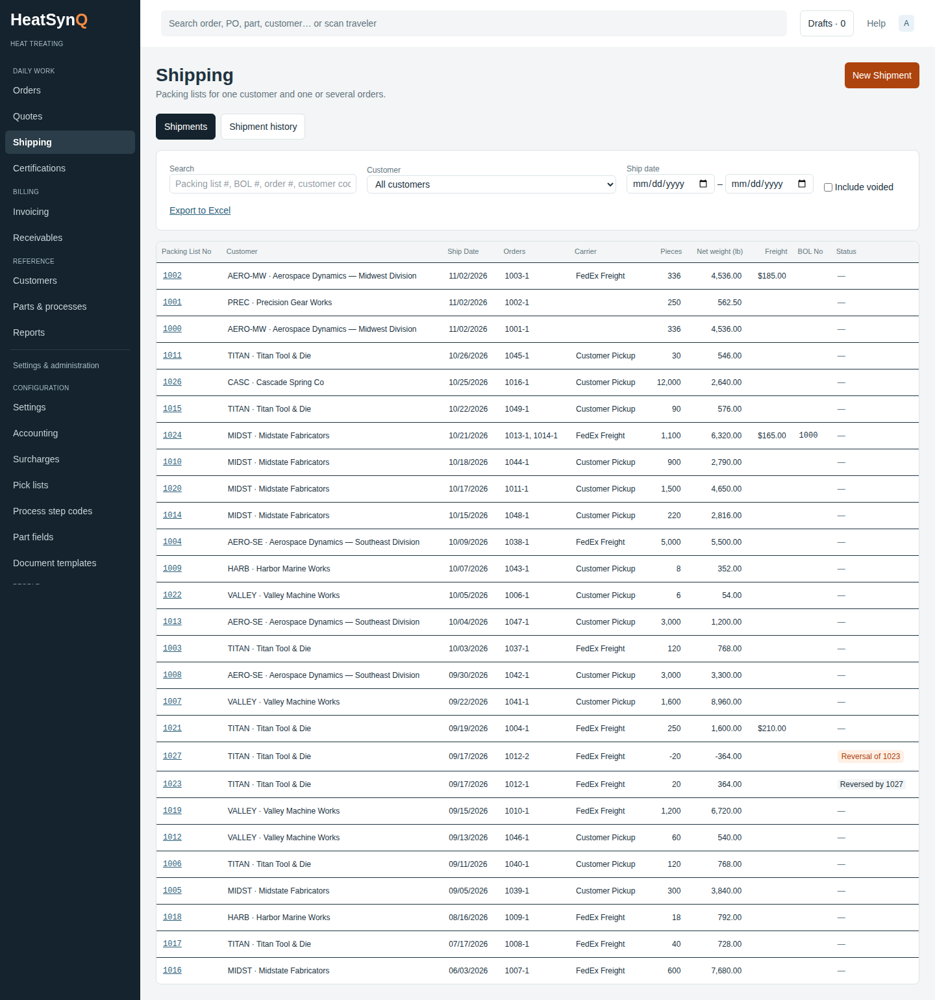
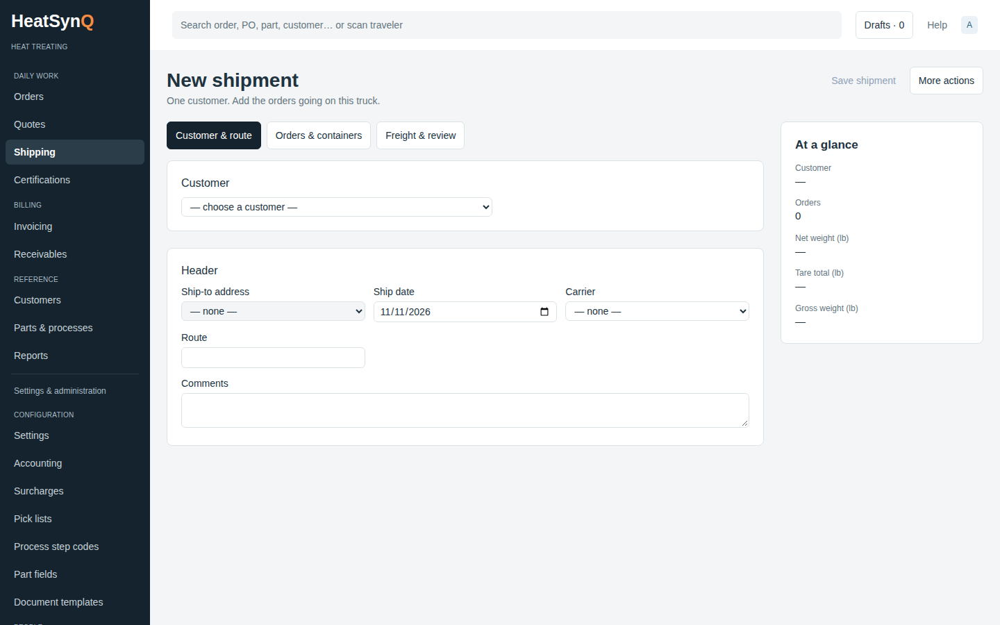
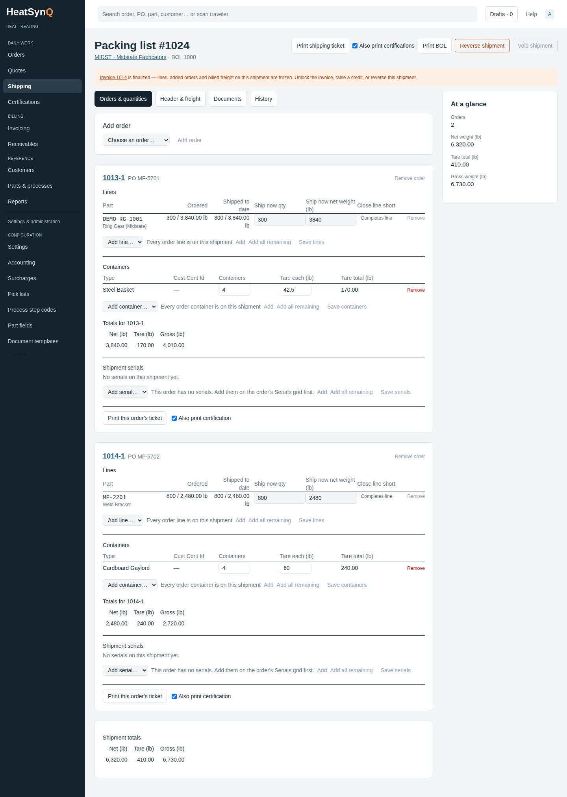

# 4. Shipping

[← Back to contents](README.md)

A shipment is the paper that goes out with the truck: the **packing list** (the shipping ticket),
and — when the carrier wants one — the **bill of lading**. One shipment can cover several orders
for the same customer, which is why the app calls the document a Packing List rather than an
"order shipment".

## The shipping list

| Column | What it is |
|---|---|
| Packing List No | The shipment's own number. Click it to open the shipment. |
| Orders | Every order on it, as `order-sequence` — `1031-1` is order 1031's first shipment |
| Pieces / Net weight (lb) | The totals across every order on the shipment |
| BOL No | Blank until a bill of lading has been printed |
| Status | **Reversal of N** on a reversal; **Reversed by N** on the original while its reversal is live; **voided** on a withdrawn shipment; **—** otherwise |

The search box takes a **packing list number, BOL number, order number or customer code**.
Two views sit above the filters: **Shipments**, and **Shipment history**, which is the
**Include voided** box ticked — the box and the view always agree, so ticking it by hand lights
Shipment history. Voided shipments are hidden until you do.
The list shows the newest 200 shipments that match, and says so under the filters:
**Showing newest 200, refine or show all**. Narrow the filters, or press **show all** to see every
matching shipment for the filters as they stand; change a filter and the list goes back to its
200. Export to Excel always writes every matching shipment.
Voiding a reversal clears **Reversed by N** on its original. The voided reversal still names
the document it reversed when you include voided shipments. Re-reversing the original gives
it a new **Reversed by N** label pointing to the new packing list.

## Building a shipment

**New Shipment** opens a blank one. It is a single form with a single **Save shipment** in the
title row (**Back to shipping** sits under More actions): nothing is written, and no number is
used up, until you press it. Shipment entry
does not autosave to the server. If browser Back or Forward leaves the form without a
confirmed discard, its unfinished values are retained in this tab and can be restored
when you return. **Restore** does not create a shipment; **Save shipment** does. Save
before reloading, closing the tab or signing out. See [draft recovery in chapter 1](01-getting-around.md).

The form is three tabs, and switching between them loses nothing; the **At a glance** card beside
them shows the customer, how many orders are on the form, and the net, tare and gross as you type:

1. **Customer & route.** The **Customer** first: everything else is scoped to them, and changing
   the customer asks before it clears the orders you had added, the ship-to address and any
   override reason — deliberately, because none of it belongs to the new customer. Under it the
   **Header** — ship-to address, ship date (today, unless you change it), carrier, route, comments.
2. **Orders & containers.** The picker offers only that customer's orders with something left to
   ship, and says so while it reads them (*"Loading orders…"*) or if the read fails (*"Orders could
   not be loaded"*). **Add order** brings the order in as its own panel; add as many as are going on
   the same truck. If the order has shipped since the list was read, or the form changed while it
   was being added, the order stays off and the card says *"This order can no longer be added.
   Check the saved records again, then pick an order."*, with a button that reads the saved records
   and the list again. **Shipment totals** sit under the last panel.
3. **Freight & review** — Bill freight, amount, **Terms** (**Prepaid** or **Collect**), class,
   description, **Package count**, **Pro number** and SCAC. Leaving Package count blank uses the
   current container count, and the field says so.

**Save shipment** stays disabled until a customer is picked, and its tooltip says so — everything
the save needs hangs off that one choice.

If **Save shipment** is refused, the red banner at the top lists every reason, one per line, and
stays at the top of the window as you scroll (a long list scrolls inside it). The cursor goes to
the first box it names, opening that box's tab first, and every box it names is outlined in red.
A refusal the server sends back takes the cursor only when it names a box exactly.

If the customer is on **credit hold** you are told before you waste any typing — named, and
linked to their record. With the `override_credit_hold` action you get a required reason field;
without it, **Save shipment** is disabled and the tooltip says which action you are missing.

### Lines, containers and serials

Each order gets three grids.

**Lines** is the one that matters:

| Column | |
|---|---|
| Ordered | Qty and net weight on the order |
| Shipped to date | What earlier shipments already took |
| Ship now qty / Ship now net weight (lb) | What is going today — **prefilled to what is left**, and freely editable. Change the quantity and the row offers a weight for it (below) |
| Close line short | Tick to finish a line that is shipping under its ordered quantity. A row that ships the rest of the line shows *Completes line* instead |

The prefill is a suggestion, not a ceiling. You can ship more than remains; the app warns and
lets you through. **Add all remaining** fills every unshipped line in one click.

Change a row's **Ship now qty** and a line appears under the row with quantity × the part's each
weight and one button. For 8 pieces of a part that weighs 10 lb each it reads
*8 × 10.0000 lb = 80.00 lb*, with the button **Use 80.00 lb**. The button fills
**Ship now net weight (lb)** with that figure and saves nothing: **Save shipment**, or
**Save lines** on a saved shipment, still does the saving. Changing the quantity never changes the
net weight by itself.

The offer shows only while the quantity differs from the one the row started with and the net weight box
does not already hold the figure. A row you have not changed is offered nothing, because its
weight may be one you received and entered on purpose. If you accept a weight and then put the
quantity back, the accepted weight stays; retype it, or on a saved shipment use that grid's
**Discard**. The offer needs the part's each weight, which comes with permission to view orders:
on a saved shipment, someone who can edit shipments but cannot view orders is offered nothing.

**Containers** is which of the order's container rows travelled. On each row, **Containers** is
how many of them went and **Tare each (lb)** is the weight of one empty container. Containers
fills with the order row's whole number, so on a partial shipment type it down to the containers
that went: the shipping ticket's Tare and Gross weight, and the gross on the bill of lading, count
the number shown. Tare each fills from the order's row when you add the container, and you can
type over it. From then on the shipment keeps its own figure: a later change to the order or to
the container type does not change it, and a change here does not change the order.
**Tare total (lb)** is not typed. It is Tare each × Containers, it follows the row as you type,
and it shows a dash while either is missing. **Serials** is which serial numbers went, each with a
**Print on ticket** tick.

Under its **Containers** grid, each order's panel adds up what this shipment takes of that order,
in a small table named for the order: **Totals for #1031** on a new shipment,
**Totals for 1031-1** on a saved one. Its three figures are **Net (lb)**, **Tare (lb)** and
**Gross (lb)**. **Shipment totals**, under the last order's panel, gives the same three for the
whole shipment, so on a shipment of one order the two tables read the same. Net is the ship-now
net weights added up. Tare is the container rows' Tare totals added up. Gross is Net plus Tare. A
container row without a Tare each makes Tare read *Incomplete* and Gross *Not available*, and the
totals say how many rows have none: the app never shows a gross that leaves a container out. With
no containers, Tare reads *Not entered* and Gross *Not available*. The shipment has a Gross only
when every order on it has one. When an order on it has no containers and another has, the line
under **Shipment totals** says so: *1 order has no containers*. An order with containers and no
line on the shipment reads a Net of 0.00 and a Gross equal to its Tare.

When a grid has nothing left to add, its picker is disabled and the reason stands as plain text
beside it: *"Every order line is on this shipment"*, and the same for containers and serials. On a
saved shipment the pickers are filled from the order, which takes permission to view orders.
Without it the text reads *"Requires orders.view"* instead, and the **Add order** list is greyed
out with the same words. While a grid on a saved shipment is still checking your access and reading
its saved record, the text beside its picker reads *"Checking access to this editor…"*, and so do
the tooltips on its controls when nothing else stops you editing. If that read fails, both read
*"This editor is unavailable."*; if what it read, or the changes retained in this tab, cannot be
used, both read *"This editor could not be loaded."*, as the notice above the grid does.

> **The quantity closes an order.** A line is complete once the quantity shipped reaches the quantity
> ordered, across however many shipments it takes. An order becomes **Shipped** when every line is
> complete, and can then be invoiced (chapter 6); an order with something shipped stays **Partially
> shipped** until every line is complete. Weight does not count, so a re-weighed shipment never holds
> an order open. When a line will never be made up
> (a customer who accepted 98 of 100), tick **Close line short** on the shipment that ends it. Once a
> later shipment brings the line to its ordered quantity, the tick is cleared automatically. The
> earlier shipment then shows as **Partial** in the shipments list. If the later shipment is voided
> or reversed, the order goes back to **Partially shipped** until the earlier line is closed short
> again.

When you save, you may get an amber list. None of it blocks the save:

| Warning | What it is telling you |
|---|---|
| "…shipping 40 / 80.00 lb exceeds the remaining 30 / 60.00 lb on this line" | You are shipping more than was left |
| "…shipped-to-date 120 / 240.00 lb exceeds the 100 / 200.00 lb ordered" | The same fact, seen later on the shipment page |
| "Order #1031 requires a certification and none exists yet" | The order needs a cert nobody has made |
| "…requires serialization but no serial numbers were selected for this shipment" | The part is serialized and this shipment names no serials |
| "Serial 4471 also appears on Packing List 1019 (2026-07-14)" | The same serial has gone out twice |

## The shipment page

The title row reads **Packing list #N**, with the customer and, once printed, the BOL number
under it, and holds **Print shipping ticket**, **Also print certifications**, **Print BOL**,
**Reverse shipment** and **Void shipment**. Four tabs hold the sections, and a tab with unsaved
grid edits says so on its name: **Orders & quantities** has the **Add order** card, then one
panel per order, each with its own **Save lines** / **Save containers** / **Save serials**
buttons and its own totals, then **Shipment totals**; **Header & freight** has the header fields,
which save as you leave each one, or when you press **Enter** in a single-line box, which keeps
the cursor there — a green **Saved** shows beside a box while it holds what was saved, and there
is no Save button up here; **Documents** and **History** are their own tabs. The **At a glance**
card beside the tabs shows the orders on the shipment and its net, tare and gross as the grids
stand, and carries the print messages.

**Ship-to address** always shows the address the shipment has, even one since made inactive or
deleted, and *Ships to:* under the header fields spells it out. Picking a different one needs
permission to view customers: without it the list holds only the shipment's address and *— none —*,
with *"Requires customers.view"* beside it, so you can clear the address but only someone who can
view customers can set one again.

Each unsaved grid also offers **Discard**, which restores only that grid's saved values and
leaves the other grids and orders alone. It is temporarily disabled while that grid is saving.

On a saved shipment the totals follow the **Lines** and **Containers** grids as you type, and read
*Unsaved totals* until you save or discard those grids. A blank **Package count** still shows the
saved rows' containers added up, so it does not follow the **Containers** grid until you press
**Save containers**. A shipment saved before the app kept a tare each has none: each of its
container rows shows an empty **Tare each (lb)** box until you type a figure and press
**Save containers**.

**A panel's messages show in that panel.** When a grid's save is refused, or a value in it fails
its own check, the reason shows in red under that grid's Save button. The message goes when that
grid's changes are saved or discarded, or when no unsaved change is left in it. A refused
**Remove order** shows under that button, in the panel's heading. The red line at the top of the
page is for the page's own controls: the header fields, **Add order**, **Void shipment** and
**Reverse**. A print reports in the At a glance card, a single order's ticket included.

**Add order** adds another order to an existing shipment. It must be the same customer —
otherwise you get *"Order #1042 does not belong to the same customer as this shipment"* — and it
cannot already be on it.

If the customer is on **credit hold** and you hold the `override_credit_hold` action, a reason
box sits beside **Add order**. While it is empty, **Add order** and every panel's **Save lines**
are greyed out with *"A reason is required to override the credit hold"*. One reason covers
adding orders and saving lines. Without the action, the **Add order** controls and the Lines
grids are greyed out and the tooltip says which action you are missing.

**Remove order** on a panel takes one off, asking first, in a dialog, since the lines, containers
and serials for that order go with it. When the page can tell that a removal would be refused, the button is
greyed out and its tooltip gives the reason. After the reasons that close every editing control
(a voided shipment, a reversal pair, a missing permission), it shows the first of these that
applies:

| Tooltip | What to do |
|---|---|
| "This is the only order on the shipment — void the shipment (Packing List 1031) instead of removing its last order." | Void the shipment |
| "Shipment paper covering this order has already printed (Packing List 1031) — void the shipment instead of removing it." | Void the shipment and start again. Once a ticket or a bill of lading names the order, the order stays on the paper |
| "This order cannot be removed from the shipment — Invoice 1031 is finalized; unlock it or raise a credit" | Deal with the invoice first (chapter 6) |
| "A shipment needs at least one line with a positive quantity" | No other order on the shipment ships anything. Save a line with a quantity above zero on one of them first, or void the shipment |
| "This order's shipment certification has already printed (Packing List 1031) — void the shipment instead of removing it." | Void the shipment and start again |
| "Order 1031-1 has unsaved lines, containers or serials on this shipment. Removing it drops those rows, so save them first — or use Discard beside each unsaved grid's Save button." | Save or discard that order's grids. Another order's unsaved grids do not block the removal |

After a ticket or a bill of lading prints from this page, **Remove order** greys on each order
that paper covers, with no reload.

Rows can be *kept from earlier selections*: lines, containers or serials that were on this
shipment when somebody later corrected the order. Kept lines and serials appear in a grey dashed
strip reading *"kept from earlier selections (the order-side rows were since corrected away)"*.
Kept containers are rows of the **Containers** table marked *Kept*. Kept rows stay on the paper —
they were printed — and cannot be changed or removed here, with one exception: a kept container's
**Tare each (lb)** can be typed, and **Save containers** saves it. Kept lines and kept containers
count in the totals. Nothing is wrong.

Removing a row from an order's **Containers** section and saving turns its row on each shipment
into a kept row. Changing a row there (its number of containers, its type or its **Cust Cont Id**)
keeps the shipment's row linked, and the shipment shows the new type and **Cust Cont Id**. The
shipment keeps its own number of containers and **Tare each (lb)**.

If you remove a row on the order, add a new row there in its place, and then add that new row
to the shipment under **Add container**, the shipment counts those containers twice in Tare,
Gross and a blank **Package count**, because the kept row already counts. The shipping ticket
prints that Tare and Gross weight, and the bill of lading that gross, so correct the rows before
you print.

### When an invoice has already been finalized

A finalized invoice freezes the money side of the shipment, and the page says so before you
click. An amber line under the page heading names the invoice and links to it:

> Invoice 1031 is finalized — lines, added orders and billed freight on this shipment are frozen.
> Unlock the invoice, raise a credit, or reverse this shipment.

The frozen controls cannot be used, and each carries the reason in its tooltip:

| Control | Tooltip |
|---|---|
| Every control in each order's **Lines** grid, **Save lines** included, and the **Add order** list and button | "This shipment cannot be changed — Invoice 1031 is finalized; unlock it or raise a credit" |
| **Bill freight** and **Freight amount** | "This shipment's freight cannot be changed — Invoice 1031 is finalized; unlock it or raise a credit" |
| **Remove order** on the invoiced order's panel, when no earlier reason in its list above applies | "This order cannot be removed from the shipment — Invoice 1031 is finalized; unlock it or raise a credit" |

Everything else stays open. You can still fix the ship-to, the ship date, the carrier, the route,
the comments, the freight terms, class and description, the package count, the PRO number and the
SCAC: descriptive corrections are always allowed. Containers and serials are deliberately *not*
frozen; they carry no money. Both prints still work, and so does **Reverse** (below), which is the
correction for an invoiced shipment. A draft invoice freezes nothing.

The amber line is left off a voided shipment and both documents of a reversal pair, where the
banner already there says what is frozen.

**Not every refusal can be shown in advance.** The page greys out what it knew when it last read
the shipment. The rest arrive when you press the button, and each names itself: a change made
somewhere else since then (an invoice finalized or unlocked, paper printed in another tab, a
certification printed from its own page, a credit hold set or lifted, an order removed by someone
else); two saves that collide, where the app asks you to try again; an order whose invoice was
finalized while you were adding it; and a save that would leave the shipment with no line above
zero. Reload the page to see where things stand.

### Printing

| Button | Produces |
|---|---|
| Print shipping ticket | One shipping ticket sheet per order on the shipment |
| Also print certifications | Ticked by default — each covered order's certificate prints and is archived alongside |
| Print BOL | The bill of lading for the whole shipment |

A single order's ticket prints from that order's own panel.
In **Documents**, a row's Type names the paper and its Scope names the order and shipment
sequence, such as **Order 1013-1**, so you can choose the right archived ticket before
**Open PDF** opens it. Whole-set tickets and bills of lading show **Whole shipment**. An older
ticket whose membership details are unavailable still has its link and reads **One order
(details unavailable)**.

A print that cannot finish in the time it is allowed, which a shipment of many orders whose tickets
run to two pages can take, is refused once the print finishes. Nothing is stored and no certification
is printed. The page then says, beside the print buttons, *"These shipping tickets took too long to
print, so nothing was stored and no certifications were printed. Print each order's ticket from its own
panel."*, or for an order's own ticket *"This shipping ticket took too long to print, so nothing was
stored and no certifications were printed."* The print buttons read **Printing…** until then.

The shipping ticket prints each line's **Net weight**. Its container table has a **Tare** column:
each row's tare total, with its tare each beneath. Its totals are for that order's part of the
shipment: **Net weight**, **Tare** and **Gross weight**, the same three figures as that order's
totals on this page. The ticket prints Tare and Gross weight only when that order has containers
on the shipment and every one of its container rows has a Tare each. Otherwise it prints the net
weight alone: paper never shows a gross that leaves a container out. The tear-off strip at the
foot states the net weight only.

The bill of lading prints one weight for the whole shipment, under
**\*Weight (Subject to Correction)**, and says beneath it which weight it is: **Gross weight**, or
**Net weight** when the shipment has no gross. A shipment has a gross only when every order on it
has one. Every weight on paper carries "lb".

**The BOL number is issued on the first BOL print and never again.** Print it a second time and
the same number comes back on a new page, made from the shipment as it stands then. Every page
printed is kept under **Documents**, and opening one there hands you that stored page, byte for
byte. There is no way to type a BOL number yourself, and a shipment that never had a BOL printed
simply has none.

If your browser blocks the new tab, the print still happened: the page says so and the document
is waiting under **Documents**.

## Voiding a shipment

**Void shipment** asks for a reason in a dialog and records it; a blank reason keeps the dialog
open. The dialog is explicit: every control
becomes read-only, the stored documents stay reprintable forever, the packing-list number and
each order's shipment sequence are never reused, and it cannot be undone from the screens.

Voiding is not part of ordinary shipping permission — it takes the named **`void_shipper`**
action, which the shop grants to a shorter list of people. Any shipment-scope certificate
hanging off the shipment is voided with it, carrying the same reason (chapter 5).

Void is refused, with the button greyed out and the reason in its tooltip, when:

| Tooltip | What to do |
|---|---|
| "Already voided" | Nothing — it is done |
| "This shipment cannot be voided — Invoice 1031 is finalized; unlock it or raise a credit" | Deal with the invoice first (chapter 6) |
| "This shipment has been reversed by Packing List 1027 — void the reversal first" | Void the reversal, then the original |

## Reversals

**Reverse shipment** sits beside Void in the title row; it asks about unsaved grid edits first, then
for a reason, each in a dialog. A **reversal** is the correction for a shipment you cannot simply void — typically because the
order has already been invoiced and finalized. Rather than erase anything, it creates a **second,
paired document**: its own packing list number, its own shipment sequence on each order, and the
original's lines with **negative quantities**. Both pieces of paper stay readable, which is the
whole point — the customer has the first one.

A reversal carries no containers: its totals show a net weight below zero, Tare *Not entered* and
Gross *Not available*.

Reversing also:

- takes its quantities back off the order, and clears any *Close short* the original set, so the
  order drops back to Partially shipped; and
- puts any order carrying a **finalized invoice** into **Reopened** — the one place that status
  ever comes from.

**Once a reversal exists, the pair is frozen.** Every editing control on both documents is
disabled, with a banner at the top of the page saying which:

> This is a reversal of Packing List 1023 — a reversal is machine-generated mirror paper; void it
> and re-reverse instead of editing it

> This shipment has been reversed by Packing List 1027 — void the reversal first, then edit, then
> re-reverse

That second sentence is the correction cycle, spelled out: **void the reversal, edit the
original, reverse again.** Voiding a reversal is the blessed undo — the original's own Void is
refused while the reversal is live, the reversal's is not.

**With one caveat: if the order still carries a finalized invoice, neither document can be voided
yet.** Void checks the invoice before it checks the pair, so on an invoiced pair the original's Void
button and its freeze banner both name the invoice first — unlock it or raise a credit, and the
correction cycle above starts after that.

A shipment can only be reversed once while the reversal is live, a reversal cannot itself be
reversed, and a reversal that would drive a line's shipped-to-date below zero is refused by name.

### Reversing one

**Reverse** sits beside **Void** at the top of the shipment page. It asks for a reason, which goes
into the audit history, and then takes you straight to the reversal it just created — a new
document with its own packing list number, which is the thing you will want to look at next.

It needs the same permission Void does. No amount of ordinary shipping permission substitutes for
it: reversing is a correction to paper the customer already holds, so it is deliberately held with
voiding rather than with editing.

**Reverse stays available on an invoiced shipment, and that is the point.** Void does not — a
finalized invoice freezes the shipment against being erased, and the Void button says so. Reversal
is the answer to exactly that situation: it corrects by adding paper rather than removing it, which
is why the invoice does not block it.

The button greys out, saying which, when:

| Why | What the tooltip says |
|---|---|
| The shipment is voided | *Shipment is voided* |
| You are looking at a reversal | *This shipment is itself a reversal of Packing List 1023 — reverse the original shipment instead* |
| It has already been reversed | *This shipment has already been reversed by Packing List 1027 — void that reversal first* |
| You lack the permission | the permission it needs |

Two refusals are not predicted on screen and arrive when you press the button — a shipment on a
**voided order**, and a reversal that would drive a line below zero. Both name themselves.

---

Next: [5. Certifications →](05-certifications.md) · Previous: [3. Quotes](03-quotes.md)
