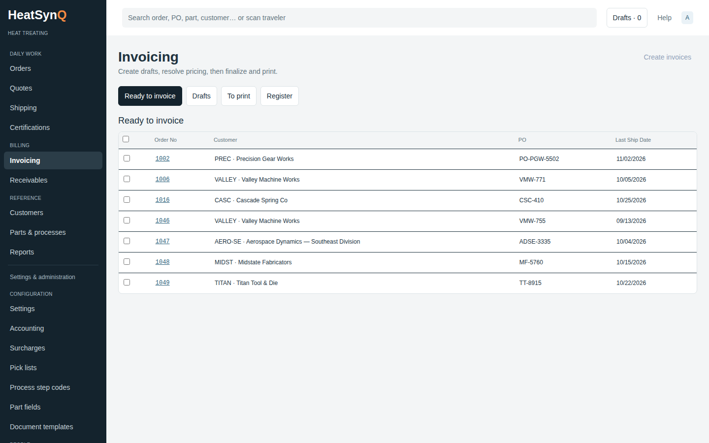
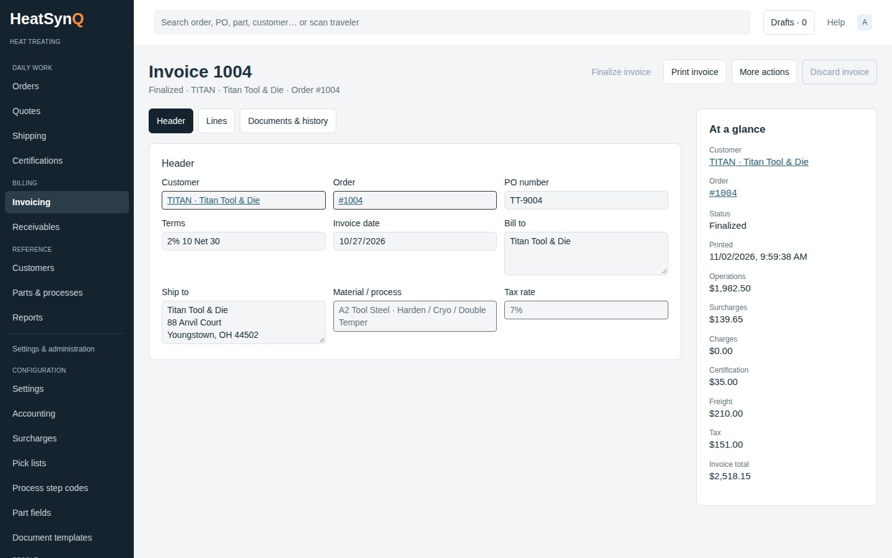

# 6. Invoicing

[← Back to contents](README.md)

Invoicing turns a finished order into paper the customer owes money against. It has two states —
**Draft**, where everything can be corrected, and **Finalized**, where nothing can — and the
whole chapter is really about that line.

## The invoicing screen

The screen is four views across the top — **Ready to invoice**, **Drafts**, **To print** and
**Register** — one lit at a time. The first is a list of its own; the other three are one list,
**Invoices & credits**, under three settings of its **Status** and **Printed** filters.

**Ready to invoice** lists orders waiting: an order at **Shipped**, not voided, with no live
invoice against it. Tick the ones you want and press **Create invoices** in the title row. Each is
created on its own — if one fails, the others still go through and the failure is reported
beside that order's own row.

The tick box in the **header row** selects or clears every order in the list at once, and shows a
dash while only some of them are ticked. It is greyed out when there is nothing to tick — either
the list is empty or you do not have the right to raise invoices, and hovering it says which.

You pick nothing but the order. The customer, PO number, terms, bill-to and ship-to addresses,
material, process names, tax rate and every line are worked out for you.

**Invoices & credits** is the register, filtered by customer, status, printed or not, and invoice
date, with **Export to Excel** and **Export to PDF** beside the filters. **Drafts** is the register
with **Status** set to *Draft*; **To print** is **Status** *Finalized* and **Printed** *Not
printed*, the finalized invoices and credits still to print; **Register** clears both. Change
either box by hand and the view that matches it lights, or none does. The customer and date
filters narrow within a view. The **Document No** column is an invoice's order number (with the
shop's prefix, if one is set) or, for a credit, its own credit number. The **Printed** column reads
the date and time of the newest print made since the invoice or credit was last finalized, and is
blank when it has not printed since. A draft shows its newest print. Unlock an invoice and finalize
it again and the column goes blank, since its earlier prints came before the new finalize. Both
export files have a **Printed** column too, after **Finalized**, and both follow the **Printed**
filter as they follow the rest.

The list shows the newest 200 invoices and credits that match, and says so under the filters:
**Showing newest 200, refine or show all**. Narrow the filters, or press **show all** to see every
match for the filters as they stand; change a filter and the list goes back to its 200.

> **An order must be fully Shipped.** *"Only a fully shipped order can be invoiced"* is the
> refusal, and Shipped means every line has shipped its ordered quantity or was closed short with
> **Close line short** on a shipment (chapter 4). An order with a line still short will not appear in
> **Ready to invoice**.

### Export to Excel and Export to PDF

Both links export the list as filtered on screen: the customer, status and dates the last load used,
with the rows read again when you click, and every matching row, not only the 200 the list shows. Change a filter and the files still hold the list on
screen, not the filter in the boxes, until the new list has loaded; if that load fails, they keep
holding it. Until a list has loaded at all, both links are grey, and hovering one reads
*"Loading the current view…"*, even when the load failed.

**Export to PDF** downloads the **Invoice register** on landscape pages, named for the day it was
made on the plant's clock (America/Chicago), such as `invoice-register-2026-10-21.pdf`. Under its
title a line names the filter, such as
*Customer: CASC · Cascade Spring Co   Status: Finalized   Invoice date: 10/18/2026 – 10/24/2026*,
with *All customers*, *All statuses* or *Any date* where none is set (*from 10/18/2026* or
*through 10/24/2026* for one date), and *Printed: Not printed* or *Printed: Printed* after them
only when the **Printed** filter is set, then the time it was made, such as *Made 10/20/2026,
9:15 AM*.
The table has the Excel file's ten columns in its order, with the header row repeated on every
page, and a row is never split between two pages. Kind and Status read in words, dates as
MM/DD/YYYY and totals such as *1,250.00*; a line break in a name prints as a space, as on screen.
**Finalized**, **Printed** and the Made line read the plant's clock, whatever clock your computer
keeps; on screen those columns read your computer's. Each page's foot reads *Page 1 of 2* and so
on. The PDF is a download only: it is not filed under any **Documents**, so nothing keeps what an
earlier one showed. For a link address edited by hand to name a customer that does not exist, the
browser shows the refusal, *Unknown customer "…"* (its id in the quotes), where the Excel file lists
no rows.

Both files end with a blank row, then one summary row: *Total of 12 documents* (*Total of 1
document* for one) under **Document No**, and the sum of every row's total under **Total**. A
credit's total is negative, so credits net it. With no rows the PDF reads *No invoices*, then
*Total of 0 documents* and *0.00*. The summary is a row of the sheet like any other, so adding up
the whole **Total** column in Excel counts it as well and doubles the figure; add up the rows above
it instead.

### Print selected

A finalized invoice or credit memo that has not printed since it was finalized has a tick box in the
first column of **Invoices & credits**, on whichever of its three views shows it (**To print** shows
exactly those rows), unless its order has been voided: nothing new prints for a voided order. Tick the ones you want and press **Print selected**, which needs the right to raise invoices
as well as the right to see them. The tick box in the header row ticks or clears every such row the
list shows, with the same dash as the one over **Ready to invoice**, and is greyed out when no row
has a box. Without the right to raise invoices the boxes and the button are greyed out, and hovering
one says so. A filter that hides a ticked row clears its tick.

A dialog names the count first — *Print 12 documents?* — with the rest of the sentence under it,
*Each is filed under its own Documents, and the PDFs download as one zip file.*; **Cancel** sends
nothing. The rows then print one at
a time, in the order the list shows them, while the button reads **Printing…**. Each is printed as
**Print invoice** on its invoice page prints it, and filed under that invoice's own **Documents**. When the
run ends with anything printed, the PDFs download as one zip file named for that day by your
computer's clock, such as `invoices-2026-10-21.zip`. It holds `Invoice-1031.pdf` for invoice 1031
and `Credit-1000.pdf` for credit 1000: the bare number, without the shop's prefix. Beside the button
the result reads, for example, *"Printed 11 of 12."* If the zip cannot be made (a very large run,
say), each print is still filed and the line says so: *"Printed 240 of 240. The zip could not be
made; each print is under its own Documents."*

A row that did not print says why under its **Document No**, and the run carries on with the next;
the row stays ticked while it still has a box. Besides the refusals any print can meet, the server
refuses two kinds of row in a run: *"Invoice 1031 is not finalized, so it was not printed."*
(unlocked since the list was read) and *"Invoice 1031 has already printed since it was finalized, so
it was not printed again."* (printed meanwhile, from its own page or another run); a credit memo
reads *"Credit 1000 …"*. A print whose answer was lost reads *"It may have printed, but the answer
was lost. Reload to see."* If it did print, it is under its **Documents** and the list shows it
**Printed**, but it is not in the zip.

Leave the page while a run is going and the run stops after the print in flight, without a warning:
nothing more is sent and no zip arrives. What printed before then is filed under its own
**Documents**.

Each print in a run is also copied into its customer's **Invoice folder**, as a single Print is
(Printing, below). A row that printed but was not filed there says why in amber under its
**Document No**, in the same words as the amber line a single **Print invoice** shows in the
invoice's **At a glance** card (Printing, below), such as *"Not filed in a customer folder — no invoice folder is set for
this customer."*

## What the lines are

An invoice builds itself out of seven kinds of line:

| Kind | Where it comes from |
|---|---|
| **Part** | One per order line that actually shipped. It is a heading — it always carries **$0**; its operations hold the money |
| **Operation** | One per priced operation on the part, or on the linked quote line, sitting under its Part line |
| **Surcharge** | The plant's surcharges, after the customer's opt-outs and rate overrides |
| **Freight** | One line, summing the freight from every live shipment on the order marked *Bill freight* |
| **Charge** | One per extra charge keyed on the order |
| **Certification** | One line, when the order requires a cert and the part and customer say to bill for it |
| **Sales tax** | One line, when the customer is taxable. **Freight is not taxed** |

On screen the lines sit in two tables: part and operation lines, then surcharges, freight, charges,
the certification and tax. The second table's **Rate** column shows a percent surcharge's rate and
the tax rate as percents (*3.5%*, *7.25%*), and a dash on every other line. The printed invoice
shows a surcharge by its name and amount only.

A line the app cannot price gets a **needs price** flag and an amber row — an operation with no
price list, or a charge with no amount. A part line that shipped nothing at all is simply left
off.

## The invoice page

The page is three tabs — **Header**, **Lines** and **Documents & history** — with an **At a
glance** card beside them: the customer, the order, the status, when it last printed, and the
seven totals (**Operations**, **Surcharges**, **Charges**, **Certification**, **Freight**, **Tax**
and **Invoice total**). The title row holds **Finalize invoice** and **Print invoice**, a **More
actions** menu with **Recalculate lines**, **Create credit** and **Unlock invoice**, and **Discard
invoice**. On a credit memo the same controls read *credit* (**Finalize credit**, **Print credit**).
Every tab stays live: unsaved line edits stay as you left them while you look at another tab, and
the **Lines** tab carries an **Unsaved changes** badge until you save or discard them.

The header saves field by field as you leave each box. The line grid is split in two —
**Part / operation lines**, then **Surcharges, freight, charges, cert & tax** — but it is one
grid: **Save lines** writes the whole set at once.

When the line grid has unsaved edits, **Discard** beside Save lines restores the whole grid to
its saved values, including undoing added or removed rows. It leaves header changes alone and
is temporarily disabled while the lines are saving.

**On a finalized invoice the lines are not an editor at all.** The figure above is a finalized
one on its **Header** tab, its boxes read-only; on its **Lines** tab there are no boxes to type in
at all: the same columns are there, printed as plain figures, with no **Remove**, no **Add charge
line** and no **Save lines** / **Discard** beneath them. A line reading *Finalized — these are the figures this invoice was issued on.* sits above the
grid and says so. **Unlock invoice** brings the editor back (below).

Every operation line names where its price came from, under the description: **Part price**,
**Manual**, or **Quote #1006**.

On a draft invoice an operation line's description box also offers a list (a credit memo's does
not): the part's own process steps first (on the order's first part line, the steps the order was
saved with), then every other active step code. Words you type or pick are kept when you press
**Recalculate lines**, as the table below sets out; on a line the app priced, its amount is still worked
out again.

### Manual lines replace, they do not add

Type into a line's **Amount** and that line becomes **Manual**. That single edit is the pricing
decision — it also clears the *needs price* flag. Editing a description, quantity or weight does
not reclassify anything; those are corrections. Picking a step on a **Needs price** line does more
(below).

**Add charge line** adds a row of your own, always of kind Charge.

> **A manual line is an override, not an extra.** When you press **Recalculate lines**, every computed
> line is rebuilt from current data — but a manual line is matched to the computed line it
> stands for and **takes that line's place**, in the same position. It does not appear beside a
> freshly regenerated twin, which would bill the customer twice. A manual line matching nothing
> at all rides at the end of the invoice, where you can see it.

If you typed a price into a **Needs price** line — one with no operation code of its own — the
app treats it as standing for the whole part line, and says so on every load:

> Line 4 · TD-77 — Needs price is a typed price standing in for every priced operation on this
> part — re-check it after any pricing change

That warning is worth acting on. It means that if a real price list appears for that part later,
your typed figure is what will be billed instead of it.

**Pick the step the price is for.** On a **Needs price** line with a typed price, choose the step
from the description's list. The line then carries that step's code and, once you **Save lines**,
its GL account, and covers that one step only: if the part is priced later, **Recalculate lines** bills
any other priced step on its own line. On an invoice, Finalize refuses a typed **Needs price** line
with no step picked, unless its amount is $0.00; a credit memo is not refused.

There is no "revert to computed" button, by design. Remove the manual row, save, and recalculate —
the computed line comes back.

### Removing a computed line

Remove a line the app worked out — an operation, a surcharge, the freight, a charge, the
certification, the sales tax, even a part row — and press **Save lines**, and the app remembers it:
**Recalculate lines** leaves it out from then on, so a waived Small Lot Charge stays waived. Each
such line is listed under the grid on the **Lines** tab, under **Removed lines**:

> Recalculate leaves these out. Restore one and the next Recalculate bills it again.

Each row names the line and its amount when it was removed, with a **Restore** button. **Restore**
takes the line off the list and changes nothing else — the message under the list says *"Small Lot
Charge comes back at the next Recalculate."* — and the next **Recalculate lines** bills it again as
its own kind of line, on its own account. With two or more lines on the list, **Restore all**
takes every one of them off it at once (*"3 removed lines come back at the next Recalculate."*): the
way to rebuild a draft you emptied. A line you remove in the grid joins the list only once you
**Save lines**. Removing a typed row is not remembered: that is still how you undo an override.
A part line removed leaves its operations billed, printed without their part heading.

A removed **Needs price** line is remembered for that part line with no step: if the part is priced
later, its steps come back at **Recalculate lines** as lines of their own. The marks stay with the
invoice when it is finalized and unlocked, and the list shows on a draft only. A credit memo copies
none, since it is never recalculated.

### Save lines vs Recalculate lines

| | Save lines | Recalculate lines |
|---|---|---|
| The lines | Writes what is in the grid, amounts as typed, except the computed surcharges and the tax, which follow the lines you saved; a computed line you removed is remembered | Rebuilds every computed line from **current** prices, surcharges and shipped totals, but for the lines you removed; manual lines survive and take their slots |
| Words you typed or picked | Saved with the line; a step picked on a **Needs price** line also takes that step's GL account | Kept on a line you typed a price on. On a line the app priced, kept while the part is still priced for that step, and its amount is worked out again. Words typed on an unpriced **Needs price** line carry over only when one operation appears for that part line; a step picked there before a price is typed is kept only once that step is priced. |
| The surcharges | A computed percent surcharge is worked out again over the operation lines you saved, typed prices included. A computed surcharge with no line left to apply to is removed. None is added | Worked out over the operation lines as they will print, typed prices included. A surcharge appears when a line on the invoice is in its scope, and goes when none is |
| The tax | Recomputed over what you just saved | Recomputed over the final set |
| A typed surcharge | Left exactly as typed | Left exactly as typed; if its surcharge no longer applies to any line, it rides at the end |
| A manually typed tax line | Left exactly as typed | Left exactly as typed |

Both need the price-changing permission on top of ordinary edit rights, and both are refused on
a finalized invoice: *"Invoice #1031 is finalized and locked — unlock it before editing."* A
credit cannot be recalculated at all.

## Finalizing

**Finalize invoice** raises the paper. Afterwards every editing control is locked — the header fields go
read-only and the line grid stops being an editor entirely — the order moves to **Invoiced**, and
the invoice starts ageing.

It refuses in seven ways worth knowing:

| Refusal | Meaning |
|---|---|
| "Order #1031 is Partially shipped — ship the rest or close the line short, then finalize" | The order is no longer **Shipped**: a quantity was raised, a line was added or a shipment was voided after the draft was raised. Finalize is refused until the order is Shipped again (chapter 4) |
| "The shipments for order #1031 have changed since this invoice was calculated — Recalculate, review the lines, then finalize" | A shipment for the order was added, edited, voided or reversed, or its billed freight changed, after the invoice was raised or last recalculated. Click **Recalculate lines**, check the lines, then finalize |
| "That invoice has no lines — add the work being billed, or discard it" | An invoice with nothing on it is not paper |
| "Line 3 · TD-77 — Nitride needs a price — price every line before finalizing" | Something is still flagged *needs price* |
| "Line 4 · TD-77 — Needs price is a typed price with no step picked — pick its step in the description box, then Save lines and Recalculate before finalizing" | A price was typed on a **Needs price** line but no step was picked from its description's list, so the app cannot tell which step it bills, or the account it posts to. Pick the step, **Save lines**, then **Recalculate lines**, so any other priced step on that part line bills on its own line |
| "Line 3 · HT-208 has priced steps not on this invoice — Recalculate before finalizing" | **Recalculate lines** would add a priced step to that part line: the part was priced, or priced for another step, after the invoice was last recalculated, or a typed price stood in for it before its step was picked. Recalculate, check the lines, then finalize. A line you removed (above) does not count, and a credit memo is not refused |
| "The accounting period 2026-07 is closed — reopen it to make this change" | The month you are finalizing into is shut (chapter 8) |

> **It refuses an empty invoice, never a zero total.** A warranty job, a no-charge rework, a
> goodwill re-run — all of these are real paper, listing the work at $0, and the app will
> finalize them happily. What it will not do is let an order sit at Invoiced behind a document
> with nothing on it.

A missing GL account does **not** block finalizing (a typed **Needs price** line is refused for
want of its step, above, not its account). It shows as a warning — *"Line 6 · Freight has no GL
account"* — and becomes a blocker later, at the month-end export (chapter 8).

The month that counts is the month you **finalize in**, not the invoice date. An invoice dated
in July but finalized in August belongs to August.

### What finalizing freezes

> **A finalized invoice is frozen paper.** Names, addresses, part numbers, GL account names and
> every price on it are **snapshots**, taken when the invoice was raised and read back
> unconditionally forever. Rename the part, retire the price, move the customer to a new
> address, delete the quote it was priced from — none of it rewrites an invoice already in the
> customer's hands. This is the opposite of how the shipping and certification screens behave,
> and it is deliberate: those documents are still being worked on, an invoice is not.

Finalizing additionally stamps three things that until that moment were being read live off the
customer:

- the **due date**, from the invoice date plus the terms' net days;
- the **early-pay discount** — the percent and the days — so that reassigning a customer's terms
  next month cannot change what an invoice already issued is worth (either way);
- the **terms name**, re-stamped from the customer's actual terms record.

That last one has a sharp edge: **if the customer has no terms record, a terms label you typed
by hand on the draft is cleared when you finalize.** If terms matter on that invoice, set them
on the customer, not on the invoice.

## Unlocking

**Unlock invoice**, under **More actions**, puts a finalized invoice back to Draft. It asks for a
reason in a dialog and holds it open until one is typed, and it needs the named
**`unlock_invoice`** action — no amount of ordinary invoicing permission substitutes.

Everything unlocks: the header, the lines — which become an editor again, boxes and all —
Recalculate lines, and Discard invoice. The order goes back to the status its shipments say it should have. Unlock works even after the invoice has printed — the
printed copy stays exactly as printed.

Two things stop it:

- *"Invoice #1031 has payments, credits or write-offs applied — void them before unlocking"* —
  money has already landed against it (chapter 7);
- the period lock, guarding **the month it was finalized in**, not the invoice date. Unlocking a
  July-finalized invoice in August needs July reopened.

The first refusal also tells you when voiding that money is itself blocked: *"…what is applied in
closed period 2026-08 cannot be voided until it is reopened."* Those are two different months and
they catch people out — an application is dated when the **money moved**, while the unlock is
guarded by when the **invoice was finalized**. A July-finalized invoice paid in August can pass the
unlock's own period check and still be stuck, because August is closed and the payment cannot be
voided until it reopens. That is why the sentence names the month: the one to reopen is the month
the *payment* landed in, which is not the month the unlock was checking.

An invoice finalized before step picking existed that holds a typed **Needs price** line with no
step picked can still be unlocked; it finalizes again only once a step is picked for that line, or
its amount is $0.00.

## Credit memos

**Create credit**, under **More actions** on a finalized invoice, creates a credit memo and takes
you straight to it. Its page is titled by the invoice it credits — **Credit from invoice 1040** —
with its own credit number under the title.

| | |
|---|---|
| Numbering | Its **own series** — a credit prints its bare credit number, not the order number |
| Lines | Every line of the source invoice, copied with the money **sign flipped**, everything else as billed |
| Date | **Today**, the day you raise it — never the source invoice's date |
| Order status | A credit does not touch it |

An invoice can be credited more than once. A credit cannot be credited, and cannot be
recalculated — correct it by editing its lines while it is a draft, or discard it and raise
another. **Save lines** on a draft credit works its tax out again over the lines you saved, but
leaves its surcharge lines as copied: if you credit only part of the work, type the surcharge figure
yourself. Refusals read *"That document is a credit, not an invoice — a credit cannot itself be
credited"* and *"Invoice #1031 is not finalized — only a finalized invoice can be credited."*

A credit finalizes through the same door as an invoice, with the same empty-set and needs-price
guards, but gets no due date and no early-pay discount: it ages from its own date and there is
nothing to discount.

## Discarding a draft

**Discard invoice** throws a draft away and frees the order for a fresh invoice. It asks for a
reason in a dialog and holds it open until one is typed, and it is refused once anything has
printed — *"This invoice has already printed and cannot be
discarded — credit it instead"* — or once money has been applied to it. A finalized invoice
cannot be discarded at all: *"Cannot discard a finalized invoice — unlock or credit it
instead."*

## Printing

**Print invoice** renders the invoice or credit, archives it under **Documents** on the
**Documents & history** tab, and opens the stored copy in a new tab: the same page Documents hands back, named `Invoice-92026.pdf` (an invoice goes by its
order number) or `Credit-1000.pdf` (a credit by its own). Drafts print too — useful for checking a
layout before you finalize. Print it a second time and you get a new page. A finalized invoice's
lines and amounts are the frozen snapshot above, so they do not change, but the page is laid out by
the template and the app as they stand then. Every page printed is kept under **Documents**, and
opening one there hands you that stored page, byte for byte.

When the office's shared folder is set up, a print of a **finalized** invoice or credit is also
copied into the customer's **Invoice folder** (chapter 9) under the same name, and a reprint
replaces the copy there. A draft is never copied, and **Finalize** copies nothing: print the
finalized invoice to file it. The copy can take up to 10 seconds; the tab opens at once and fills in
when it is done. A copy that did not land never stops the print: it opens as usual, and an amber
line in the **At a glance** card says why — *"Not filed in a customer folder — no invoice folder is set for
this customer."*, or *"Not filed in the customer folder — the shared folder is not connected. Print
again once it is reconnected."* Print again once the cause is put right.

To print several finalized invoices and credits in one go, tick them on the invoicing screen and
press **Print selected** (above). It prints no draft, and nothing that has printed since its
finalize.

---

Next: [7. Receivables →](07-receivables.md) · Previous: [5. Certifications](05-certifications.md)
