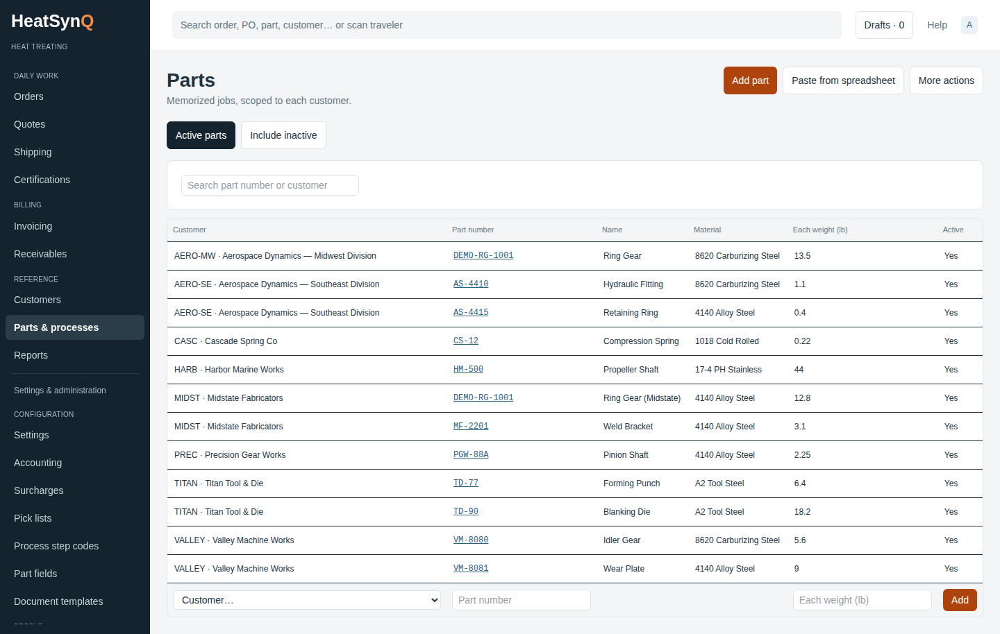
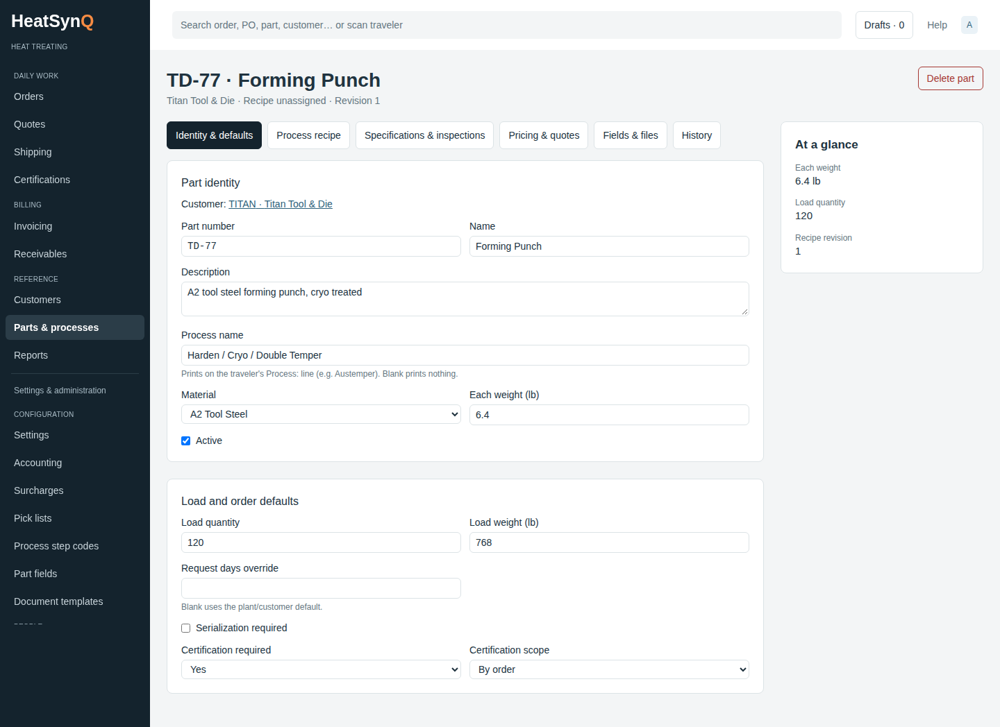
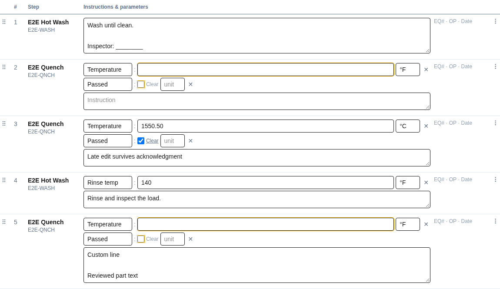
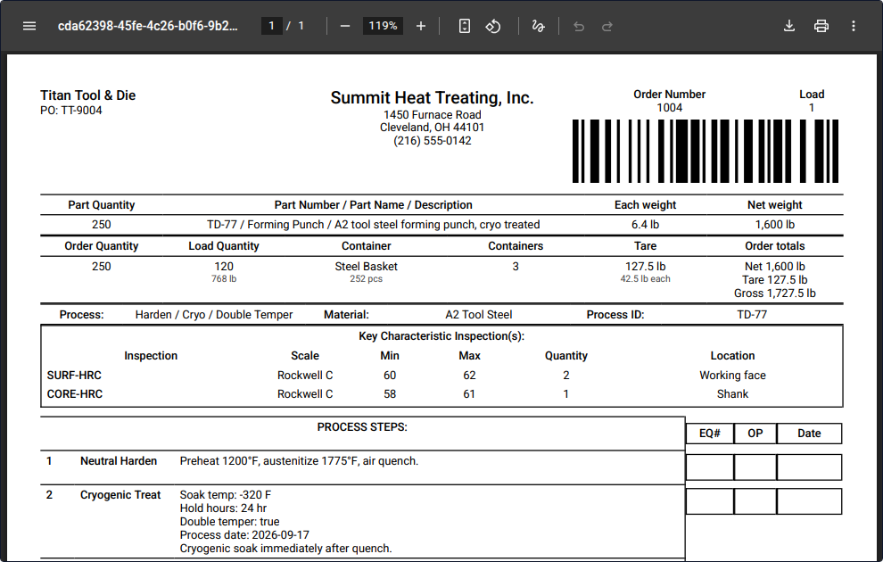

# 10. Parts and processes

[← Back to contents](README.md)

A part in this system is a **memorized job**: the customer's part number, what it is made of, the
recipe that runs it, what it costs, and what has to be inspected. Memorize it once and every order
for that part comes in ready.

## Part numbers belong to the customer

This is the single most important idea in this chapter, and it is different from how most
inventory systems work.

> **A part number belongs to a customer, not to the shop.** `DEMO-RG-1001` can exist for two different
> customers and mean two different parts, with different recipes and different prices. Neither one
> is "the" DEMO-RG-1001.

Everything follows from that:

- A part number only has to be unique **within one customer**. Key it twice for the same customer
  and you get *"A part with that part number already exists for that customer"*.
- **A part cannot be moved to another customer.** The app says so: *"A part cannot move to another
  customer — deactivate it and key a new part instead."*
- **An order cannot borrow another customer's part**, however identical the work. Try it and you
  get *"Line 3 (ACME · 12345-A): that part belongs to another customer"*. Order entry normally
  prevents this by only offering the selected customer's parts.
- Deleting a part frees its number for re-use by that customer, and re-using it **starts a fresh
  part** rather than restoring the old one.

## The parts list

**Parts** lists **Customer**, **Part number**, **Name**, **Material**, **Each weight (lb)** and
**Active**.

**It is one list for the whole shop, not one per customer** — there is no customer filter. The
search box is how you narrow it, and it matches a part number *or* a customer code *or* a customer
name, so typing a customer's code is the practical way to see their catalogue.

**Active parts** and **Include inactive**, above the search box, choose whether retired parts are
listed. **Add part** takes the cursor to the row at the foot of the table, **Paste from
spreadsheet** loads parts in bulk, and **Export to Excel**, under **More actions**, exports what you
see. Prices are deliberately not pasteable — they are keyed on the part.

## The part record

The title is the part number and name; under it sit the customer and, if you can view processes,
the recipe number and the current revision. **Delete part** is at the right of the title. Six tabs hold the record, and moving between
them loses nothing:

| Tab | What is on it |
|---|---|
| **Identity & defaults** | **Part identity** and **Load and order defaults** |
| **Process recipe** | **Process steps**: the recipe, its number, its revisions and the preview |
| **Specifications & inspections** | **Specifications** and **Inspection requirements** |
| **Pricing & quotes** | **Operation prices** and **Active quotes** |
| **Fields & files** | **Custom fields** and **Attachments** |
| **History** | Every saved change, with who made it |

A tab holding unsaved work shows the **Unsaved changes** badge. Coming from another page,
**Return to editor** under **Drafts** opens the tab the draft belongs to. The **At a glance** card
beside the tabs shows **Each weight**, **Load quantity** and, if you can view processes, the
**Recipe revision**, which is the current revision whichever one you are reading.

**Choose file…** at the top right of the Attachments section picks a file and uploads it at once;
the name of the file you picked shows beside the button. Attachment filenames wrap so the complete
name stays readable alongside the size, date and **Delete** control. Click a filename to open or
download the file.

As on the customer screen, most fields **save when you leave them or press Enter**, and a green
**Saved** shows beside a box while it holds what was saved. **Save recipe**,
**Save process steps** and **Save custom fields** are explicit saves.

### Identity & defaults

**Part identity** shows the customer, which cannot be changed, then **Part number**, **Name**,
**Description**, **Process name**, **Material**, **Each weight (lb)** and **Active**. **Load and
order defaults** holds **Load quantity**, **Load weight (lb)**, **Request days override**,
**Serialization required**, **Certification required** and **Certification scope**.

Two of these do more than they look like:

**Load quantity** and **Load weight (lb)** are what split an order into furnace loads (chapter 2). Get
them right and order entry does the splitting for you.

**Process name** is print-only: *"Prints on the traveler's Process: line (e.g. Austemper). Blank
prints nothing."* It is a label for the floor, not the recipe.

The two certification controls work like the customer's, one level down — their inherit option reads
**"Inherit — currently Yes"**, because a part inherits from its *customer* first and the plant only
behind that.

## The recipe — process steps

**Process steps**, on the **Process recipe** tab, is the recipe: the operations this part goes through, in order, with the
instructions and the settings the floor needs. The section is laid out like the PROCESS STEPS block
of the traveler it prints on. It is the only place a part's steps are built — one step code at a
time, with no templates to load from and, deliberately, no way to copy another part's steps.

### The table

Each row is one step: a drag handle, the step number, the **Step** (the code's standard name, with
the code beneath it), **Instructions & parameters**, a greyed *EQ# · OP · Date* reminder of the
sign-off boxes the traveler prints, and a **⋮** menu. The reminder hides on a narrow window, and
the page never scrolls sideways.

**Adding a step.** Type a code or a name into **Add a step**, under the table. Codes whose code
starts with what you typed come first, then codes whose name starts with it, then names with a
word that starts with it, then anything else that contains it; inactive codes are not offered.
**↓** and **↑** move through the list and **Enter** adds the highlighted code, or click one. Each
entry says what the step will bring — *"Suggests: Soak temp (F), Hold hours (hr), …"* or *"No
suggested parameters"*. The new step copies the code's **Standard instructions** and its suggested
parameters once, with empty values, and the cursor lands in its first empty value, or in its
instruction when it has none. You can customize or clear the copy for this part; later changes to
the code do not alter the part. Printed step names always come from the code's standard name.
Reusing a code creates another real step rather than merging the two.

**Inserting.** Point at a row and click **+ Insert** on its top edge, or open **⋮** and choose
**Insert step above** or **Insert step below**. The same search opens and says where the step will
go (*"Inserting before step 3"*). **Esc** cancels and puts you back where you were.

**Reordering.** Drag a row by its handle, press **Alt + ↑** or **Alt + ↓** on the handle, or use
**⋮ → Move up** or **Move down**. Numbering updates at once, and the moved step keeps the focus.

### Parameters

A parameter is one line of settings on a step, and it reads the way it prints: a name, a colon,
the value and an optional unit — *Soak temp: -320 F*. A parameter copied from the code keeps that
code's type, so its value is a number box, a date picker or a tick box (with **Clear** to empty
it). **+ Parameter** on a row's bottom edge, or **⋮ → Add parameter**, adds a text parameter and
puts the cursor in its name. **✕** removes one. A step needs no parameters at all: a wash step is
usually just its instruction.

An empty value is outlined in amber so it stands out. That is not an error: an empty value prints
as a blank for the operator to write in, *Soak temp: ________ F*. Every parameter needs a name,
though — an unnamed one stops the save and the preview until you name or remove it.

### Removing a step, and Undo

**⋮ → Remove step** takes the step out at once and shows *"Step 3 removed."* with **Undo** for 15
seconds. The step is only gone for good once you save.

### Instructions and saving

Instructions are plain text in a box that grows as you type. Line breaks, blank lines and literal
blanks such as `Time in: ________` print exactly as typed.

Order, instructions, parameters and removals all stay on your screen until **Save process steps**
saves the whole sequence together. Beside it the section reads *Unsaved process changes*,
*Saving…*, *Process saved*, *Save failed — draft retained* or *Saved state needs refresh*. A failed
or uncertain save keeps your draft so you can reconcile and retry, and if someone else saved the
steps in the meantime your save is refused rather than overwriting theirs. **Discard process
changes** puts every step and the recipe number back to what was last saved.

Without permission to edit processes, every control is greyed out with the reason as its tooltip.
The **+ Insert** and **+ Parameter** chips still appear when you point at a row, greyed the same
way. **Preview traveler** stays available (below).

### Recipe number

Enter the part's optional **Recipe number** in Process steps, then press **Save recipe**.
It is text: leading zeros such as **001207** stay intact. Use 1–20 letters, digits or hyphens;
spaces at either end are trimmed. Leaving it blank means the part has no numbered recipe.

A recipe number belongs to one part across the whole installation, including parts belonging
to different customers. Letter case does not make a second number: **HT-01** and **ht-01**
conflict. A refused save leaves your attempted number in the box so you can correct it.
Editing requires permission to edit processes.

Before an order uses the number, you can correct it or clear it and save; this releases the
old number. Once an order uses it, the number becomes read-only and stays attached to that
part, including after deletion. Later settings use new revisions of the same numbered recipe.
A part number and a recipe number therefore have different reuse rules.

The number saves separately from the steps. Pending step edits survive a number save, including
when that save creates a new revision. Recipe-number and step drafts can be restored together;
an older saved draft without a recipe-number edit leaves the saved number alone. If another
edit or an uncertain save leaves the draft out of date, reconcile it with the saved revision
before retrying. A refusal does not discard your typed work.

### Revisions — what happens when you edit a recipe

Recipes change, and paper is already on the floor. The app handles that with revisions, and it does
it quietly enough that it is worth knowing the rule.

At the top of the section is a revision picker, whose entries read like **Rev 2 · on 3 orders**,
and a badge reading either **Rev 2 · working** or **Rev 2 · locked**.

| State | What it means |
|---|---|
| **working** | Nobody has run this recipe yet. Edits change it in place |
| **locked** | An order has been placed against it. It is now a historical record |

**A revision locks when an order is saved against the part** — specifically the order's lead part.
From that moment the recipe describes work that is really happening, so it stops being editable in
place, and it stays locked.

**On N orders** counts the orders whose lead part saved that revision, each once, leaving out
voided orders. So a locked revision can read **on 0 orders** once its orders are voided.

You are not blocked from editing a locked revision. Instead an amber note appears beside the badge,
*"Saving creates Rev 3."*, followed, when orders use the revision, by *"The 4 orders on Rev 2 keep
it."* (or *"The 1 order on Rev 2 keeps it."*). The next change you save **cuts that new revision**,
copying every step, instruction and parameter across, and moves you onto it. The locked revision
stays exactly as it was, so the traveler that printed still matches a recipe you can look up.

Pick an older revision in the picker to read it. It opens read-only and says *"Rev 1 is superseded
and read-only."*; every control on it carries *"Superseded revision — read-only"*, and **Current
revision** returns you to the one you can edit.

For a numbered recipe, the first order using a revision captures its steps, instructions and
parameters — names, types, units and values — together. Orders on that revision, and the revision
itself once you pick it as an older one, show those captured settings; no later change to a step
code touches them. Blank parameters stay blank. A parameter's type and unit are part of its
identity for equipment integration: change a parameter's unit on a later revision and it is
recorded as a new parameter, so a captured one never changes meaning. Existing values are never
converted automatically.

Older locked revisions without a captured numbered recipe remain readable. The system does not
reconstruct historical units or make those revisions available for equipment integration by
guessing their original settings.

> **A part with no process steps cannot be the lead part on an order.** The lead-part picker greys
> it out with *"No process steps"*. If a new part will not go on an order, this is almost always why.

### Previewing the traveler

**Preview traveler**, at the top of the section, opens a window showing the real traveler PDF for
the steps on your screen, saved or not. It goes through the same layout, and the same customer
traveler template, used for printing, and marks every page
**DRAFT PROCESS PREVIEW - NOT FOR PRODUCTION**.

It opens on the newest order that has this part as its lead part, with that order's
lowest-numbered load. **Order and load** chooses another; **Find existing order** narrows the list
to one order number, and **More orders** pages through a long list. Above the PDF it says how many
pages the traveler takes — *"1 page · Fits on one page"* or *"2 pages · Continues on additional
pages"*. Longer instructions continue onto readable additional pages; they are not clipped to force
a one-page result. The preview follows your edits a moment after you stop typing, **Refresh preview**
picks up changes saved elsewhere, and **Close** returns you to the table.

**The SAMPLE header.** When no order can supply the header, the preview prints a SAMPLE header
built from the part itself, and says why. That happens when you cannot view orders (*"A real order
needs orders.view access…"*), or when no order for this part has a load yet (*"No order for this
part has a load yet…"*): only an order that has this part as its lead part and at least one load
can supply the header, and a voided order never counts. The customer name, the company, the part
line, material, process name, Process ID and inspections are real; quantities and containers are
blank, and the PO line prints its label and a blank; the order number and load read SAMPLE, and the
barcode slot says SAMPLE instead of carrying a scannable code. On a SAMPLE header the received-from
address and phone print only if you can view customers. A preview around a real order prints what
that order's traveler prints, address, phone and PO included.

Preview needs permission to view parts and processes, and works on the current revision only. It is
read-only: it does not save the process, allocate a number, mark anything printed or add a document
to the order.

This is a **part draft preview**, not an old-order reprint. It combines the process currently in
your editor with the selected order/load only to check the proposed paper. To reproduce paper that
was actually issued, open the order and use its stored Traveler document. Later edits to the part
do not rewrite that order's captured recipe or its archived PDF.

A numbered revision captured before parameters became part-owned (September 2026) recorded every
field its step codes then had, filled or not; the upgrade kept only the filled ones as the part's
parameters. While such a revision is current, the table and an unedited preview show those
parameters rather than the captured recipe. Orders on that revision keep printing the captured
recipe.

## Pricing

**Operation prices**, on the **Pricing & quotes** tab, are per **operation**, not one price for the
part: each priced step code is its own card, because that is how heat treating is actually sold.

Each operation carries four figures:

| Field | What it means |
|---|---|
| **Setup charge** | A fixed charge for the run |
| **Unit price** | The rate for the work |
| **Minimum charge** | A floor on the work |
| **Price per** | What the unit price is measured in |

**Price per** offers **Each**, **Per lb**, **Per 100**, **Per 1,000** and **Lot (flat)**.

**Remove operation price** asks first: *"This removes the part's operation price and its price
breaks. The process step stays."*

**The setup charge sits on top of the minimum, never inside it.** The work is priced, the minimum is
applied if the work comes to less, and then setup is added. A $50 minimum with a $25 setup on a
small job bills $75.

### Price breaks

Below each operation sit its **Price breaks** — a **Threshold** and a **Price**, as many tiers as
the account needs, each added with **Add price break**.

**The tier that wins is the highest threshold that does not exceed the quantity.** With breaks at
100, 500 and 1,000, an order of 750 pays the 500 price. Below every threshold, the operation's own
**Unit price** applies.

**What the threshold is measured in follows the unit** — pounds on a **Per lb** operation, pieces on
everything else. Note that includes **Per 100** and **Per 1,000**: a threshold of 500 on a Per 100
row means 500 *pieces*, not 500 hundreds.

> **A LOT price cannot have breaks.** A lot price is one flat figure for the job, so tiers are
> meaningless against it. The app refuses both directions with the same words: *"A LOT-priced
> operation cannot carry price breaks."* You cannot add a break to a LOT operation, and you cannot
> switch an operation to LOT while it still has breaks — delete the breaks first.

> **Changing the unit does not convert the numbers.** Switch an operation from Each to Per 100 and
> the app warns you plainly: the unit price and every break's threshold and price *"are all read
> today as Each amounts… Switching to Per 100 does not change any of those stored numbers — every
> one of them will be read as a Per 100 amount from now on."* You must re-key them yourself. This is
> the easiest way in the whole system to bill a customer a hundredth of what you meant to.

**There is no effective dating on part prices.** A price is the price; change it and the new figure
applies to work invoiced from then on. What *does* displace a part price is a live quote for that
part — that is what the **Active quotes** section is showing you.

An operation with neither a unit price nor a minimum is not silently dropped: it comes through onto
the invoice as a line needing a price, where somebody has to deal with it.

## Specifications and inspections

These are two different things and only one of them prints.

**Specifications** are a simple list of the customer or industry specs the part is made to — picked
from the reference list, shown as chips, removed with an ×. They record what the part is built to.
**They do not print on any document**; do not memorize a spec here expecting it to appear on the
certificate.

**Inspection requirements** are the key characteristics that get measured: **Code**, **Scale**, **Min**,
**Max**, **Sample qty** and **Location**, each row added with **Add inspection requirement**. **Min** and **Max** take up to six digits and four decimal
places and cannot be below zero (zero is fine); a value below zero is refused. On a saved row the box goes back to what it held; in the Add row what you typed stays so you can correct it.
On a narrow window the table scrolls sideways inside its
own section, so the page itself never does.

These do print, in two places. They go onto the **traveler** under *"Key Characteristic
Inspection(s):"*, so the floor knows what to check. And they seed the **certification** requirements
for the part, so the results the customer is certified on are the ones you said mattered.

**Sample qty is free text on purpose.** Real inspection plans say "8" on one row and "100%" on the
next, and a numeric field would reject half of them. Type what the plan says.

## Custom fields

If the shop needs to record something the app has no box for — a customer's drawing revision, a
nadcap flag, a re-qualification date — an administrator defines it once under **Part custom fields**
(chapter 12) and it appears on every part.

Fields can be **TEXT**, **NUMBER**, **DATE** or **CHECKBOX**. Unlike the rest of the screen this
section is a batch save: fill in what you need and press **Save custom fields**.

A tick box you have touched counts as filled in, even when unticked. That is what the small **clear**
link beside it is for — it returns the field to genuinely unset, which is what an administrator needs
before the field's type can be changed or the field retired.

## Deleting a part

**Delete part** asks for a reason and spells out the consequence:

> *"Its specifications, inspections, and prices are deleted with it. The part number can be reused
> later for this customer, which starts a fresh part rather than restoring this one."*

A part on a live order or a live quote will not delete, and the app says which. Deactivating is
usually the better move: an inactive part stops being offered at order entry but keeps its history
and its prices intact. Deleting a part does not release its recipe number; correct or remove an
unused recipe number before deletion if it needs to be reused.

---

Next: [11. Reports →](11-reports.md) · Previous: [9. Customers](09-customers.md)
