# 12. Administration

[← Back to contents](README.md)

The screens in this chapter live in the three groups under **Settings & administration** at the
bottom of the left rail — **Configuration** (Settings, Accounting, Surcharges, Pick lists, Process
step codes, Part fields, Document templates), **People** (Users, Roles) and **System** (Audit log,
Backups, Practice data, Setup checklist). If you cannot see any of those headings, you do not
administer this system
and nothing here will be visible to you — which is the intended state for most people in the shop.

## Who can do what

This is the part worth reading slowly, because it explains the single most common question in the
whole application: *"why can't I click that?"*

### Areas and actions

The system is divided into **twelve areas**, and each area has **four actions**:

| The twelve areas | |
|---|---|
| Orders · Parts · Processes · Customers | Quotes · Certs · Shipping · Invoicing |
| Reports · Templates · Admin · Receivables | |

The four actions are **View**, **Create**, **Edit** and **Delete**. So "orders.edit" means the
right to change an order, and "customers.view" means the right to look at customers at all.

### The named actions

Twelve areas times four actions does not cover everything, because some acts are dangerous in a way
that has nothing to do with which screen they live on. Voiding a shipper is not "shipping.edit" —
it is its own decision. So alongside the areas there are **thirteen named actions**, each granted
separately:

| | | |
|---|---|---|
| void shipper | unlock invoice | void order |
| change prices | edit cert results after print | apply payments |
| run qbo export | close ar period | edit templates |
| manage users | override credit hold | write off |
| manage backups | | |

These are the ones to be careful with when setting somebody up. A clerk who needs to key payments
needs *apply payments*; that does not mean they should also hold *write off*, which lets them
declare a debt uncollectable.

**Backups is deliberately one of these** rather than part of the Admin area, and the reason is worth
repeating: a backup is a complete copy of every customer's record. That is a different kind of
privilege from editing a carrier list.

### Roles, and overrides on top of them

Most people get their permissions from a **role** — a named bundle you set up once and assign to
staff. On top of the role, an individual can carry an **override**, either granting something their
role lacks or taking away something their role has.

The system decides in this order, and stops at the first answer:

1. **Is there a DENY override on this person?** → refused, whatever their role says.
2. **Is there a GRANT override on this person?** → allowed.
3. **Does their role grant it?** → allowed.
4. Otherwise → refused.

In plain terms: **an override on one person beats their role, in either direction, and a deny beats
a grant.** If somebody has a permission their colleagues on the same role do not, or lacks one they
should have, look for an override on their user record before you go changing the role — changing
the role will not help, and it will affect everyone else who holds it.

The default is always *no*. A permission that has never been granted anywhere is refused.

### What this looks like day to day

**Your menu is only as long as your permissions.** Nav entries appear only for areas you can view,
so two people can sit side by side with different-length menus. That is correct behaviour, not a
fault, and it is worth telling new staff on day one so they do not report it as a bug.

Two entries follow their own rule, which occasionally surprises people:

- **Document templates** appears for anyone who can view the Templates area, even without general
  Admin rights. So a person may see a Configuration heading containing nothing but Document
  templates.
- **Backups** appears for anyone holding *manage backups*, again regardless of Admin rights — a
  System heading containing nothing but Backups.

Both are deliberate: a permission you hold but cannot find a link to is worse than no permission at
all.

**Inside a screen, controls are disabled rather than hidden**, and the tooltip names the exact
permission you are missing — "Requires admin.edit", "Requires manage_users", "Requires
change_prices". Hover before you ask.

## Users

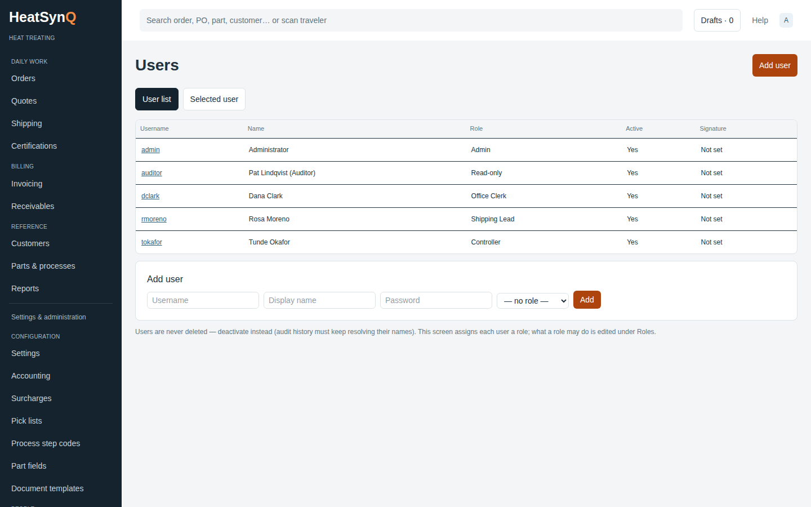

The page has two tabs. **User list** is a read-only table: **Username**, **Name**, **Role**,
**Active** and **Signature** (*Present* or *Not set*). **Add user** in the header takes you to the
form under the table: username, display name, password and a role. Click a row to open **Selected
user**, where everything about that person is edited.

**Display name** and **Title** save when you leave the box or press **Enter**, and a green **Saved**
shows beside them. A blank Display name is refused. **Role** saves when you pick one, and **Active**
when you tick it. The Username cannot be changed.

**Set password** opens a dialog: type the new password (minimum eight characters) and press **Set
password**. The box hides what you type. A refused password is explained in the dialog, which stays
open and clears the box so you can try again; it closes once the new password is saved. There is no
self-service reset anywhere in the system, so this is how a locked-out colleague gets back in.

**Signature** holds a PNG or JPEG of the person's signature, used on printed documents. **Choose
file…** picks the image; the name of the file you picked appears beside the button while it
uploads. **Clear** asks first, then removes it, and only appears for someone who actually has a
signature — *No signature* means there is nothing to clear, so it offers no button.

> **Users are never deleted — deactivate them instead.** Untick **Active**. The account can no
> longer sign in, but every audit entry they ever created still resolves to their name. Deleting the
> row outright would leave years of history pointing at nobody, so the app does not offer it.

A refused change shows at the top of the **Selected user** card, and a refused **Add** shows under
the Add user form, which keeps what you typed. Removing the last person who can manage users is
refused: *"At least one active user must retain the ability to manage users."* A line at the top of the page means the list itself
could not be read.

Everything on this screen is gated on the *manage users* action.

## Roles

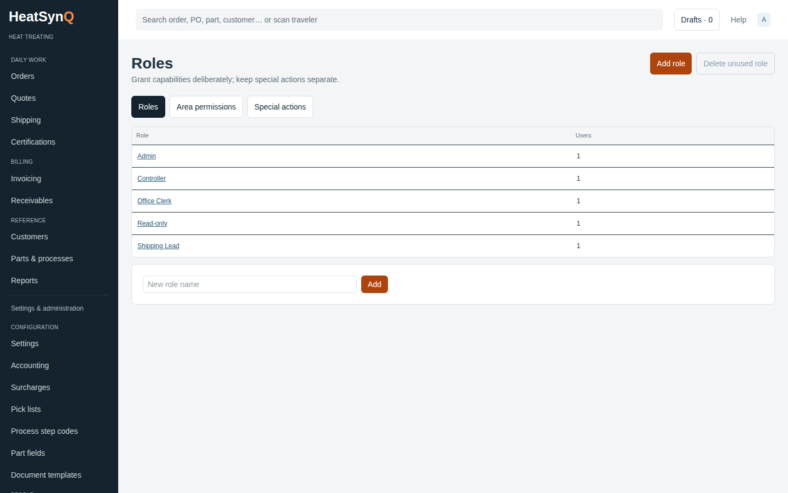

The page has three tabs. **Roles** lists the roles with the number of people holding each; **Add
role** in the header takes you to the box under the table. Click a row to pick the role and open
**Area permissions**: a row per area, a tick per action. **Special actions** is a table of the named
actions, each with its own **Granted** tick. Every tick saves on its own.

Anyone who can open Administration can read this screen. Adding a role, changing a tick and deleting
a role need the *manage users* action, the same as the Users screen, because a role decides what its
people can do.

Build roles around jobs rather than seniority. The demonstration data does this deliberately —
Office Clerk holds no special actions at all, Shipping Lead holds the shop-floor ones and nothing
financial, Controller holds the money actions, Read-only holds view rights only.

**Delete unused role**, in the header, works on the role you have picked, and **asks you why**,
storing the answer in the audit trail. It is the one place in Administration that demands a reason,
because a role deletion silently changes what a group of people can do. A blank reason keeps the
dialog open, and nothing is sent. A role that people still hold is refused.

A refused tick shows under the role's name in its tab, a refused delete above the tabs, and a refused
**Add** under the new role's name box. Taking *manage users* from the last role that gives it to an
active person is refused in the same sentence as on Users. A line at the top of the page
means the list itself could not be read.

## Pick lists

The shop's pick-lists — the values that appear in dropdowns everywhere else. Eleven kinds, chosen
from the list on the left:

| | | |
|---|---|---|
| Container types | Materials | GL accounts |
| Inspection scales | Inspection codes | Carriers |
| Terms | Payment types | Comment snippets |
| Specifications | Ending statements | |

The screen opens on Container types; a link from the setup checklist or the Close screen opens the
list it names. **Add row** takes you to the row at the foot of the table, **Paste from spreadsheet**
loads rows in bulk, and **Export to Excel**, under **More actions**, exports the list you are looking at.

Each has a table with **Active** and an add row. Some carry extra columns — Terms has **Net days**,
**Discount %** and **Discount days** (the early-pay terms in chapter 7); GL accounts have a
**Description**; Ending statements have **Text** and **Default**; Container types have **Tare each
(lb)**.

**An existing row can be changed in place.** Its name, and its text and number columns, are boxes:
type in one, then leave the box or press **Enter**, and it is saved, with a green **Saved** beside it.
A **Text** box takes **Enter** as a new line, so it saves when you leave it. If a value is refused, the
box goes back to the stored value and the reason shows under that row. An emptied name box goes back
to the name. Renaming a row changes what screens and new paper show from then on; paper already
printed does not change. The two columns that link to another list, an inspection code's **Default
scale** and a payment type's **GL account**, are set when the row is added.

**Discount %** and **Discount days** on Terms go together, so they save together. Leave one box
filled while the other is empty and nothing is saved yet: the box says what it needs, and leaving
the page asks first. Fill the other and both are saved at once. Empty both and the discount is
removed. An invoice already finalized keeps the terms it was issued on.

**Tare each (lb)** on a container type is the weight of one empty container of that type. A
container row on an order starts from it when the type is picked (chapter 2), and the figure can
be typed over there. An empty box clears the figure. Changing a type's figure does not change an
order that is already saved.

A refused change on any row of a pick list (one of its boxes, its **Active** box, a flag such as
**Default**, or its **delete**) shows under that row, and a refused **Add** shows under the
Add row, where what you typed stays. A line across the top of the table means the list itself
could not be read.

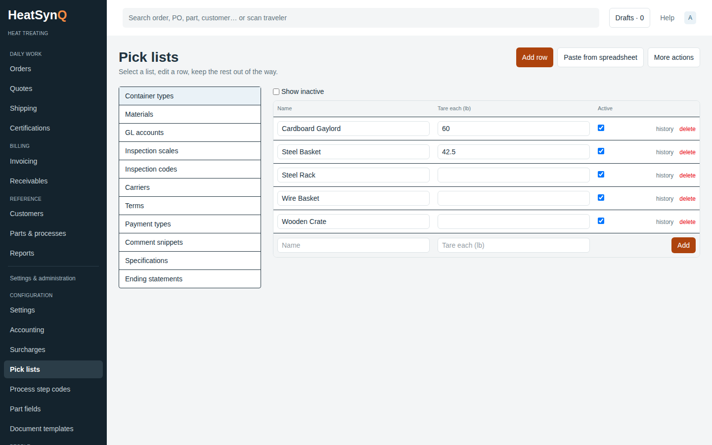

**Show inactive** reveals retired entries. **Paste from spreadsheet** opens a bulk-entry box for
loading many rows at once — useful when first setting up.

> **A refused delete tells you what is in the way.** If a value is in use, the delete is refused and
> an amber panel lists the records using it, with **Export list to Excel** so you can work through
> them. This applies on reference data, part fields, step codes and surcharges alike. If you cannot
> clear the blockers, untick **Active** instead: the value stops being offered on new work while all
> the history that references it stays intact.

A **material** is in use as soon as a free-text line on any quote holds it (chapter 3) — an open
quote or a closed one. Deleting it is refused, and the amber panel lists those quotes by number so
you can open them. Untick **Active** instead: the material is no longer offered on other lines, and
the lines that hold it keep it.

Every row has a **history** link showing who changed it and what the value was before.

## Process step codes

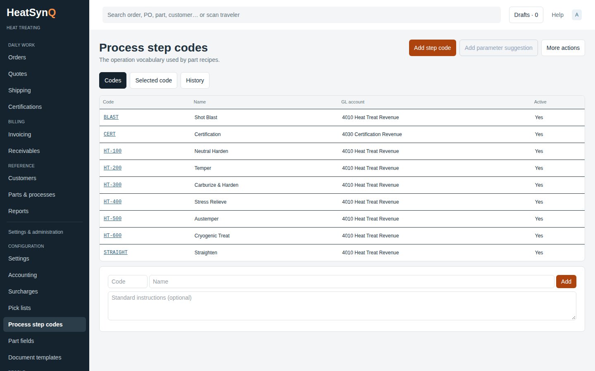

The operations a part can go through — the vocabulary the recipes in chapter 10 are written in.
The page has three tabs. **Codes** lists every code with its **Name**, **GL account** and whether it
is **Active**; click a row to open it on **Selected code**, and its changes are on **History**.
**Add step code** takes you to the row under the table, and **Parts**, under **More actions**, goes
to the parts list.

Each code has a code, a name, an **Active** flag and a **GL account** (revenue for that operation
lands there; a code without one is badged **needs GL** and cannot be billed properly). Its
**Standard instructions** are copied into each new step of that code; existing steps stay
unchanged. The instructions save when you leave the box.

Below that are its **Suggested parameters** — the settings a step of this kind usually needs. Each
has a **Name**, a **Type** (NUMBER, TEXT, DATE or CHECKBOX) and an optional **Unit**;
**Add parameter suggestion** adds one, and the arrows reorder them. The button of that name at the
top of the page opens the row, once a code is picked. When someone adds a step of this code to
a part, its suggestions are **copied onto the new step once**, in this order and with empty values.
From then on the part owns its copy: renaming, reordering or removing a suggestion here never
changes a part's steps, an unsaved draft or a recorded recipe. A code with no suggestions is right
for something like a hot wash, whose step is just its instruction.

> **A suggestion's type and unit cannot be changed.** A part's copied parameter keeps the
> suggestion's identity, and that identity always means one type and one unit, which is what
> equipment integration relies on. To change either, remove the suggestion and add a new one;
> removing one never touches a part. Its name can be edited freely: it saves when you leave the box
> or press **Enter**, and a green **Saved** shows beside it.

> **A code used on a locked recipe revision can never be deleted.** That revision is frozen by
> design, so its step can never be released, even after the part has moved on to a newer revision.
> Set the code Inactive instead: it stops being offered for new steps and its history stays intact.

## Part fields

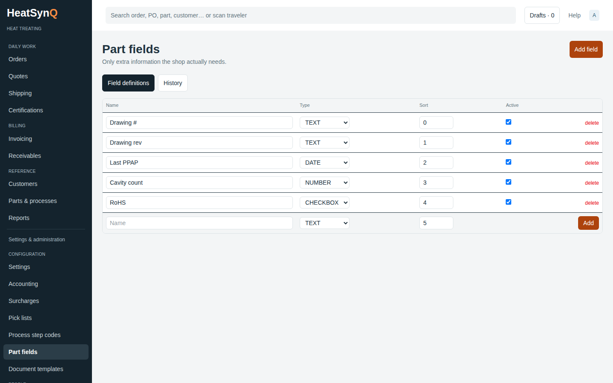

Extra fields you want to record on every part that the built-in ones do not cover. **Field
definitions** lists them, and **Add field** takes you to the row at the foot of the table; **History**
shows what changed on the field you pick. Each has a
**Name**, a **Type** (TEXT, NUMBER, DATE, CHECKBOX), a **Sort** position and **Active**. They then
appear on every part record (chapter 10). A Name or Sort saves when you leave the box or press
**Enter**, and a green **Saved** shows beside it.

The same rule applies: once values have been recorded, the field's type cannot change and it cannot
be deleted — the panel tells you how many parts are using it.

## Settings

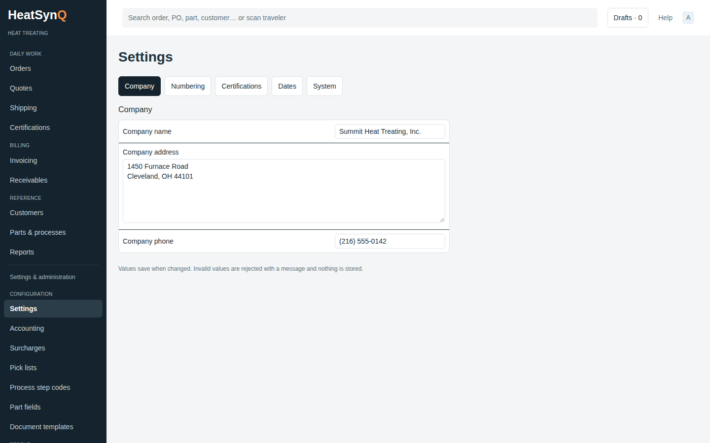

Plant-wide values, in five tabs. **Values save as soon as you change them**: a list or a tick box
when you pick, a box when you leave it or press **Enter** (in the address box, Enter starts a new
line). An invalid value is rejected with a message and nothing is stored. A green **Saved** shows
beside a value's name while it holds what was saved.

| Tab | What is in it |
|---|---|
| **Company** | Company name, address and phone — the identity printed on every document |
| **Numbering** | The next number for orders, packing lists, credits, quotes, bills of lading, receipt batches and GL export batches, plus an invoice number prefix |
| **Certifications** | Whether certification is required by default, and the default scope (**By order**, **By load** or **By shipment**) |
| **Dates** | Default request days, quote validity, and the two traffic-light windows — **May-miss** and **Will-miss** — that colour the dots on the orders board |
| **System** | Session timeout in minutes, and **Backup stale after (hours)** |

> **Set the numbering before you go live, and then leave it alone.** These are the starting points
> for the counters that issue document numbers. Moving one backwards after the shop is running
> invites a collision with paper a customer already holds.

An invoice is identified by its order number and a certificate carries no number of its own
(chapter 5), so neither has a counter here.

## Accounting

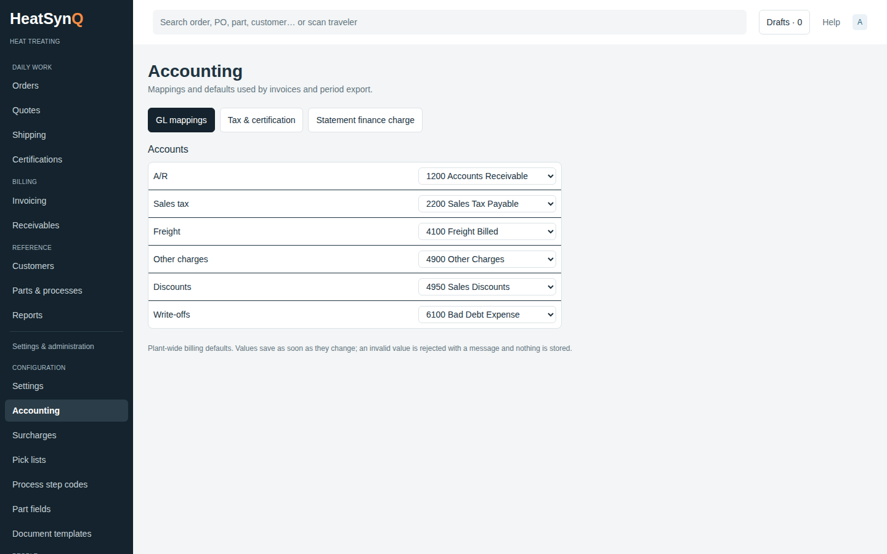

Where the money defaults live, and the GL accounts that invoice lines post to, in three tabs: **GL
mappings**, **Tax & certification** and **Statement finance charge**. A box saves when you
leave it or press **Enter**, a list as soon as you pick from it, and a green **Saved** shows beside
a field's name while it holds what was saved.

| Field | What it does |
|---|---|
| Plant sales tax rate (%) | The plant-wide rate, entered as a percent — 7 means 7%; a customer can be taxable or not (chapter 9) |
| Sales tax | The GL account tax posts to |
| Freight | The GL account freight lines post to |
| Other charges | The GL account extra charges post to |
| A/R | The receivables control account |
| Discounts | The GL account early-pay discounts post to |
| Write-offs | The GL account bad debt posts to |
| Certification charge step code | The operation a cert charge bills under |
| Certification charge ($) | The default cert charge |
| Monthly rate (%) | The monthly late charge rate, as a percent — 1.5 means 1.5% per month |
| Bill for certification | Whether new work charges for certification by default |

These accounts are what makes the month-end GL export balance (chapter 8). **An invoice line whose
account is missing will block the export**, so it is worth completing this screen properly before
the first month end rather than discovering it during one.

## Surcharges

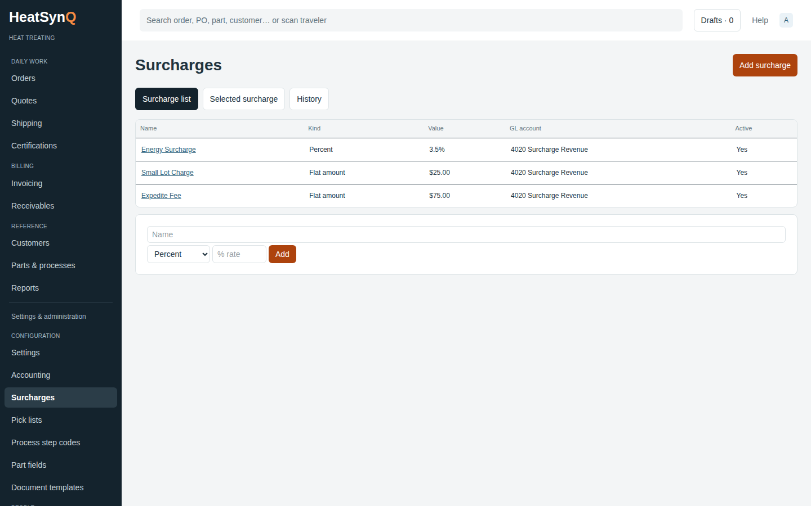

Standing extras added to invoices — an energy surcharge is the usual example.

**Surcharge list** is a table of **Name**, **Kind**, **Value**, **GL account** and **Active**, so it
answers "what does this one charge?" without opening it. A surcharge with no GL account is badged
**needs GL**. Click a row to open it on **Selected surcharge**, where its figures and accounting sit
above its **Operation scope**; **History** shows its changes. **Add surcharge** takes you to the row
under the table.

Each surcharge has a **Name**, a **Kind** and a value. The Kind decides which value field you get:

- **Percent** → a **Rate (%)** field, applied to the operation lines on the invoice that are in
  scope, including a price typed on the invoice.
- **Flat amount** → an **Amount ($)** field.

Then **Minimum amount ($)**, a **Position** controlling the order they print in, a **GL account**
(one without is badged **needs GL**), **Active**, and a **Scope**:

| Scope | Meaning |
|---|---|
| All operations | Applies to everything |
| Only these operations | Applies to the step codes you tick |
| All except these | Applies to everything but the step codes you tick |

The Name, value, Minimum amount and Position boxes save when you leave them or press **Enter**, and
a green **Saved** shows beside each; the lists and tick boxes save as soon as you change them.

A price typed on a **Needs price** line has no operation code until a step is picked for it
(chapter 6), so until then it counts under All operations and All except these, never under Only
these operations. A change to a surcharge's **Scope**, or to a
percent surcharge's **Minimum amount**, reaches an open draft invoice the next time its lines are
saved; any other change, or switching it off, waits until the draft is recalculated.

**Per-customer exceptions are not set here** — they live on the customer record (chapter 9), where a
customer can be given a reduced rate, a flat amount, or opted out entirely. The only place they
appear on this screen is when a delete is refused because customers hold overrides against it; the
panel then offers **Clear override** per customer so you can unpick them.

## Setup checklist

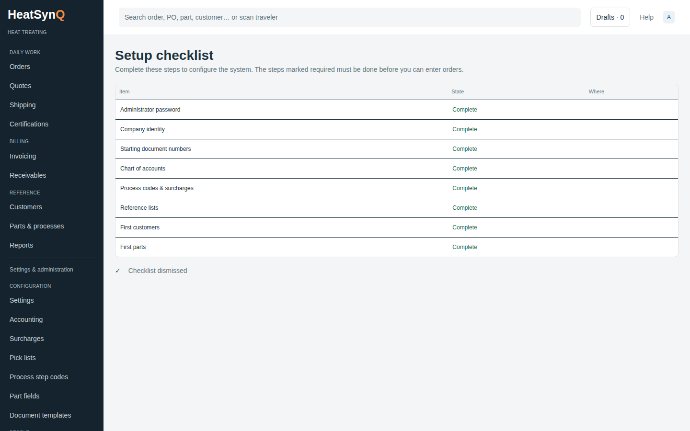

The first-run checklist. A table of the eight things a new installation needs configured: **Item**,
**State** and **Where**. State reads *Complete*, *Required*, *Not done*, or *Needs confirmation* on
Starting document numbers, and Where holds the **Set up** link to the screen that does the work.

Most of the list is checked by simply doing the work elsewhere in this chapter — the administrator
password, company identity, the chart of accounts, process codes and surcharges, the reference lists,
and your first customers and parts. Two of them gate order entry: **you cannot enter an order until
company identity and a chart of accounts are configured**, and until then the New Order screen says
so and links here instead of showing the form. Those two read *Required* until they are done.

**Starting document numbers** is the one step with no other home. You set the numbers themselves on
the Settings page's Numbering tab — where each series begins, so that the first order, invoice and
shipper carry on from whatever the shop used before rather than starting at 1 — but the **Mark
confirmed** button that completes the step is on this screen and nowhere else.

While anything is outstanding, a banner sits across the top of every screen offering **Finish
setup**. **Dismiss** puts that banner away permanently — and that is why this page has its own entry
in the rail. Without one, dismissing the banner would leave the checklist, and the Mark confirmed
button above with it, reachable only by typing the address. **Dismiss checklist** sits under the table. Once it has been
dismissed the button is gone and the page simply says **Checklist dismissed** — it is a fact about this installation from then
on, not something to click again.

## The audit log

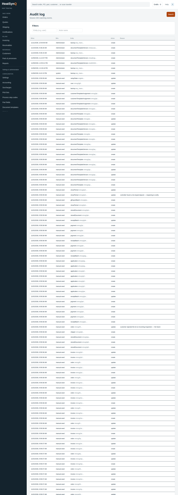

Every create, edit and delete in the system, by everybody, forever.

Filter by entity (for example `user`) and by actor name, then press **Search** in the header. Columns
are **When**, **Who**, **Entity**, **Action** and **Reason** — the reason being the one typed at the
time for the acts that demand one. The Entity cell shows the first eight characters of the record's
id, and the whole id when you hover over them.

> **This screen is the index, not the detail.** It tells you that a thing changed, who changed it
> and when. To see **what** changed — the before-and-after values, field by field — open the record
> itself and read its **History** panel. That is where a change reads as
> `status: ~~OPEN~~ → SHIPPED`, one line per altered field. Most detail screens in this manual have
> one, and the reference-data, step-code and surcharge screens carry a History panel per row.

Two practical limits worth knowing:

- **The list is capped at the 200 most recent matching entries**, newest first, as the line under
  the title says. Narrow the filters rather than scrolling.
- **The actor filter matches loosely; the entity filter must be exact.** Typing part of a name
  works; misspelling the entity returns nothing.

Nothing here can be edited or removed. That is the point of it.

## Backups

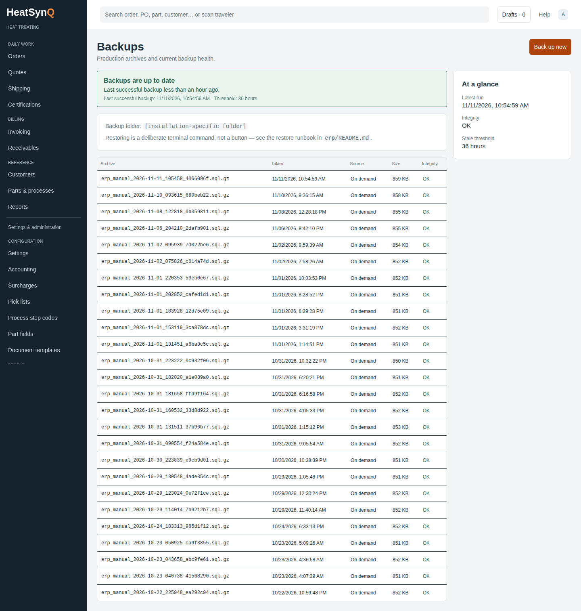

The figure substitutes `[installation-specific folder]` for the backup folder. Your live
Backups screen shows the actual folder configured for your installation.

Available to holders of *manage backups*.

The nightly backup runs every day at **23:10 America/Chicago**, following daylight saving time.
Restarting the server does not move it: when the backup service starts and the last 23:10 backup is
missing, it takes one at once, and otherwise it waits for 23:10. A failed run is retried every five
minutes. Archive names are in UTC, so the 23:10 run carries the next day's date. The archive in the
figure was named on a computer set to local time, so its name agrees with its **Taken** time.

The panel at the top is the health indicator. It is green — **"Backups are up to date"** — only when
**all three** of these hold:

1. There is a backup archive newer than the staleness threshold (36 hours by default), **and** it
   passed its integrity check.
2. The last recorded run did not fail.
3. The status file is readable.

Anything else is red, with the reason spelled out in a sentence beneath: the last run failed, the
newest archive is past the threshold, no archive has ever been written, or the retention cleanup is
failing and old archives are piling up.

> **A missing status reads as overdue, and that is deliberate.** If the app can find no status file
> at all it goes red and says so: *"No readable backup status file was found in the backup folder. A
> missing status reads as overdue — the nightly backup container may never have started."* The
> failure mode this exists to catch is the silent one — a backup process that never ran at all
> produces no error, and a system that treated silence as success would show green for months and
> then lose everything. **Absence is failure here.** If the indicator is red and you cannot see why,
> that is still a real problem to chase, not a display glitch.

The **At a glance** card reads **Latest run**, **Integrity** (the newest archive's, or *Not
confirmed* when the status cannot be read or there is no archive) and **Stale threshold**.

**Back up now**, in the header, takes one on the spot. Below the panel are the backup folder path and
a note that **restoring is a deliberate terminal command, not a button** — deliberately so, since restoring
overwrites the live database. After a restore, press **Back up now**: otherwise the restored
database is not archived until 23:10.

The table lists what is in the folder: **Archive**, **Taken**, **Source** (*Nightly* or *On
demand*), **Size** and **Integrity** (*OK* or *CORRUPT*). Nightly runs and on-demand ones never
collide.

**Archives are pruned after 30 days, on-demand ones included.** If you need to keep one longer — for
an audit, or before a big change — copy it out of the backup folder.

Anyone holding *manage backups* also sees a warning bar above every screen whenever backup health is
bad, so a failing backup follows you around the application until it is fixed.

Backups are **production-only**. On the practice copy the page refuses outright (chapter 14).

## Updates

Available to everyone for **What's new**, and to holders of *admin view* for the notice and the
**System** screen (under System in the rail).

**What's new.** After HeatSynQ has been updated, the first screen you open shows a box headed
**What's new** with the notes of every release since the last one you saw, newest first. It never
blocks the screen behind it. Click **Got it** when you have read it: that is what marks it as seen,
for you, on every computer, so it does not come back. Closing the browser without clicking leaves it
to show again.

**The update notice.** When an update that **changes the database** is waiting to install, holders
of *admin view* see a notice above every screen. It names the release and the time it installs (the
first 4:00 AM at least 12 hours after it was published), says what happens (a full backup is taken
first, then the update changes how some information is stored), what could go wrong (if the update
fails after the database has changed, HeatSynQ stays stopped until your administrator restores that
backup), and what to do (finish and save your work before you leave; if HeatSynQ is down in the
morning, or something looks wrong, stop entering data and tell your administrator). An update that
does not change the database installs without a notice.

**Hold and Release hold.** During a month-end close or a big shipping day, a holder of *admin edit*
can click **Hold** on the notice, or on the System screen. The notice then reads "Held by <name>
since <time>" and the update waits, together with any newer one, until an administrator clicks
**Release hold**. Without *admin edit* the button is shown greyed, with "Requires admin.edit".

**The System screen** shows the version that is running, the update waiting (with its notes, when
the update agent has written them), when it installs or why it will not, and whether it is held.
It changes nothing but the hold.

---

Next: [13. Document templates →](13-templates.md) · Previous: [11. Reports](11-reports.md)
