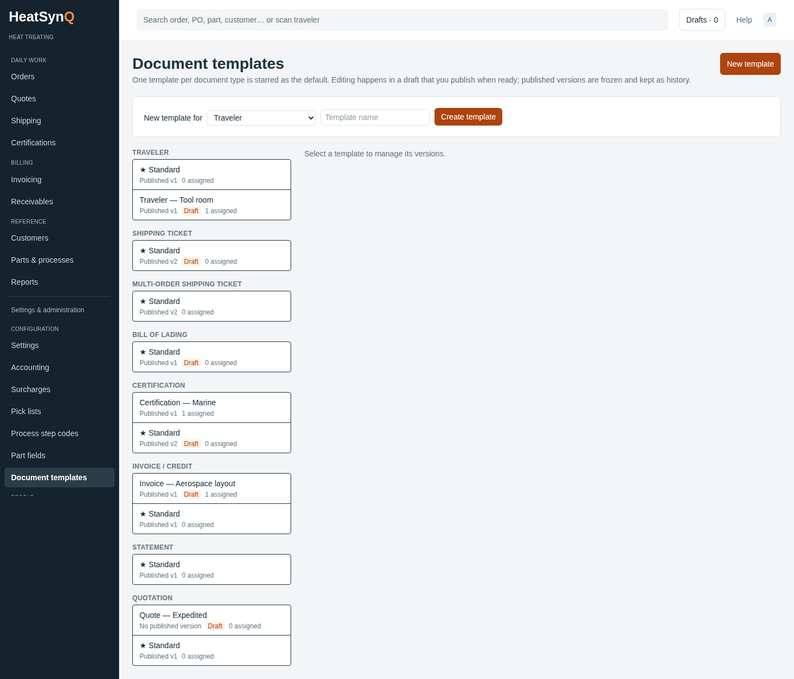
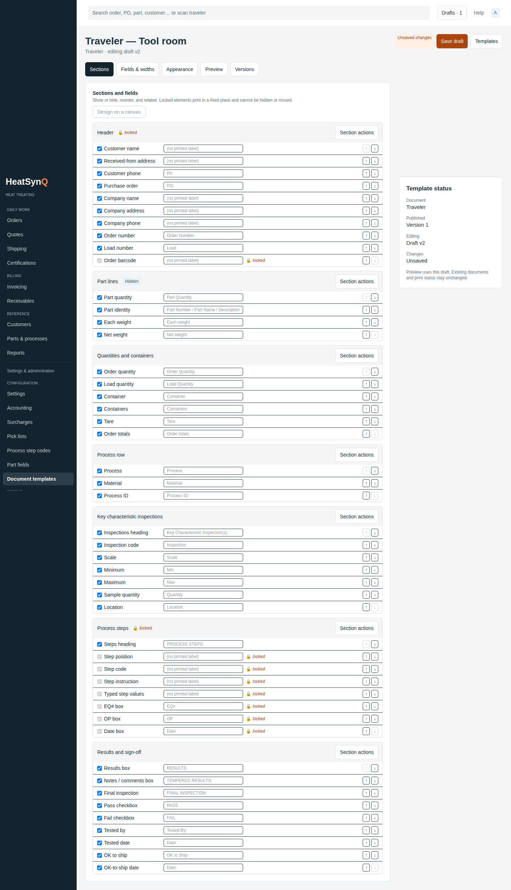
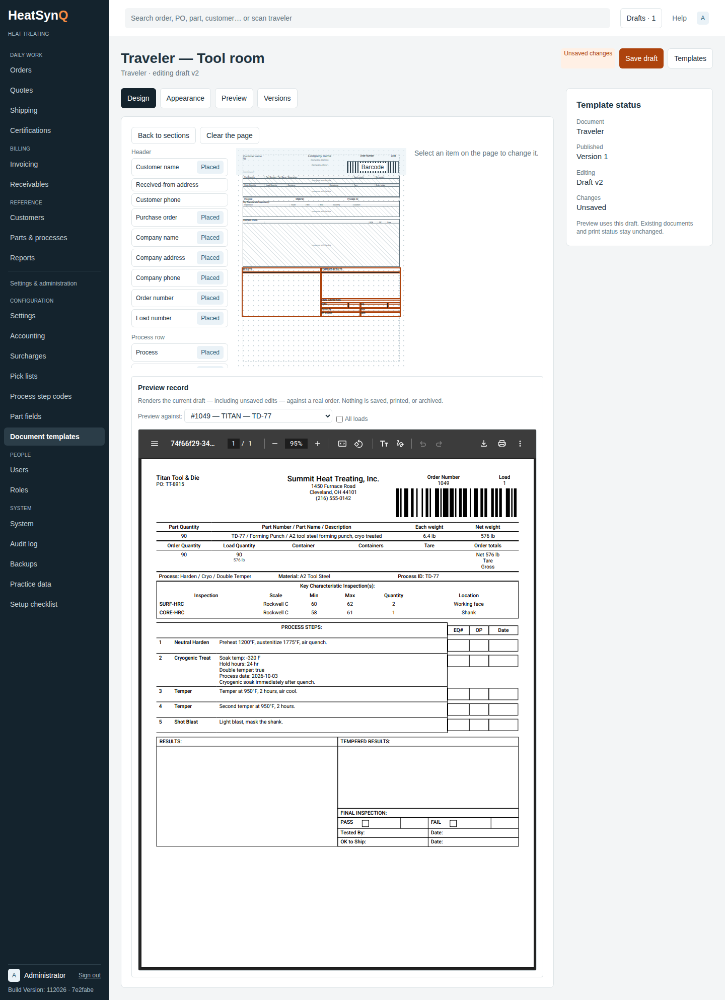
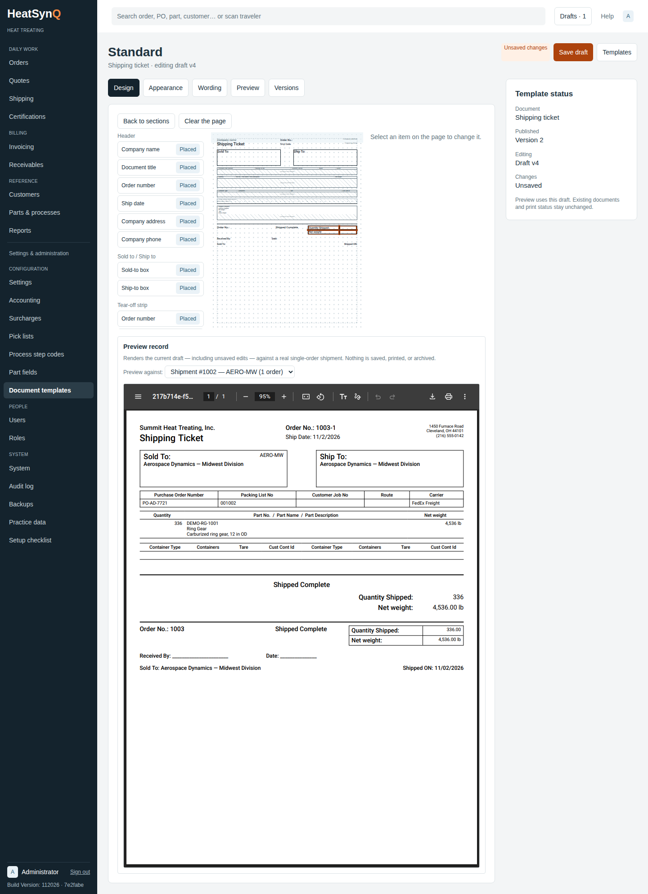
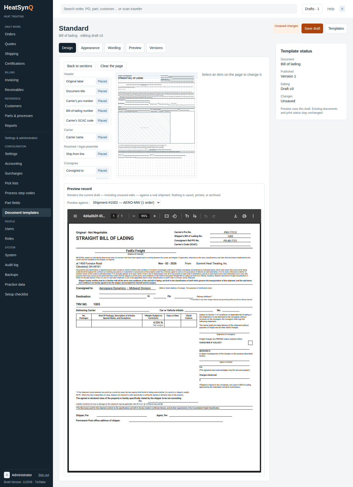
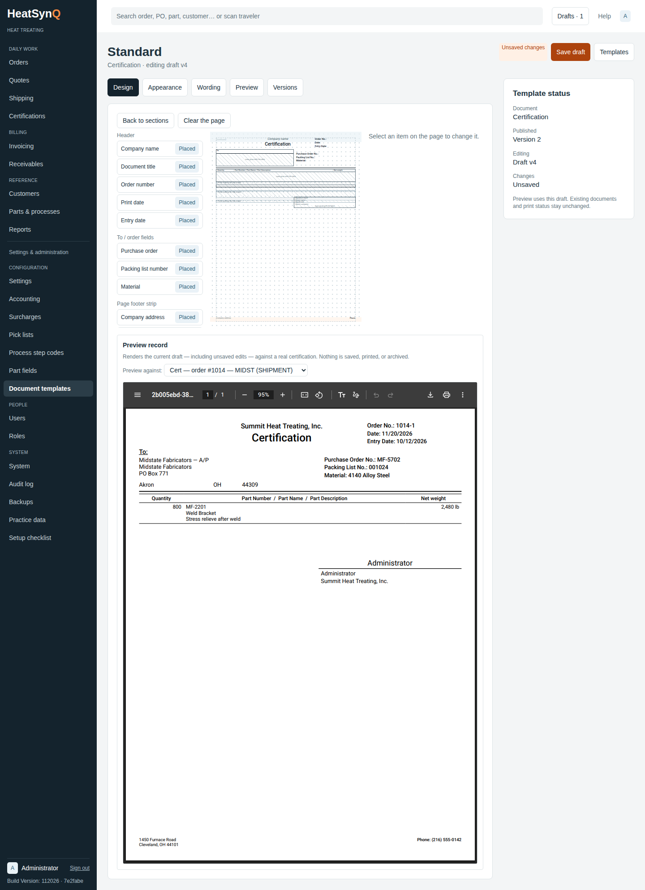
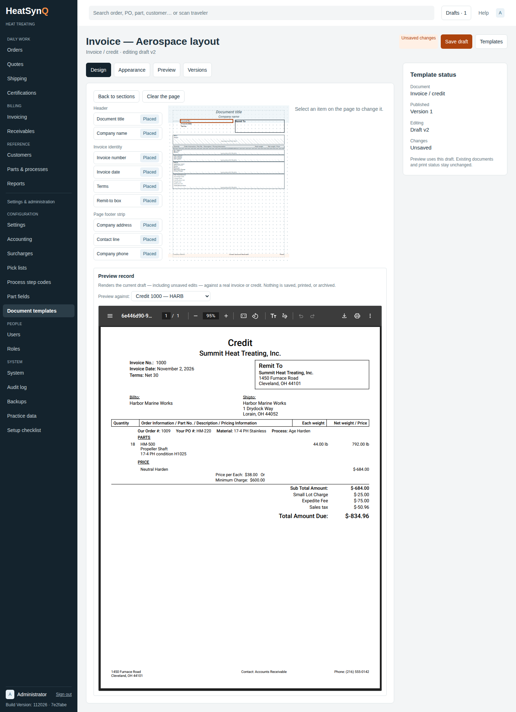
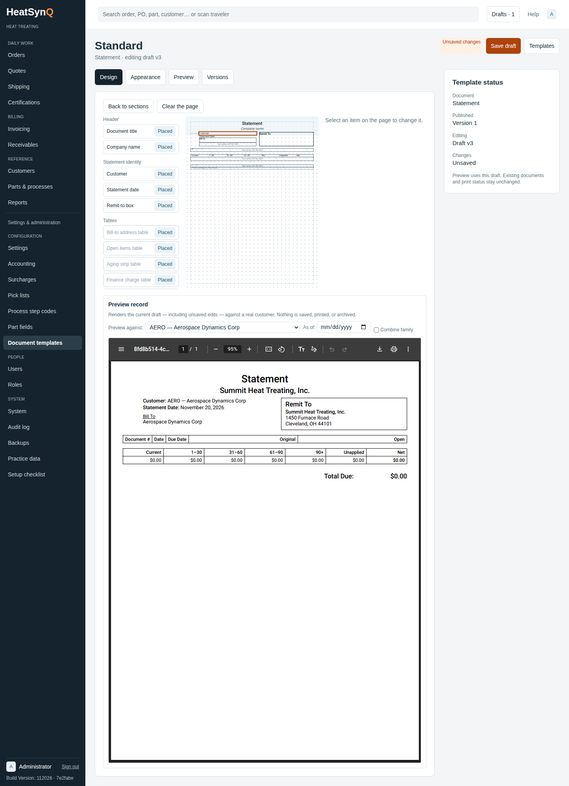
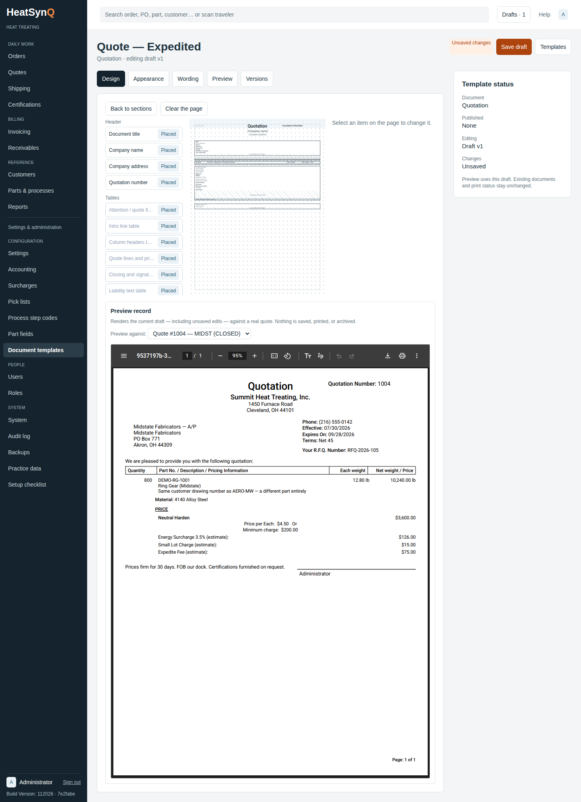
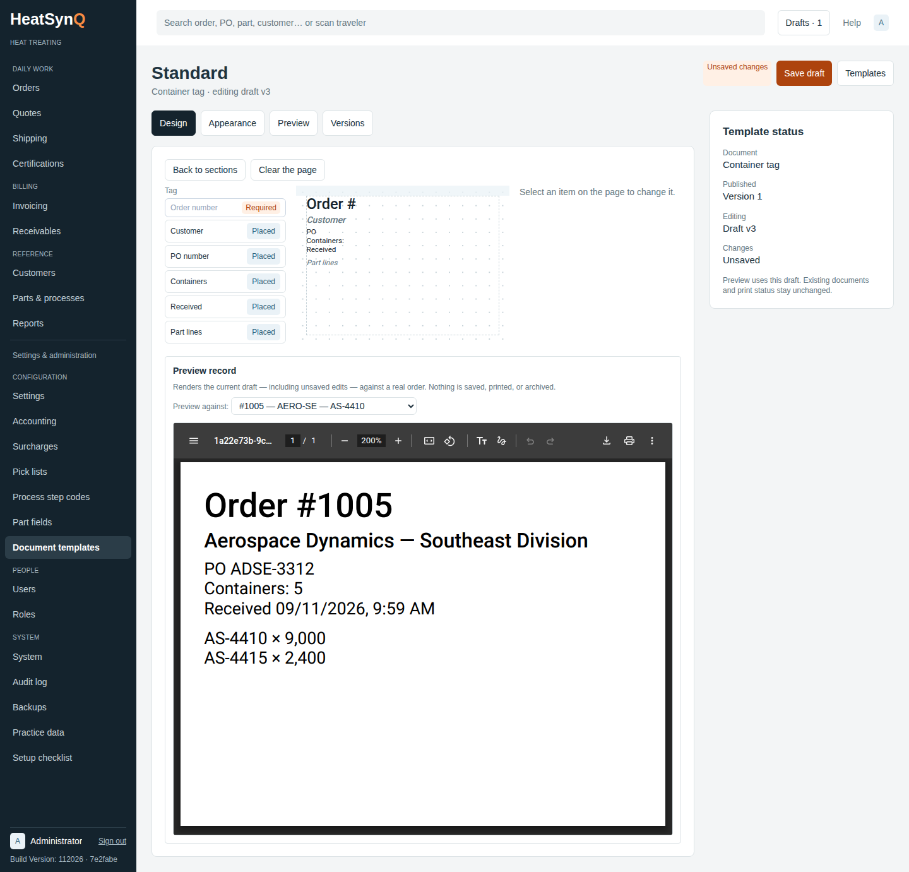

# 13. Document templates

[← Back to contents](README.md)

Every piece of paper this system produces is drawn from a **template** you control. If the traveler
needs the customer's name larger, if the invoice should carry your logo, if the bill of lading needs
different standing text — none of that is a change to the software. It is a change you make here.

## The nine document types

| Type | Where it comes from |
|---|---|
| Traveler | The order (chapter 2) |
| Shipping ticket | A shipment (chapter 4) |
| Multi-order shipping ticket | A shipment covering several orders |
| Bill of lading | A shipment |
| Certification | A certificate (chapter 5) |
| Invoice / credit | An invoice or credit memo (chapter 6) |
| Statement | A customer statement (chapter 7) |
| Quotation | A quote (chapter 3) |
| Container tag | An order's containers (chapter 2) |

The **Container tag** is the small label the order's **Print tags** link downloads, one tag per
container row, 4 in × 3 in. Its template changes the **labels** (the PO line's *Cust PO*, say, or, with the
**Print no label** box checked beside a field's label, none, so the value prints alone), which **fields are shown and in what order**, the **font family
and the body and heading sizes**, and the **label size** (one stock today, 4 in × 3 in landscape). It
has no logo placement, no page line ("Page N of M") and no small-text size, so Appearance shows none of
them (a tag laid out on a canvas, below, takes a logo as an item), and the order number cannot be hidden. A tag must stay one label, so the editor and the server
refuse a template whose order-number heading is too wide for the label or whose text sizes make the
tag taller than it. The refusal names which of the two to lower. Print tags uses the order's
customer's Container tag template, else the type's default, **Standard**, which prints today's tag.

Each type can have as many templates as you like — a plain one, one for a fussy aerospace customer,
one for the tool room. One per type is the **default**, marked with a star.

## The one rule worth learning first

**A template can re-arrange, re-label, restyle, show and hide. It can never add information the
system does not already collect.**

That sounds like a limitation and is actually the guarantee. A template chooses from the fields the
document already gathers, so it cannot invent a value, pull one from somewhere it should not, or
quietly change what a number means. Every rule elsewhere in this manual therefore still holds no
matter how the paper is laid out — a finalized invoice still prints the frozen figures it was raised
with, a shipping ticket still shows what was actually shipped.

If a document needs a piece of information it does not currently show, that is not a template job.

## The templates screen

Templates are grouped by document type. Each card shows:

| What you see | What it means |
|---|---|
| ★ before the name | This is the default for its type |
| **Published v1** | The version that prints today |
| **No published version** | Never published — cannot print, cannot be assigned |
| **Draft** (amber chip) | Somebody has an edit open |
| **N assigned** | How many customers are pointed at it specifically |

**New template** takes you to the form above the list: pick a type under **New template for**, name
it, then **Create template**. Selecting a card opens its detail pane on the right, where you can
**Rename** it, manage its versions, or **Delete template**.

**Deleting asks you why**, and says plainly what it does: the version history is retired from view
and the name can be reused later, starting a *fresh* template rather than restoring this one. A
template still assigned to customers cannot be deleted until those assignments are cleared — the
refusal lists which customers, so you know where to go.

## Drafts and publishing

This is the part that keeps old paper reproducible, so it is worth understanding properly.

**You never edit a live template.** You open a draft, change the draft, and publish it when you are
happy. The screen says so in a line: *"Editing happens in a draft that you publish when ready;
published versions are frozen and kept as history."*

The cycle:

1. **Open draft** — creates a new draft version copied from whatever is published now.
2. **Edit draft** — opens the editor. **Save draft** as often as you like; nothing prints yet.
3. **Publish saved draft** — the last saved draft becomes the published version, and from that moment
   new documents use it. Or **Discard local edits**, which removes the open draft from the server, so
   every saved change in it goes too, and the published version stays as it is.

**A published version is frozen forever.** It is never edited, never deleted, never renumbered.
Publishing a new version does not overwrite the old one — it adds a version and moves the pointer.
The **View version history** table lists them all with **Version**, **Status**, and when and by whom each
was **Published**. The one in force reads **PUBLISHED (current)**; earlier ones read **PUBLISHED**.

This is why paper stays honest: **every document the system stores records which template version
produced it.** Open an invoice from eight months ago under **Documents** and you get the exact bytes
that printed then, laid out the way your templates looked then — not the way they look today.

> **To go back to an earlier layout**, find it in the version history and press **Open draft from
> this version**. That copies the old version into a new draft you can publish. The old version is
> not "restored" or reactivated — you publish a new version that happens to match it, and the
> history keeps both. You can only have one draft open at a time.

**Set as default** makes a template the one used for its type when nothing more specific applies. A
template with nothing published cannot become the default — the button tells you so.

Publishing and setting a default both need the *edit templates* action on top of ordinary template
editing rights (chapter 12). Editing a draft is the everyday permission; changing what the shop
actually prints is the guarded one.

## The editor

The heading tells you exactly where you are — the template name, and beneath it the type and which
draft version you are editing. **Unsaved changes** appears the moment you touch anything; **Save
draft** puts it away. **Publish saved draft** and **Discard local edits** stay on the templates
screen.

The editor has six tabs, and moving between them loses nothing: **Sections**, **Fields & widths**,
**Appearance**, **Wording**, **Preview** and **Versions**, the same table as the templates screen. A
document with no standing text has no Wording tab. A template designed on a canvas (every type
offers one) shows **Design** in place of
**Sections** and **Fields & widths** (see *Designing on a canvas* below). The **Template status** card shows the
document, the published version, the draft you are editing and whether your changes are saved.

**Sections** — the main one. *"Show or hide, reorder, and relabel."* Each section's **Section
actions** menu holds **Move up**, **Move down**, **Hide section** (**Show section** once hidden, when
the row carries a **Hidden** tag) and **Edit fields and widths**, which opens that tab. An item that
cannot be used is greyed, and hovering it says why. Every field in a section has a tick box (show it
or not), a text box to override its printed label, and arrows to move it. Clear a label box and it
goes back to the built-in wording.

The built-in wording is the app's own, and an update of the app can change it. A label box you
have left empty then prints the new wording on the next document, whichever version of the
template is published. A label you typed stays as you typed it. The grey text in an empty label
box shows the built-in wording as it stands. A document already printed does not change: opening
it under **Documents** gives the page as it printed. Pressing **Print** again makes a new page,
from the app and the template as they stand then.

**Fields & widths** holds **Column widths** — for the tables on the document, measured in points. Each table shows a running
total against its budget, because a page is only so wide: *"the 564pt letter content width, or less
where a table shares the page"*. Go over and the editor refuses to save until you narrow or hide a
column. On paper every table is wider than the widths you type: each column adds 8pt of cell
padding, and a boxed table adds its rules too (the traveler's process steps table adds 25.6pt in
all). The editor counts those too: a table whose typed widths, padding and rules (and 4.5pt more
when it has a **Flexible** column) would not fit is refused, and the editor names the table and the
figure under it in red. On a bill of lading the freight table is judged against the room beside
the box at its side, and on an invoice the totals lines, which print under the Amount column, are
refused too if that column is wide enough to push them past the page. A column can be **Flexible**, which fills whatever width is left; type a width
into it and it stops being flex until you empty its box. A table keeps its flexible columns inside
the page: where they have less room than their headings need, the heading words break inside their
cells, and the editor says so in amber, with the width at which the headings print whole, as in
*"Container gets 34 pt, under the 34.8 pt its widest heading word needs, so its heading words break
inside their cells."* It still lets you save. A long word on the record itself breaks inside its
cell the same way. Under a shipping ticket's container table the panel also says what each column
that shares width gets, as in *"Containers and Tare get 54 pt each"*.

A width you have not set shows the built-in one in italic, marked **pt (default)** beside the box;
a width you have typed shows in plain text, marked **pt**. The two used to look identical whenever
the number you typed happened to match the built-in one. Empty the box to hand the column back to
its default.

**Appearance** holds three cards.

**Typography** — one font family for the whole document, from a bundled set, plus **Body (pt)**,
**Heading (pt)** and **Small text (pt)**. You cannot upload a font.

**Formats** — how money, quantities and dates print: negative amounts (sign after the symbol, leading
minus, or parentheses), decimal places, thousands separators, and the date format.

**Footer and logo** — whether to print "Page N of M" at the foot of every page, and the logo: **Choose
file…** uploads a PNG or JPEG up to 512 KB (the name of the file you picked shows beside the button);
then choose a **Placement** (header left, centre or right, or *Not printed*) and a width. It prints
only when both an image and a placement are set.

**Wording** — the paragraphs printed verbatim on every document of that type: the cert statement, the
shipping liability text, the quote intro. The bill of lading has eleven of them, which is the nature
of a bill of lading, so it lists them under **Standing clauses** and shows the one you pick. **This
is where that wording is edited** — it used to be a system-wide setting and is now part of each
template, so two templates can carry different terms.

**Preview** — the one to use before publishing. Under **Preview record**, pick a real record and press
**Generate preview**: it renders the draft you are looking at, *including edits you have not saved*,
against genuine data. *"Nothing is saved, printed, or archived."* No number is allocated, no document
is stored, nothing is marked as printed. Preview freely. A traveler preview prints the order's
first load only, which is enough to judge a layout; tick **All loads** to see every load's sheet, as
the print does (an order with more than 100 loads is then refused, as its print is).

> **If two people edit the same draft**, the second save is refused rather than silently overwriting
> the first. The editor reloads the current draft, sets your edits aside, and offers **Re-apply my
> changes**. Nobody's work is lost, but somebody has to decide.

## Designing on a canvas

A traveler, a shipping ticket, a bill of lading, a certification, an invoice, a statement, a quote or a
container tag can also be laid out as a **canvas**: a picture of the page on which
you drag each piece where you want it, the way you would arrange paper on a desk. Everything else in
this chapter still holds. The canvas places the fields the document already collects, a template still
cannot add information, and the draft, publish and version history work exactly as above. The
traveler, both shipping tickets, the bill of lading, the certification, the invoice and credit memo, the
statement, the quotation and the container tag offer a canvas, so every template type now does. The account
below is the traveler's; *On a shipping ticket*, *On a bill of lading*, *On a certification*, *On an invoice*,
*On a statement*, *On a quote* and *On a container tag*, further down, say what differs on those.

**Once a template has a canvas, the sections layout stops printing for it.** The canvas is the page.

**To start**, open the draft in the editor and pick an order under **Preview**: the canvas lays
out a real order, so until one is picked the **Design on a canvas** button on **Sections** is greyed
and says *"Pick an order in Preview first"*. Press it and the editor asks first: *"The sections
layout stops printing for this template. The canvas starts from today's paper for order #… and its
first load; Save keeps it, Discard undoes it."* Confirm, and the **Design** tab opens on a canvas
laid out from the paper you print today, so you start from something familiar rather than an empty
page. Nothing is stored until you press **Save draft**.

**The Design tab** has three columns, and the live page sits beside the canvas when the window is wide
enough for both, under it otherwise:

- **The palette**, on the left: the traveler's fields under their section's name, then the four
  tables, then the barcode, the logo, and **Text**, **Line** and **Box** for your own words, rules
  and boxes. Click an entry to add it to the page. A table or the logo already on the page says
  **Placed** and cannot be added twice; a field can be placed more than once. The barcode and the
  **Process steps table** say **Required**: every traveler prints them.
- **The page**: page 1 of the traveler, drawn with the template's own font, its dots a quarter
  inch apart; items snap to 1/16 in. Drag an item to move it, or drag the handles of the selected item to resize it. The arrow
  keys nudge the selected item one grid step (Shift and an arrow, a quarter inch), and Delete removes
  it.
- **The inspector**, on the right: *"Select an item on the page to change it."* For the selected
  item it shows where it is and what it prints. **X (in)**, **Y (in)**, **Width (in)** and
  **Height (in)** are in inches to two decimals. A figure you type moves the item as you type, and
  the box shows the snapped figure once you leave it. A line's other side stays at zero, and a width
  or height under one grid step is refused. A field has its **Label** (empty prints the built-in wording, as on Sections), a text
  item its **Text**, both a **Size (pt)**, **Bold** and **Align**; a line or box has its **Weight
  (pt)**; a table has its **Heading** and its **Columns** (show, label and width, as on **Fields &
  widths**). **Remove from the page** takes the item off.
- **The live page**, titled *Live page*: the real PDF of the picked order, drawn again a moment after
  each change on any tab, unsaved changes included. As with **Preview**, nothing is saved, printed or
  archived. The canvas reads where the tables actually ended on that page, so what sits below a table
  is drawn where it will print.

**Anchors.** Every item other than a table is anchored one of three ways, chosen under **Anchor**:

- **Page top**: it prints where it is drawn.
- **Below** a table (*"Below Process steps table"*, for example): it rides that table's bottom edge.
  Its **Y** is then measured from the table, not from the page: *"Y is measured from the bottom of
  the table above."*
- **Page bottom**: it prints at the foot of the load's last page, in a band kept clear on every page.

Dragging sets the anchor for you: dropped under a table, an item hangs below it. Tables have no
anchor. They stack down the page in the order they are drawn and take the rows they need (the
inspector says *"Stacks with the tables"*).

**Repeat on every page** prints a page-top or page-bottom item again on every continuation page; out
of the box that is the order number, the load number and the barcode. The box is greyed for an item
below a table, which prints once, after its table: *"An item below a table prints after its table;
only page-top and page-bottom items repeat."*

**How the page grows.** Nothing on the canvas is stretched to fit the data. A table takes as many
rows as the order has, and everything below it moves down with it. A long process runs onto
continuation pages: the repeated items print again at the top of each, *(continued)* prints at the
bottom-left of that top band, and the page-bottom band prints on the last page. An item drawn
dashed on the canvas prints on a later page for the picked order, and hovering it says which (*"Prints
on page 2 for this order"*). A table the picked record leaves empty is drawn at its own box, hatched
and greyed, and hovering it says *"Prints nothing for this record"*; it can still be moved and
resized. The table itself prints nothing for that record, and what follows it on paper moves up into
its place.

**Warnings and refusals.**

- **Amber outline: a warning.** Hover the item for the sentence, such as two items overlapping
  (*"…overlap; one prints over the other"*), an item that would add a page or be cut off, a
  table whose box is too narrow for its headings to print whole (*"…its headings print whole from
  N pt wide"*), or, once a record is picked, a table whose columns are narrower than words it prints
  for that record, so the words break inside their cells. A table never prints wider than its box: where
  the columns do not fit, they share the box's width and long words break inside their cells.
  Items may overlap; a warning never stops a save. The canvas laid
  out from today's paper already warns of overlaps in the results and sign-off block, where today's
  boxes and rules meet.
- **Red outline: a refusal.** The panel shows the sentence above the page, and **Save draft** stays
  closed with the same sentence until you fix it. Something off the page, anything covering the
  barcode or the Process steps table, and a barcode smaller than today's 2.58 × 0.61 in are
  refused.

**The barcode and the Process steps table can be moved and resized on a canvas, never removed**:
*"The barcode and the Process steps table are on every traveler; they can be moved, not removed."*
Their locked columns (the typed step values and the EQ#, OP and Date boxes) stay on, as below.

**The logo** is placed by the **Logo** item, which carries its own position and size. The image
itself is still uploaded under **Appearance**, on the **Footer and logo** card, which on a canvas
template says *"Placed by the Logo item on the Design tab"* in place of its placement and width.

**On a shipping ticket**

A shipping ticket is designed the same way, laid out from a shipment rather than an order. Pick a
single-order shipment under **Preview** (a multi-order shipment, on the multi-order ticket): until you
do, **Design on a canvas** is greyed and says *"Pick a single-order shipment in Preview first"*
(*"Pick a multi-order shipment in Preview first"*). The question then names the shipment: *"The
sections layout stops printing for this template. The canvas starts from today's paper for shipment
#…'s first ticket; Save keeps it, Discard undoes it."* A shipment whose first ticket runs to two pages
cannot start a canvas, and the button's panel says why: *"The canvas starts from a one-page ticket;
this shipment's first ticket prints 2 pages. Pick a shipment whose ticket fits one page."* Pick a
shorter one under **Preview** and press it again.

A ticket has no barcode and nothing on it is required, so **Remove from the page** takes off anything
and **Clear the page** empties the page: *"Every item is removed from the canvas; Save keeps it,
Discard undoes it."* The **Sold-to box** and the **Ship-to box** print in a border, and the canvas
draws them bordered. The liability text is the **Liability text wording** item, under **Wording** in
the palette: it prints the text the **Wording** tab holds, so you change the words there and their
place here.

The **Totals table** is a block of rows, not columns, and its rows come and go with the data: Tare
and Gross weight print only when the shipment has a gross weight, and whatever sits below the table
rides up when they do not. The tear-off strip's items are anchored **Page bottom**, which pins them to
the foot of the ticket's last page.

A label too long for its box, or a party box that a long name or address outgrows, is outlined in
amber; hover it for the sentence, and make the box bigger until the amber goes.

**On a bill of lading**

A bill of lading is laid out from a shipment too. Until one is picked under **Preview**, **Design on a
canvas** is greyed and says *"Pick a shipment in Preview first"*, and the question then names it:
*"The sections layout stops printing for this template. The canvas starts from today's paper for
shipment #…'s bill of lading; Save keeps it, Discard undoes it."* The canvas lays the PO list out one
line tall, however many POs the shipment has, so a long list does not stop it; but a bill of lading
that still runs to two pages, laid out that way, cannot start a canvas: *"The canvas starts from a
one-page bill of lading; this shipment's bill of lading prints 2 pages. Pick a shipment whose bill of
lading fits one page, or change this template's settings (its font or sizes) so it does."* The
template's own settings can do that for every shipment: in **Roboto Mono**, for one, even a one-order
bill of lading runs to two pages, so pick another font or smaller sizes under **Appearance** first.

The form's fields print on their rules, as they do today. The **Consignee's ref/PO table** and the
**TRV numbers table** are lists that grow with the shipment: a longer list of POs or travelers takes
more lines, and everything below it moves down with it. The **Freight table** and the box of clauses
beside it are one block: the table takes the width the block leaves beside the box. The **Collect
checkbox** is the block's toggle, with **Show** and **Label** in the inspector and no width. The three
clauses in that box (the **Section 7 clause**, the **No-delivery clause** and the **Imprint note**) are
edited on the **Wording** tab and print inside the block, so they are not items of their own; the
other clauses are wording items, placed as on a ticket.

A bill of lading has no barcode and nothing on it is required, so **Clear the page** empties the page.
The **Bill-of-lading number** comes onto the canvas set to **Repeat on every page**: a shipment long
enough to run onto a second page prints it again at the top there, as long as it sits above the
**Consignee's ref/PO table**.

**On a certification**

A certification is laid out from a certification. Until one is picked under **Preview**, **Design on a
canvas** is greyed and says *"Pick a certification in Preview first"*, and the question then names it
by its printed label, a load's certification with its load: *"The sections layout stops printing for
this template. The canvas starts from today's paper for certification …; Save keeps it, Discard undoes
it."* The canvas lays every part that grows out at its least (one part line, or two when the
**Multi-part line heading** is the only row of the requirements shown; one requirement, one serial,
one line of freeform text), whatever the picked certification holds, so a long certification does not
stop it; what can is the template's own settings: *"The canvas starts from a one-page certification;
laid out at its least, this template's certification prints 2 pages. Change this template's settings
(its font, sizes, logo or certification statement) so it fits one page."* A template that prints one
page in the sections layout but whose blocks, drawn on the canvas, would run into the page-bottom band
is refused in a sentence of the same kind, which names the page line among the settings to change,
and one whose header runs past the page's right margin (a logo too wide for it, or a title at a
heading size too large for the font) is refused in a sentence naming the logo's width, the font and
the heading size; a **To** label of one long word, or a font too large, that pushes the order fields
beside the To box past that margin is refused the same way, naming the font, the sizes and the To label.

The **To box**, the **Part lines**, the **Certification statement**, the **Requirements and readings**,
the **Serial numbers**, the **Freeform text** and the **Signature block** are blocks: each grows with
the certification it prints, and everything below it moves down with it. The rows of the
**Requirements and readings** and of the **Signature block** are shown or hidden in the inspector,
never reordered or sized. The signature is the printing user's: its rule rides the signature mark,
and the name, title and company print under the rule, the title only for a user who has one.

The **Company address** and the **Company phone** print in the page-bottom band, on every page. **Page
N of M** takes room at the foot of every page, so the canvas starts the strip above the page line when
the template prints it; a strip laid out with the page line off must be moved up before **Save draft**
once the page line is turned on, and the save says which item is in its way. The **Order number** comes
onto the canvas with **Repeat on every page** ticked when it prints at the top of the page, ending at
least one grid step above the first block (it does in the Standard's order; printed below a block, or
hidden, it comes without the tick): a certification long enough to run onto a second page prints it
again there, where it is drawn, with *"(continued)"*. A certification has no barcode and
nothing on it is required, so **Clear the page** empties the page.

**On an invoice**

An invoice template prints invoices and credit memos alike, so one canvas lays out both. Until an
invoice or a credit is picked under **Preview**, **Design on a canvas** is greyed and says *"Pick an
invoice or credit in Preview first"*, and the question then names the one picked, *invoice …* or
*credit …*: *"The sections layout stops printing for this template. The canvas starts from today's
paper for invoice …; Save keeps it, Discard undoes it."* The canvas lays every part that grows out at
its least (each address one line, the order strip on one line, one part with one price, and no
surcharge, charge, certification, freight or tax line), whatever the picked invoice holds, so a long
invoice does not stop it. What can stop it is the template's own settings, and each refusal names the
settings to change: an invoice that, laid out at its least, prints more than one page (its font, sizes
or logo), or whose blocks, drawn on the canvas, run past its one page (the page line among them); a
header that runs past the page's right margin (the logo's width, the font or the heading size); and a
**Remit-to box** pushed past that margin (the font, the sizes or the labels). A template that hides its
**Column headers** while setting their columns apart from the Standard's is refused before anything
is laid out: *"The canvas starts from today's paper, and this template hides its Column headers while
setting their columns apart from the Standard's (their order, widths or which are shown); a canvas
with no Column headers block prints the body under the Standard's columns. Show the Column headers,
or set their columns back to the Standard's, before designing on a canvas."*

The **Bill to / ship to** addresses, the **Column headers**, the **Order strip**, the **Part rows**, the
**Price block** and the **Totals** are blocks: each grows with the invoice it prints, and everything
below it moves down with it. The Column headers are the grid the order strip, the parts, the prices
and the totals print under: the order strip from its left edge, the totals to its right edge, the
parts and the prices under its columns. The order strip drawn at another left edge, the totals at
another right edge, or the parts or the prices at another left edge or (while a column shares the
width, as the Standard's Information column does) another width prints out of line with the columns
above it, and the designer outlines the block in amber: the order strip and the totals with *"…so it
does not line up under its columns."*, the parts and the prices with *"…so its columns do not line up
under them."* With no Column headers block on the page, the body prints under the Standard's
columns. The order strip prints on one line, and each part's prices end with a rule, as on the
sections layout (*The invoice's order strip prints on one line* and *The invoice's prices print by
part*, at the end of *Locked elements*). The **Remit-to box** prints in
a border, and the canvas draws it bordered.

The **Company address**, the **Contact line** and the **Company phone** print in the page-bottom band,
on every page. **Page N of M** takes room at the foot of every page, so the canvas starts the strip
above the page line when the template prints it; a strip laid out with the page line off must be moved
up before **Save draft** once the page line is turned on, and the save says which item is in its way.

The **Invoice number** comes onto the canvas with **Repeat on every page** ticked, so an invoice long
enough to run onto a second page prints it again there, where it is drawn. That has two costs. On a
continuation page *"(continued)"* prints at the left margin on the number's line and runs into its
label (in **Roboto Mono**, over the first letters of it), and the designer outlines the number in
amber: *"The Invoice number field repeats where "(continued)" prints on continuation pages, at the
repeat band's bottom-left; the two print over each other."* And every continuation page starts below
where the number is drawn, so it holds less than on the sections layout (about 0.6 in less, or 0.8 in
with **Page N of M** on), and a long invoice can take more pages than it does there. Moving the number
up the page gives that room back (with **Page N of M** on, all but about 9 pt, 0.12 in, which the strip
takes above the page line), and drawing it right of where *"(continued)"* prints, at an **X**
of 1.19 in or more, ends that warning; either move changes page 1 too, where the number prints where
it is drawn. Moved as it is, the number then overlaps the **Remit-to box**, the **Document title** or
the **Company name**, and the designer warns of that instead: narrow it, or move what it meets, until
the amber goes. An invoice has no barcode and nothing on it is required, so **Clear the page** empties the
page.

**On a statement**

A statement is laid out from a customer. Until one is picked under **Preview**, **Design on a canvas**
is greyed and says *"Pick a customer in Preview first"*, and the question then names the customer by its
code: *"The sections layout stops printing for this template. The canvas starts from today's paper for
customer …; Save keeps it, Discard undoes it."* The canvas lays every part that grows out at its least,
whatever the picked customer owes, so a long statement does not stop it; what can is the template's own
settings or the company address, and each refusal names what to change: a statement that, laid out at
its least, prints more than one page, or whose blocks, drawn on the canvas, run past its one page; a
header that runs past the page's right margin; and a **Remit-to box** pushed past that margin. The
**As of** date and **Combine family** under **Preview** set what the live page prints on both tabs.

The **Bill-to address**, the **Open items**, the **Aging strip**, the **Finance charge** and the **Total
due** are blocks: each grows with the statement it prints, and everything below it moves down with it.
The Bill-to address sits beside the **Remit-to box** and prints at least as tall as it is drawn, and
the canvas draws it down to the box's bottom, so what follows clears the box however short the address is;
after moving or resizing the Remit-to box, resize the Bill-to address so it still reaches the box's
bottom. The **Remit-to box** prints in a border, and the canvas draws it bordered.
The open items run onto continuation pages with their heading row printed again at the top of each. An
open items block never prints wider than its box, and it can be drawn no narrower than 49.5 pt. Drawn
narrower than its rows' words, its columns shrink to share the box and the words break inside their
cells (a long payment reference beside a negative figure in parentheses, at about 4.2 in, or the usual
rows in **Roboto Mono**); with a record picked, the designer outlines the block in amber, *"…columns are
narrower than words it prints for this record, so they break inside their cells."* The fields of the **Open items**, the
**Finance charge** and the **Total due** are shown or hidden and relabelled in the inspector (**Show**
and **Label**), never reordered or sized; the aging strip's columns have their **Show**, **Label** and
**Width**.

The finance charge prints only on a statement printed with **Show finance charge (not billed)** ticked
on the Statements screen, and the live page never ticks it, so its block is drawn at its own box,
hatched, and hovering it says *"Prints nothing for this record"*. When it prints, it shows the label
it carries on the sections layout, *"Finance Charge (not billed, not in total):"*, and Total Due still
leaves it out.

The **Customer** comes onto the canvas with **Repeat on every page** ticked when it prints at the top of
the page, ending at least one grid step above the first block (it does in the Standard's order; printed
below a block, or hidden, it comes without the tick, and continuation pages then print unnamed): a
statement long enough to run onto a second page prints it again there, where it is drawn. That has two
costs. On a continuation page *"(continued)"* prints at the left margin on the customer's line and runs
into its label (in **Roboto Mono**, over the first letters of it), and the designer outlines the
customer in amber: *"The Customer field repeats where "(continued)" prints on continuation pages, at the
repeat band's bottom-left; the two print over each other."* And every continuation page starts below
where the customer is drawn, so it holds less than on the sections layout, and a long statement can take
more pages than it does there. Moving the customer up the page gives that room back. While the customer
is the only item repeated at the top of the page, two moves end that warning: drawing it at an **X** of
1.19 in (85.5 pt) or more with its right edge at or left of where the **Remit-to box** starts as the
canvas places it, 4.69 in (338 pt), so that its **X** and **Width** add up to no more than that (at an
**X** of 1.19 in, a **Width** of 3.5 in or less, 252.5 pt the most; past that edge it overlaps the
**Remit-to box**, and the designer warns of that instead), or clearing its **Repeat on every page**. Either changes the
paper: the first moves the customer on page 1 too, and the second leaves the continuation pages
unnamed. Another item repeated lower on the page takes *"(continued)"* down to that item's bottom. A
statement has no barcode and nothing on it is required, and the canvas places nothing in the
page-bottom band (a field such as the **Company name** may still be anchored there), so **Clear the
page** empties the page.

**On a quote**

A quotation is laid out from a quote. Until one is picked under **Preview**, **Design on a canvas** is
greyed and says *"Pick a quote in Preview first"*, and the question then names it by its number: *"The
sections layout stops printing for this template. The canvas starts from today's paper for quote #…; Save
keeps it, Discard undoes it."* The canvas starts from a stand-in laid out at its least, every part that
grows held to a placeholder (a one-line address, one part with one price and one surcharge estimate), so
it is the same whichever quote is picked, but for the quote's number and its two dates; a long quote does
not stop it. What can stop it is the template's own settings, its intro or liability wording or the
company name or address, and each refusal names what to change: a quote that, laid out at its least,
prints more than one page, or whose blocks, drawn on the canvas, run past its one page; and a header that
runs past the page's right margin. A template that hides its **Column headers** while setting their
columns apart from the Standard's is refused before anything is laid out, as an invoice's is.

The **Attention / quote fields**, the **Intro line**, the **Column headers**, the **Quote lines and
prices**, the **Closing and signature** and the **Liability text** are blocks: each grows with the quote
it prints, and everything below it moves down with it. The lines print under the Column headers' columns:
drawn at another left edge, or (while a column shares the width, as the Standard's Information column
does) another width, they print out of line with the columns above them, and the designer outlines the
lines block in amber: *"The Quote lines and prices table prints under the Column headers table's columns,
but is drawn at another left edge or width, so its columns do not line up under them."* Moving or
resizing the Column headers alone brings the same warning, so move the two together. Each part's
surcharge estimates print inside the lines block, under its last price row, as on the sections layout; a
customer opted out of surcharges prints none, and one opted out of a single surcharge prints no row for
it. The rows of the attention fields, the lines and the closing are shown or hidden and relabelled in the
inspector (**Show** and **Label**), never reordered or sized.

The intro and the liability print the wording typed on the **Wording** tab. While the liability's wording
is blank, as it is on the Standard, its block is drawn at its own box, hatched, and hovering it says
*"Prints nothing for this record"*, and it prints nothing.

The **Quotation number** comes onto the canvas with **Repeat on every page** ticked as long as it prints
at the top of the page, ending at least one grid step above the first block (it does in the Standard's
order): a quote long enough to run onto a second page prints it again there, where it is drawn, with
*"(continued)"* at the left margin. Hidden, it does not come onto the canvas at all; printed below a
block, it comes without the tick. Either way nothing repeats. The page line reads *"Page: N of M"*, as on the sections layout. A quote has no barcode
and nothing on it is required, and the canvas places nothing in the page-bottom band, so **Clear the
page** empties the page.

**On a container tag**

A tag is laid out from an order. Until one is picked under **Preview**, **Design on a canvas** is greyed
and says *"Pick an order in Preview first"*, and the question then names the order's first tag: *"The
sections layout stops printing for this template. The canvas starts from today's paper for order #…'s
first tag; Save keeps it, Discard undoes it."* An order with no container row, or a voided one, is
refused with the same sentence **Print tags** gives. The canvas starts from today's tag, the same whichever
order is picked: each field the template shows, in its order, one line tall at its size from the label's
top, with the part lines in a box seven lines tall. Two refusals come from the template's own settings: a
**Customer** shown at a body size over 70 (it prints 2 pt larger, and no item takes over 72 pt), and text
sizes that do not fit one 4 in × 3 in label as a canvas; each says to lower the size.

A tag prints on one label, so the canvas is held to one label. Every item is placed from the label's top:
the **Anchor** box offers only **Page top**, and there is no **Repeat on every page**. A **Text** or a
field cannot be drawn shorter than one line of its text at its size (the designer's drag stops there, and
a typed height below it is refused with *"… is shorter than one line of its text; draw it at least … in
tall."*; the height it names is on the designer's 1/16 in grid, so typing it clears the refusal, and raising
an item's size or making it bold can bring the same refusal, cleared the same way), and the **Order number** must fit, with its label and seven digits, within the label's width at
its size: *"… does not fit an order number of 7 digits within the label's width at this size and label;
lower its size or shorten its label."* A tag has no table and no barcode, and the **Order number** is the
one thing required, so **Clear the page** leaves it, one line tall, and empties the rest. **Logo**, **Text**, **Line** and
**Box** may be placed; the logo's image is uploaded on **Appearance**, whose logo card offers the image alone
on a tag.

Paper prints what the box allows, and the designer says when it does not. A value printed past its box's
right edge is **cut** at the edge, on the paper as on the page: the designer outlines it in amber, *"The
Customer field is cut at its box's edge for this record."* The **Order number** is the exception: it is
never cut. A number wider than its box prints whole, and the designer outlines it, *"The Order number
field runs past its box for this record."*; one that would pass the label's right margin is moved left,
to end at the margin. The **Part lines** print as many lines as the box holds, and when the order has
more, the last line reads *"and N more parts"*; the designer outlines the box, *"The Part lines field
shows 5 of 8 parts for this record."* A label typed for the part lines prints as their first line when
the box holds two lines or more; a box one line tall prints no label, only the order's one part or, for
more, *"and N more parts"* naming them all. The seeded box holds seven lines, so an order of seven parts shows
all seven where the sections layout shows six and *"and 1 more part"*, and a field placed under the part
lines sits under the whole box where the sections layout puts it under the lines it printed. Every tag of
an order reads the same, and **Print tags** prints one label per container row from the published layout.

**Back to sections** sets the canvas aside and prints the sections layout again, exactly as it was
before the canvas. On a traveler, **Clear the page** removes every item but the barcode and the
Process steps table, to start from nearly empty; on a shipping ticket, a bill of lading, a
certification, an invoice, a statement or a quote it empties the page, and on a container tag it leaves the order number. Each asks first, and for each *"Save keeps it, Discard undoes it."*

## Locked elements

A few things cannot be hidden, and the editor marks them with a **padlock** and the word *locked*.
Hover it and it tells you why.

**All of them are on the traveler**; every other document type is entirely free.

| Locked | Why |
|---|---|
| The **Order barcode** (and so the Header section that contains it) | The barcode is automatic — scanning it opens the order. A traveler without it breaks the scanning workflow the shop runs on. |
| The **Process steps** section, and within it **Step position**, **Step code**, **Step instruction**, **Typed step values**, **EQ#**, **OP** and **Date** | The instructions, settings and handwriting boxes must remain present for every step. EQ#, OP and Date print as small boxes at the top of each step. Older traveler layouts that hid a sign-off column are normalized when rendered. |

The reasoning is the same in both cases: these are not decoration, and a traveler that lost them
would look fine and be wrong. So the app refuses in three separate places — the editor disables the
control, the validator refuses a configuration that hides them, and the document builder prints them
even if a configuration somehow got past both.

Two details that catch people out:

- **The Process steps section is also pinned** — it cannot be moved, not just not hidden. Its EQ#,
  OP and Date boxes are mandatory and cannot be hidden; each step prints all three even when an old
  saved layout says otherwise.
- **The Header section shows a padlock but can still be reordered.** Only *hiding* it is refused.
  You can move it; you cannot lose it.

The steps heading and other unlocked presentation fields remain yours to arrange or relabel.

**The traveler header can show the customer's phone.** The **Customer phone** field (label
**Ph:**) prints the phone from the customer page under the received-from address. Hide or relabel
it like any other field. It always prints below the customer's name and address, even if you move
the field in the list. To print **NOTES / COMMENTS** instead of **TEMPERED RESULTS**, relabel the
**Notes / comments box** in your traveler template and publish; the box stays blank for handwriting.

**The traveler header prints the order's PO.** The **Purchase order** field (label **PO:**) prints
the order's PO as the last line on the left, under the customer phone. When the order has none it
prints the label and a line to write one in. Hide or relabel it like any other field. It always
prints last in that stack, even if you move the field in the list. A template saved before this
field existed prints it from its next print. Clearing the label box puts back **PO:**.

**The invoice's order strip prints on one line.** Our Order #, Your PO #, Material and Process
print side by side under Order Information, in that order, even if you move the fields in the list.
Hide or relabel any of them like any other field; a field the order leaves blank still prints its
label. A long value wraps inside its own space on the line. If the Quantity column is made so wide
that the four cannot share the line, they print one to a line instead. A template saved before this
change prints the one line from its next print.

**The invoice's prices print by part.** Under PRICE, each part's operations print together, in the
order the parts are listed, with a thin line across the page after each part's prices; the last line
sits above Sub Total Amount. A price whose part line was removed, or a typed price that belongs to no
part, prints after the last part, followed by its own line. A part with no prices prints no line, and
nothing names the groups. Credit memos print the same way. A template saved before this change
prints the lines from its next print.

## Assigning a template to a customer

Most shops need one exception before they need two. Rather than switching the default back and
forth, point the individual customer at the template they need.

On the customer's page there is a **Document templates** section with a row per document type. Set
one and that customer's paper uses it. The first option in every dropdown is **Use default /
inherit**, which is how you take an exception back off again.

Each row tells you, in words, what will actually print:

| The row says | Meaning |
|---|---|
| **Assigned: Invoice — Aerospace layout** | This customer has been pointed at that template directly |
| **Inherited from AERO — Aerospace Dynamics Corp: …** | Nothing is set here; the parent customer's choice applies |
| **Bill of lading default (Standard)** | Nothing is set anywhere up the chain; the type's default applies |

That is the whole resolution rule, and it runs in that order: **the customer's own choice, then the
nearest parent division that has one, then the type's default.** Divisions (chapter 9) inherit from
their parent unless given their own, so setting a template once on the parent covers every division
beneath it.

A template that has never been published appears in the list but cannot be chosen — it is greyed
out, with a tooltip saying to publish a version first. Nothing unpublished can ever reach a
customer's paper.

Changing an assignment needs both customer-editing rights and the *edit templates* action.

---

Next: [14. The practice copy →](14-practice-copy.md) · Previous: [12. Administration](12-administration.md)
